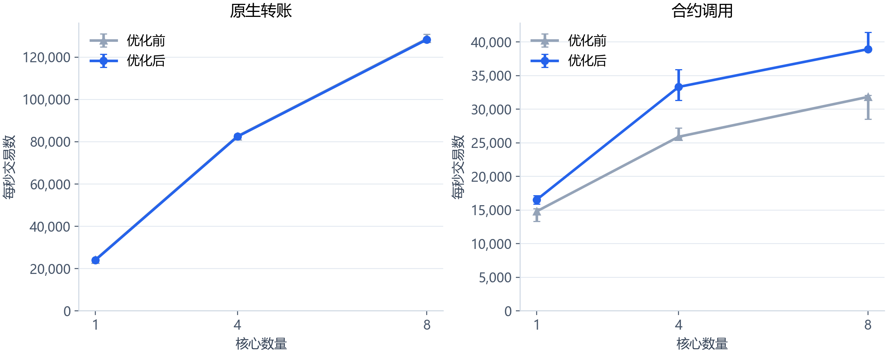
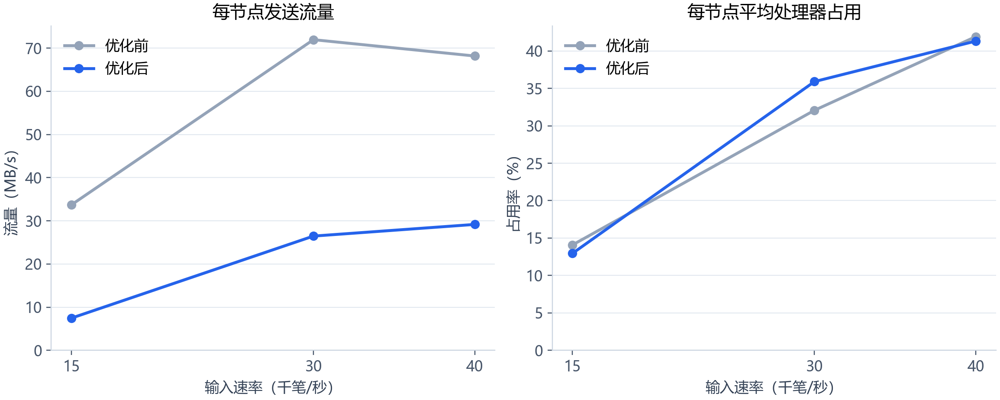
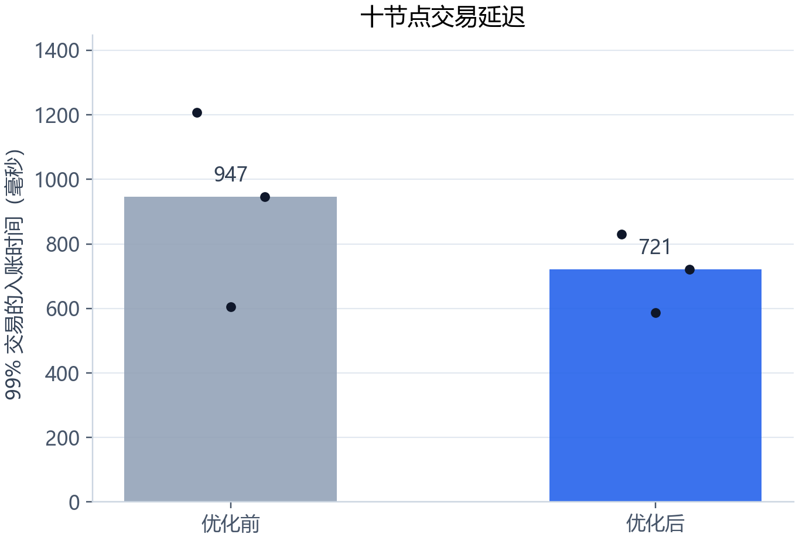
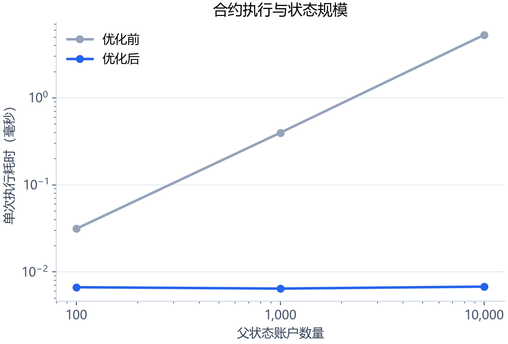

# 区块传播、同步与 EVM 执行优化

日期：2026-10-13。代码基线：`1ac05a2`；优化提交：`2b637d4`。

## 结果

本机 8 核原生转账中位数为 **128,353 TPS**，合约调用为 **38,930 TPS**，合约相对基线提升 **22.3%**。十节点在每秒 40,000 笔输入的 20 秒测量中完成全部交易并通过共同链和账户核对；更高输入档位的表现见下表。三轮 60 秒测试保留全部结果和积压判据。

TPS（Transactions Per Second）表示每秒交易数。EVM（Ethereum Virtual Machine）表示以太坊虚拟机。CPU（Central Processing Unit）表示中央处理器。P99 表示 99% 样本达到共同链所需的时间上界，包含计划发送到共同链观测的等待。
MiB（Mebibyte）为 2 的 20 次方字节，GiB（Gibibyte）为 2 的 30 次方字节。

## 五项改动

| 项目 | 实现 | 边界与验证 |
|---|---|---|
| 区块传播 | 区块哈希去重、按监听地址合并连接、跳过来源、摘要通知、按索引补传缺失交易 | 近期交易保留至多 32,768 笔、16 MiB；完整块 32 MiB；拼装 16 块、32 MiB，5 秒清理；完整交易和合约输入继续验签 |
| 追赶同步 | 8 块滑动窗口、每请求 4 块、批次统一入队、优先回放较高分支 | 回放按父块顺序原子保存；分支至多 256 块、512 MiB，覆盖 2 MiB 最大块的完整恢复窗口 |
| 执行复用 | 缓存完整区块字节、父哈希、高度与状态版本绑定的执行结果 | 至多 8 项、估算 32 MiB；初始化、提交和回滚失效；分叉回放重新执行；写库成功后发布状态 |
| 合约状态 | 按访问加载账户和存储槽，只写变化的元数据、代码与槽值 | 交易完成后复位访问状态；删除、重建和回退保留原语义；分叉失败恢复使用完整状态备份 |
| 验签及锁 | 冷块最多四片并行验签，独立线程池；回滚交易先筛序号再批量入池 | 待执行任务至多线程数的两倍；记录提交锁、交易池锁和队列等待；状态执行保持确定顺序 |

高负载试跑复现了分支缓存不足造成的追赶停滞，增加了 70 个满块、420,000 笔交易的整体恢复测试。摘要拼装的异步验证任务改为持有连接对象，补充了连接生命周期检查。

## 本机核心数对照

处理器为 Intel Core i7-13700。每个物理核心使用一个逻辑处理器，保留一个性能核心供发送端；8 核节点点位使用 7 个性能核心和 1 个能效核心。两版本共享同一交易文件、发送程序与核心亲和性，交替测试三轮，启用同步落盘。原生每轮 300,000 笔，区块上限 6,000 笔、等待 50 毫秒；合约每轮 10,000 次 Counter.Increment()，64 个调用账户，块上限 256 笔、等待 10 毫秒。计时包含发送启动至全部交易在本地保存，收尾逐个核对账户和计数器。

| 负载 | 核心数 | 优化前 TPS | 优化后 TPS | 变化 |
|---|---|---|---|---|
| 原生 | 1 | 24,244 | 24,118 | -0.52% |
| 原生 | 4 | 82,616 | 82,461 | -0.19% |
| 原生 | 8 | 128,624 | 128,353 | -0.21% |
| 合约 | 1 | 14,802 | 16,533 | +11.69% |
| 合约 | 4 | 25,902 | 33,312 | +28.61% |
| 合约 | 8 | 31,825 | 38,930 | +22.33% |



图中线为中位数，误差线为三轮最小值与最大值。原生交易的结果接近基线，主要收益集中于合约执行和多节点传播。

## 十节点结果

十台 Ubuntu 24.04 服务器，每台 8 个虚拟处理器、16 GiB 内存。通过私有网络连接，4 个网络线程、8 个接收验证线程，块上限 6,000 笔、等待 50 毫秒，启用同步落盘和测量索引，关闭逻辑轮次开关。新旧程序分别使用全新数据库，签名数据集一致；全部十节点的程序校验值一致。Ubuntu 基线的 11 个核心文件与 Git 基线逐文件比较一致。

共同链 TPS 由测量窗口起止的共同前缀交易增量计算。短窗口中，预热积压的追赶会使该值超过输入速率。下表同时列出实际发送速率、延迟与收尾核对。前三档预热 5 秒、测量 20 秒；5 万和 6 万档预热 3 秒、测量 15 秒。

| 版本 | 目标输入 | 实际发送 TPS | 共同链 TPS | P99 毫秒 | 非法或拒收副本总数 | 收尾核对 | 持续负载判据 |
|---|---|---|---|---|---|---|---|
| 优化前 | 15000 | 15,003 | 14,984 | 533 | 0 | 通过 | 存在积压 |
| 优化后 | 15000 | 15,005 | 14,960 | 878 | 0 | 通过 | 存在积压 |
| 优化前 | 30000 | 30,005 | 30,072 | 1,602 | 0 | 通过 | 存在积压 |
| 优化后 | 30000 | 30,000 | 33,334 | 2,100 | 0 | 通过 | 存在积压 |
| 优化前 | 40000 | 40,002 | 41,970 | 6,882 | 0 | 通过 | 存在积压 |
| 优化后 | 40000 | 39,996 | 42,963 | 4,267 | 0 | 通过 | 存在积压 |
| 优化后 | 50000 | 54,346 | 28,892 | 34,694 | 3,131,267 | 未收尾 | 存在积压 |
| 优化后 | 60000 | 50,882 | 16,963 | 18,545 | 5,003,774 | 未收尾 | 存在积压 |



### 三轮 60 秒对照

输入每秒 15,000 笔，预热 5 秒，测量 60 秒。每轮共发送 975,000 笔，启用相同的发送、区块和写入参数。

| 版本 | 共同链 TPS 中位数 | P99 中位数（毫秒） | 收尾通过 | 持续判据通过 | 积压斜率（笔/秒，十节点之和） |
|---|---|---|---|---|---|
| 优化前 | 14,995 | 947 | 3/3 | 2/3 | -58.4, -53.5, 63.6 |
| 优化后 | 14,988 | 721 | 3/3 | 0/3 | 22.9, 31.4, 10.6 |



持续负载判据沿用既有实验：实际发送与共同链速率均达到目标的 95%，无非法或拒收交易、全部样本解析成功，十节点积压总和的回归斜率至多每秒 10 笔。收尾核对包括同一共同链、所有账户余额和序号、总量及独立状态摘要。较高负载下的积压增长和延迟仍需继续优化。

## 性能瓶颈

在十节点 4 万输入档，节点平均使用 **3.31/8 个处理器当量**，数据库同步写入累计约 **273 毫秒/秒**，每节点实际写入约 **69.5 MB/s**。原生交易输入体量为每节点约 7.0 MB/s。分支重放、块体与交易索引、回滚记录及数据库整理共同增加写入量；提交锁覆盖这些原子状态操作，接收线程在此期间等待。

当前重点是 **分支竞争与回放产生的写放大，以及串行提交和同步落盘的等待**。在 5 万和 6 万档的测量窗口内，额外主机采样共 323 个样本，处理器平均空闲 **43.9%**，虚拟磁盘平均忙碌 **9.0%**，写操作平均等待约 **21.0 毫秒**。下一步优先优化分支处理、提交线程和同步写入的时序。

冷块验签的单进程分片实验从约 **28,248 笔/秒**提高到 **110,196 笔/秒**；此计时覆盖区块验证阶段。

下一步按实测成本处理三处：减少同高度低价值候选反复回放；为追赶中的父块保留接收优先级；缩短提交锁内的批次准备时间，并比较更大批量写入对延迟的影响。不同区块参数使用同一数据集对照，保留同步写入和独立状态核对。

5 万和 6 万档触及每节点 200,000 笔的交易池上限。十节点累计拒收副本分别为 3,131,267 和 5,003,774，非法交易均为零。缺少连续序号后，后续交易继续等待缺口补齐；这两个档位记录过载行为。后续需要让发送端按接收容量等待与重试，并给补齐序号的交易保留容量。副本总数按十个节点累加，同一交易可能在多个节点被拒收。

## 状态规模实验

每个账户预置 4 个存储槽，独立执行同一计数器调用，每个点 200 次、三轮。计时覆盖合约执行与临时状态构建，父状态保持不变。



覆盖层使执行工作量随本次访问的账户与存储槽增长，减少全局账户表扩大带来的复制和清理开销。

## 回归、部署和材料

- Windows 与 Ubuntu 全部九项 CTest 通过；涵盖签名篡改、完整输入绑定、状态回退、嵌套调用、分叉重连、写盘失败、缓存版本变化、重启与测量索引。70 满块恢复测试分别约 12.70 和 14.19 秒。
- 数据库格式升级至 5，默认目录为 `data/accounts-v5`。版本 2、3、4 的账本保持在原目录，使用全新目录和创世配置启动本版本。
- 新节点使用握手类型 3，统一升级后启用摘要和批量报文。模块入口、锁顺序、缓存边界和协议记录在 `MODULE_GUIDE.md`、`EVM_GUIDE.md`。
- 试跑的连接生命周期故障和磁盘空间不足样本已保留。正式结果分开保存，成功核对的临时测试数据库在收尾后清理；早期实验账本保持原样。
- 原始指标在 [data](data/)，核心数图包含完整三轮范围；十节点采样时间线保存在本地实验归档中。字节流量图使用 MB/s（Megabytes Per Second，每秒百万字节）。

复测命令：

```text
python Test/CompareThroughput.py --source . --new build --old <基线构建目录> --work <新输出目录> --cores 1,4,8 --repeats 3
ctest --test-dir build --output-on-failure
```
