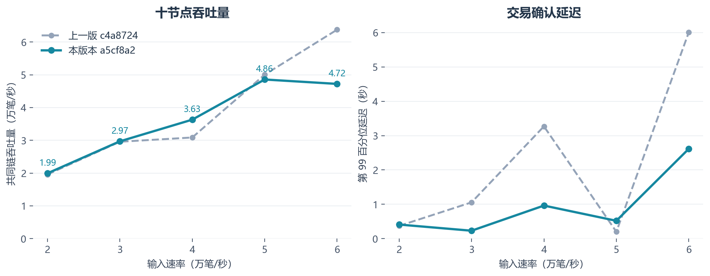
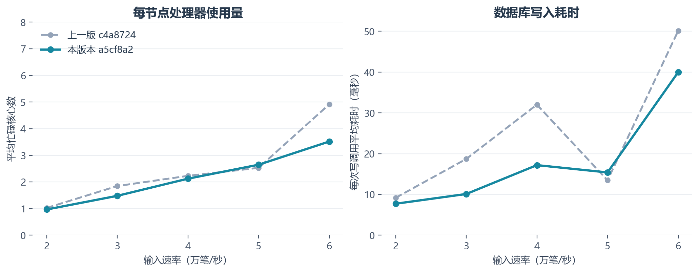

# 十台服务器部署与性能短测

日期：2026-10-14。测试代码：`a5cf8a2dc2585cccf321dd08691b1f09ceef4628`。十台 Ubuntu 服务器，每台 8 核、16 吉字节内存（Gibibyte，GiB），使用内网通信。

本轮最高短测吞吐量为 **48,562 每秒交易数（Transactions Per Second，TPS）**，出现在 5 万笔输入档。五档全部通过共同链、唯一交易数、1,024 个账户的余额和序号、费用、供应总量及状态摘要核对。各轮结束后删除数据库，十台节点已停止。

## 1. 五档实测

每档预热 2 秒、测量 10 秒、各一次，收尾最多等待 5 秒。交易为原生转账，每批 128 笔向十节点广播。

| 输入目标（笔/秒） | 实际发送（笔/秒） | 共同链吞吐量（笔/秒） | 第 99 百分位延迟（秒） | 最终状态核对 |
|---:|---:|---:|---:|:---:|
| 20,000 | 19,994 | 19,943 | 0.411 | 通过 |
| 30,000 | 30,011 | 29,701 | 0.232 | 通过 |
| 40,000 | 40,000 | 36,312 | 0.964 | 通过 |
| 50,000 | 50,005 | 48,562 | 0.521 | 通过 |
| 60,000 | 60,000 | 47,224 | 2.615 | 通过 |

确认延迟从计划发送时刻到全部节点查询到相同入块位置计算，包含发送、传播、处理、落盘和观察等待。最终状态核对在收尾完成后执行。最高值描述本轮五档中的一次测量结果。

## 2. 与上一轮短测对照

对照版本为 `c4a8724`，沿用同一历史签名文件的前缀、创世配置、区块和线程参数、同步落盘及发送方式。两次均每档一次，下面的百分比记录这两次短测的观测差值。

| 输入（笔/秒） | 上轮吞吐量 | 本轮吞吐量 | 变化 | 实际测量跨度：上轮 / 本轮（秒） |
|---:|---:|---:|---:|---:|
| 20,000 | 19,592 | 19,943 | +1.8% | 9.950 / 9.974 |
| 30,000 | 29,573 | 29,701 | +0.4% | 9.431 / 9.899 |
| 40,000 | 30,875 | 36,312 | +17.6% | 9.539 / 9.475 |
| 50,000 | 50,041 | 48,562 | -3.0% | 9.943 / 9.934 |
| 60,000 | 63,758 | 47,224 | -25.9% | 6.216 / 9.719 |

4 万档从 30,875 提高到 36,312 TPS，提升 **17.6%**；确认延迟从 3.269 秒降至 0.964 秒。该档每节点重组重放从约每秒 40,593 笔降至 18,332 笔。

5 万档从 50,041 降至 48,562 TPS，变化 **-3.0%**。上轮该段重组为零，本轮每节点平均每秒重组 0.57 次、重放约 5,187 笔；写调用平均耗时从 13.46 增至 15.40 毫秒。

6 万档从 63,758 降至 47,224 TPS，观测变化 **-25.9%**。本轮处理器占用及重放工作量下降，该档共同链仍存在明显积压。两轮的实际首尾采样跨度分别为 6.216 秒和 9.719 秒。

6 万档上轮窗口的唯一交易落后量从 98,304 降至 74,880 笔，本轮从 23,808 增至 147,984 笔。其关系可直接核对：

`共同链 TPS = 实际发送 TPS − 唯一交易落后量增量 / 实际采样跨度`

本轮对应 `60,000.21 − (147,984 − 23,808) / 9.71943 = 47,224.15`。上轮窗口处理了预热阶段留下的积压，本轮窗口中的积压持续增加。

## 3. 资源与剩余瓶颈

中央处理器（Central Processing Unit，CPU）的忙碌核心数由进程处理器时间增量除以测量秒数计算。网络列为应用层收发合计，单位为十亿比特每秒（Gigabits Per Second，Gbps）；磁盘忙碌比例来自主机计数。

| 输入（笔/秒） | 每节点平均忙碌核心 | 节点内存峰值（GiB） | 每节点平均网络（Gbps） | 主机磁盘平均忙碌比例 |
|---:|---:|---:|---:|---:|
| 20,000 | 0.97 | 0.16 | 0.13 | 8.4% |
| 30,000 | 1.48 | 0.20 | 0.20 | 10.1% |
| 40,000 | 2.12 | 0.43 | 0.33 | 11.7% |
| 50,000 | 2.65 | 0.35 | 0.37 | 13.1% |
| 60,000 | 3.52 | 0.80 | 0.56 | 19.6% |

6 万档每节点平均占用 3.52 个核心，主机平均空闲约 43.2%，节点内存峰值约 0.80 GiB，应用层平均网络约 0.56 Gbps，磁盘平均忙碌约 19.6%。主机资源有余量；提交等待和分支处理仍限制共同链推进。

| 输入（笔/秒） | 每次写调用（毫秒） | 每节点重组（次/秒） | 每节点重组重放（笔/秒） | 执行缓存命中率 |
|---:|---:|---:|---:|---:|
| 20,000 | 7.72 | 0.14 | 567 | 97.0% |
| 30,000 | 10.11 | 0.29 | 1,578 | 95.1% |
| 40,000 | 17.19 | 2.68 | 18,332 | 58.9% |
| 50,000 | 15.40 | 0.57 | 5,187 | 89.4% |
| 60,000 | 39.99 | 2.90 | 45,343 | 29.0% |

### 出块节拍与持久化等待

`Network/Client.h:352` 使用 `max(lastRound + 1, 当前时间 / 轮长 + 1)` 选择未来轮次。候选收集和同步提交位于同一个主循环。本轮 6 万档平均写调用约 40 毫秒，加上 12 毫秒候选窗口，容易超过 50 毫秒轮长。

代码路径举例：轮次起点为 0 毫秒，12 毫秒开始提交，写入用时 40 毫秒，52 毫秒返回主循环；未来轮次公式将下一次生成安排到 100 毫秒。期间还包含生成、分支处理及广播开销。这是由当前调度代码推导的等待路径。

计数与该路径相符：5 万档每节点每秒生成约 **18.41** 个本地候选，6 万档降至 **7.39** 个；数据库实际写调用从每秒 18.49 次降至 8.98 次。后续增加跳过轮次和提交完成时刻的统计，核对各阶段对该下降的贡献。

### 分支重放与候选队列

6 万档每节点每秒重放约 **45,343** 笔交易，执行缓存命中率约 **29.0%**。完整块累计排队约每秒 1.04 秒，元数据累计排队约每秒 2.70 秒；多个任务的等待时间分别累加。完整块在途预算峰值达到 39,104 笔，接近 40,000 笔容量。

候选参与执行时仍需要读取一致父状态，同步写盘和分支切换期间形成等待。已实现的增量清池及异步读块降低了部分重复工作，本轮 6 万档清池累计约每秒 13.94 毫秒，块回复读取及编码约每秒 19.84 毫秒；后续优先处理出块节拍与重放。

在途完整块重复合并在 6 万档平均每节点每秒发生 7.60 次。该网络主要通过摘要传播，继续提升需要结合元数据重建、同高度候选和父状态等待。

## 4. 后续优先改进

1. **轮次内补入。** 仍处于当前轮候选收集窗口时，允许主循环加入当前轮；超过窗口后进入下一轮，保留每轮最多生成一次。先记录晚到量、跳轮数和完成时刻，再验证边界、时钟校正、慢提交及分叉恢复。这个入口直接处理同步写入后额外等待一个整轮的问题。
2. **减少重复分支执行。** 按轮次记录候选父状态、交易集合、采用次数和重放笔数，定位持续分歧。现有累计排名、确定打包与版本绑定缓存继续复用；从已完整收到的候选和连续后继形成一次有效提交。
3. **拆分写调用耗时。** 使用现有 `--db-profile 1` 低频抽样预写日志（Write-Ahead Log，WAL）、内存表及限流时间，确认约 40 毫秒的组成，再选择合并写入或数据库参数。状态、回执与回滚记录继续原子同步提交。

本轮完成五个授权档位，下一次参数与版本对照按用户确定的次数执行。

## 5. 测量口径与验证

| 输入（笔/秒） | 实际首尾跨度（秒） | 共同链样本数 | 原持续负载条件 | 业务队列持续负载条件 |
|---:|---:|---:|:---:|:---:|
| 20,000 | 9.974 | 177 | 通过 | 通过 |
| 30,000 | 9.899 | 176 | 未通过 | 未通过 |
| 40,000 | 9.475 | 97 | 未通过 | 未通过 |
| 50,000 | 9.934 | 150 | 未通过 | 未通过 |
| 60,000 | 9.719 | 18 | 未通过 | 未通过 |

吞吐量采用全十节点已落盘共同链的累计唯一交易数增量。共同链查询的实际首尾时间构成计算跨度，名义测量窗口为 10 秒。持续负载条件要求发送与落盘均达到目标的 95%、最终核对通过、非法或拒绝计数为零、抽样完成及队列增长满足既定门限。五档非法或拒绝计数均为零；2 万档通过持续负载条件，其他四档队列增长超过门限。

摘要计数本版本采用消息数，上轮采用交易数加权。原混合队列条件与新增业务队列条件并列保存，字段定义见 `EXPERIMENTS.md`。所有累计工作计时用测量首尾增量计算，再对十节点求均值；多个工作线程时间可能重叠。

## 6. 部署、参数与清理

本地通过 Git 导出固定提交，源包校验后在二号机构建。Ubuntu 全部 11 项 CTest 通过，耗时 14.31 秒。运行包通过内网并行分发至其余九台；逐台核对程序、发送器、合约发送器的校验值与动态库。十台节点的程序校验值均为：

`b63fbe51ed1502fecb28adfecdbf07da1fa647cd66080c99b69db1180fd541be`

参数为每块 6,000 笔、区块等待 50 毫秒、轮长 50 毫秒、候选窗口 12 毫秒、网络输入输出线程 4 个、交易验签线程 8 个、候选线程 4 个、冷块验签线程 4 个、查询线程 1 个，同步写入开启。并行发送与数据库阶段抽样均关闭，使用上轮相同的串行广播入口。主机资源采样并行运行。

五档合计发送 **240 万笔唯一交易**，每档使用独立账本。50 个节点轮次均在停止进程、收集统计与日志后删除数据库。结束核对确认十台节点停止、8089 端口空闲、本轮数据库为零，每台至少剩余 9.81 GiB。Ubuntu 回归的 22 个临时数据库另行保存记录后清理，释放约 109.5 兆字节。

原始记录已取回本地，包含五份时间线、逐节点统计与日志、主机资源、交易确认样本、部署、清理和参数。结果归档约 3.13 兆字节，校验值见 `data/archive-manifest.json`。汇总见 `data/results.json`、`data/analysis.json`；复现入口见 `methods/README.md`。历史对照见 [上一轮短测](../2026-10-14-six-ten/REPORT.md)，代码修改见 [本地实施记录](../2026-10-14-tps-local/REPORT.md)。
