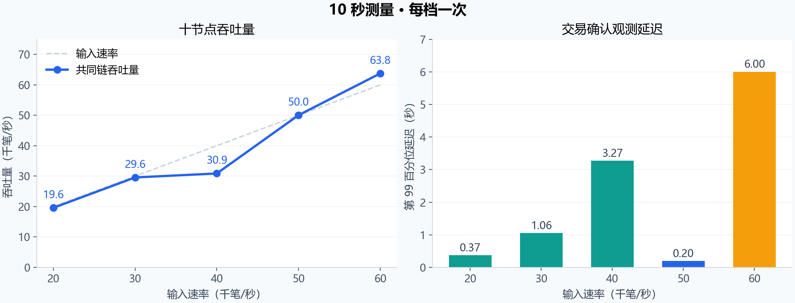
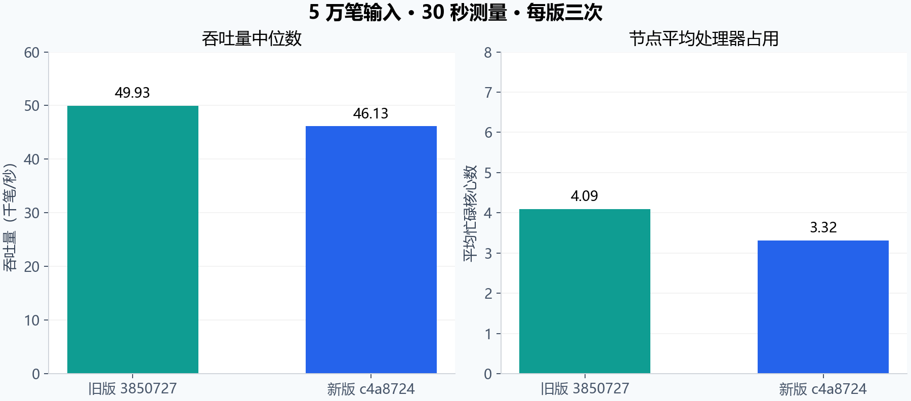

# 十节点短测与版本对照

日期：2026-10-14。测试代码：`c4a8724`；旧版：`3850727`。十台云服务器，每台 8 个逻辑核心、16 吉字节内存（Gibibyte，GiB），通过内网通信。

## 最新短测

按照用户确认的五档运行：预热 2 秒、测量 10 秒、每档一次，结束后最多等待 5 秒。五档全部完成十节点共同链、唯一交易数、1,024 个账户的余额和序号、费用、供应总量与状态摘要核对。

| 目标输入（笔/秒） | 实际发送（笔/秒） | 共同链吞吐量（笔/秒） | 第 99 百分位延迟（秒） | 最终状态核对 |
|---:|---:|---:|---:|:---:|
| 20,000 | 20,004 | 19,592 | 0.373 | 通过 |
| 30,000 | 30,007 | 29,573 | 1.057 | 通过 |
| 40,000 | 39,999 | 30,875 | 3.269 | 通过 |
| 50,000 | 50,002 | 50,041 | 0.202 | 通过 |
| 60,000 | 59,989 | 63,758 | 6.002 | 通过 |

5 万档测得 **50,041 每秒交易数（Transactions Per Second，TPS）**，第 99 百分位延迟（99th Percentile，P99）为 0.202 秒。6 万档测得 **63,758 TPS**，P99 为 6.002 秒。测量窗口内会处理预热阶段留下的交易，因此共同链吞吐量可以高于该窗口的输入速率。6 万档体现了短窗口处理能力及明显的积压。

各档的最终核对在测量结束、收尾完成后执行。五档均通过这项核对；既有持续负载判据中，五档的队列增长仍高于每秒 10 个排队副本的门限，`sustainable` 均为 `false`。该队列指标汇总十个节点，同一笔交易在不同节点的副本分别计数。输入速率与测得吞吐量的非单调变化需要结合分叉、出块和测量窗口理解，单次短测保留实际结果。

## 30 秒三轮对照

此前两版在清理旧测试数据库后，以相同数据、参数和 5 万笔输入各测量 30 秒、重复三次。此处报告三轮中位数；上表报告单次 10 秒值。

| 指标 | 旧版 3850727 | 新版 c4a8724 |
|---|---:|---:|
| 吞吐量中位数（TPS） | 49,930 | 46,130 |
| P99 中位数（秒） | 4.855 | 9.595 |
| 每节点平均忙碌核心数 | 4.09 | 3.32 |
| 最终状态核对 | 3/3 | 3/3 |
| 持续负载判据 | 2/3 | 0/3 |

**46,130** 的含义是：将新版三轮 30 秒测得的吞吐量排序，取中间值。**50,041** 来自后续单次 10 秒短测。两者分别描述对应的次数和窗口。

该三轮对照中新版吞吐量变化为 **-7.6%**，处理器占用变化为 **-19.0%**，确认延迟增加。新版 6 万档的三轮吞吐量中位数为 50,921 TPS，最终核对 3/3，持续负载判据 0/3；旧版同组出现三轮查询超时。完整 33 轮汇总见 `data/long-summary.json`，超时组的吞吐量保留为空值。

## 资源与后续优化

新版 5 万档三轮的主机观测如下。中央处理器（Central Processing Unit，CPU）、网络和磁盘统计在同组测量窗口采样。

| 资源 | 实测情况 |
|---|---|
| 处理器 | 节点平均占用 3.32 个逻辑核心；主机平均空闲 51.9% |
| 内存 | 节点驻留内存峰值约 0.98 GiB |
| 网络 | 每节点平均收发合计约 0.63 十亿比特每秒（Gigabits Per Second，Gbps） |
| 磁盘 | 平均忙碌时间占比 19.9%；写请求平均等待 31.1 毫秒 |

主机资源仍有余量，等待集中在软件队列、分支切换和同步写入路径。初始新版 5 万档的单轮时间线中，每节点累计区块排队时间约每秒 5.21 秒、数据库写调用约每秒 0.40 秒、分叉重放约每秒 5.15 万笔。这些计数来自并行任务，按各自累计计时解释。当前数据支持优先检查以下路径：

1. **候选和分叉调度：** 测量每次重组触发原因、有效连续块批次大小和写盘次数，减少同高度候选的反复执行与提交等待。
2. **同步落盘：** 保持原子提交和同步持久化，检查批次形成条件及提交队列，合并已经验证且连续的后继块。
3. **验签与缓存：** 对照缓存命中、淘汰和重复验签，核对近期交易缓存与完整验签缓存的实际工作集。

下一次优化通过相同参数的短测逐项比较吞吐量、延迟、重放量与等待计数；本次服务器实验已结束。

## 参数、清理与复现

两版对照固定每块最多 6,000 笔、出块等待 50 毫秒、逻辑轮次 50 毫秒、候选收集 12 毫秒、时间同步开启、输入输出工作线程 4 个、验签线程 8 个、同步落盘开启。每批 128 笔交易向十节点广播；使用相同创世配置与 350 万笔签名文件的所需前缀。最新短测轮询间隔为 50 毫秒，项目默认计划为 10 毫秒，实际测量以保存的 `short-plan.json` 为准。所有节点二进制的安全散列算法 256 位（Secure Hash Algorithm 256-bit，SHA-256）校验值一致。

程序在 Ubuntu 上通过全部 11 项 CMake 测试（CTest），耗时 24.78 秒。本次后续修改集中于实验计划与退出清理；本机完成清理路径、运行进程拒绝、路径不匹配拒绝、重复清理和五档计划校验。

旧测试数据库已清理约 67.50 GiB，相关日志和配置已归档。最新五档每轮停止、保留记录、删除测试数据库；通过和失败轮次采用同一清理流程。结束核对确认十台节点停止、8089 端口无监听、两批测试目录数据库数为零，每台磁盘至少剩余 10.15 GiB。代码、发布包、创世配置、签名数据和结果保留。

项目 `AGENTS.md` 已记录用户偏好：十台服务器、少量短测、当前五档、每档一次、每轮删除数据库；问题使用相同参数与新数据库复跑。

结果与方法：`data/short-results.json`、`short-plan.json`、`long-summary.json`、`postflight-verification.json` 和 `methods/`。最新五档原始时间线与节点记录已取回本地 `work/quick-c4a8724-results.tar.gz`；33 轮完整原始记录归档保存在控制服务器，文件大小与校验值见 `data/archive-manifest.json`。报告包含两种测量窗口的独立图表。
