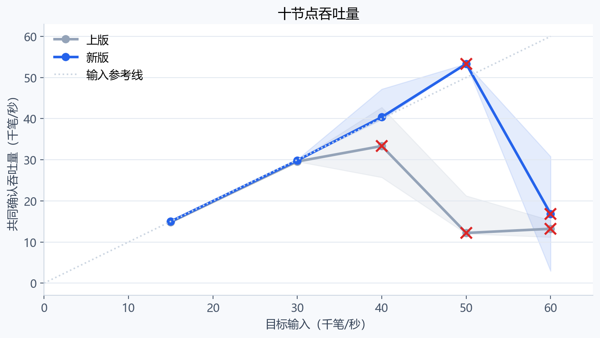
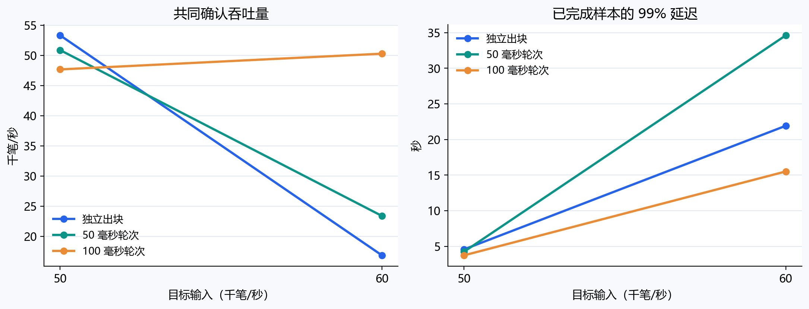
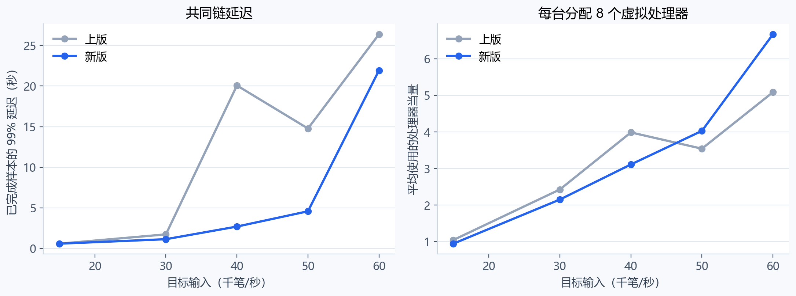
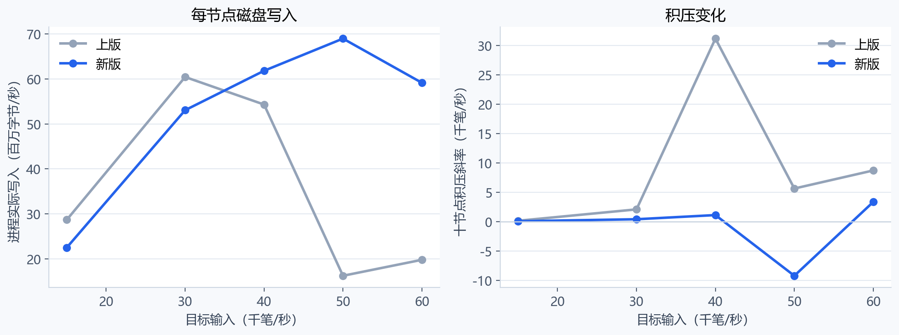

# 十节点吞吐量复测

日期：2026-10-14。实测代码：`3850727`；上版程序：2026-10-13-throughput。全部实验使用十台服务器，每台 8 个虚拟处理器、16 GiB 内存。

## 主要结果

- **50 毫秒轮次、12 毫秒候选窗口：每秒输入 50,000 笔，共同确认吞吐量中位数 50,880 TPS，三轮均完成全部交易与账户核对。** 三轮分别为 50,880、50,342、53,912 TPS；其中一轮记录 10,576 个节点拒收副本，最终区块补齐后全部状态一致。预设持续负载判据通过 1/3。
- 同一独立出块参数下，每秒输入 40,000 笔，新版中位数 **40,367 TPS**，较上版 **33,336 TPS 提高 21.1%**；完整核对从 1/3 提高到 3/3，新版三轮零拒收。
- 100 毫秒轮次、20 毫秒候选窗口在 50,000 笔输入下为 **47,681 TPS**，三轮均完成核对、零拒收。60,000 笔输入下为 **50,290 TPS**，完成核对 2/3，并出现拒收和积压。

TPS（Transactions Per Second）表示每秒交易数。CPU（Central Processing Unit）表示中央处理器。P99（99th Percentile，第 99 百分位数）表示已完成采样交易中，99% 达到十节点共同链所需的时间上界。GiB（Gibibyte）为 2 的 30 次方字节；MiB（Mebibyte）为 2 的 20 次方字节。SSH（Secure Shell）表示安全远程连接协议。

## 测试方法

新旧程序交替测试，共 30 轮；两组时间轮次配置各测试 6 轮，合计 **42 轮十节点性能测试**。每轮预热 5 秒、测量 30 秒，结束后最多等待 20 秒完成剩余交易。每个输入档重复三次，图表显示中位数与已取得测量窗口的最小、最大值。

所有轮次复用同一个 3,500,000 笔签名交易文件、1,024 个账户和创世分配。发送端通过内网将每笔交易发送到全部十节点，每帧 128 笔；保留原始固定速率发送方式。节点启用同步落盘和测量索引，使用 4 个网络线程、8 个交易验证线程，新版使用最多 4 个独立候选处理线程。每块最多 6,000 笔。独立出块等待参数为 50 毫秒；轮次模式按统一的逻辑时间边界提出候选，再等待接收窗口结束后提交，并启用已有四时间戳中位数时钟同步器。

共同链吞吐量按测量窗口起止、十节点相同前缀内的交易增量计算。预热积压在测量阶段被处理时，短窗口吞吐量会高于输入速率。账户核对包含每个账户的余额和连续序号、供应总量、十节点独立状态摘要与共同链。

## 相同参数的代码对照

| 版本 | 目标输入 | 实际发送 TPS | 共同链 TPS | P99 毫秒 | 完整核对 | 查询超时 | 拒收或非法副本中位数 |
|---|---:|---:|---:|---:|---:|---:|---:|
| 上版 | 15,000 | 15,000 | 14,829 | 585 | 3/3 | 0/3 | 0 |
| 新版 | 15,000 | 15,001 | 15,001 | 585 | 3/3 | 0/3 | 0 |
| 上版 | 30,000 | 30,002 | 29,571 | 1,729 | 3/3 | 0/3 | 0 |
| 新版 | 30,000 | 30,001 | 29,843 | 1,135 | 3/3 | 0/3 | 0 |
| 上版 | 40,000 | 40,354 | 33,336 | 20,066 | 1/3 | 0/3 | 2,338,881 |
| 新版 | 40,000 | 40,000 | 40,367 | 2,691 | 3/3 | 0/3 | 0 |
| 上版 | 50,000 | 51,459 | 12,194 | 14,768 | 0/3 | 0/3 | 11,244,536 |
| 新版 | 50,000 | 50,001 | 53,322 | 4,573 | 1/3 | 2/3 | 5,456 |
| 上版 | 60,000 | 63,928 | 13,210 | 26,370 | 0/3 | 1/3 | 15,199,658 |
| 新版 | 60,000 | 60,002 | 16,849 | 21,927 | 1/3 | 1/3 | 5,048,022 |

新版 50,000 档只有一轮取得完整测量结果，另外两轮查询超时；表中 53,322 TPS 对应该轮。60,000 档新旧版本各有一轮查询超时。超时轮次原样保留在结果文件中。拒收或非法副本按十节点累加，同一交易可对应多个副本。

红叉标记该档存在完整核对未通过或查询超时。阴影表示已取得测量窗口的结果范围。所有输入档位的程序参数与数据保持一致。

## 出块轮次对照

| 新版配置 | 目标输入 | 共同链 TPS | P99 毫秒 | 完整核对 | 查询超时 | 持续判据通过 |
|---|---:|---:|---:|---:|---:|---:|
| 独立出块 | 50,000 | 53,322 | 4,573 | 1/3 | 2/3 | 0/3 |
| 独立出块 | 60,000 | 16,849 | 21,927 | 1/3 | 1/3 | 0/3 |
| 50 毫秒轮次 | 50,000 | 50,880 | 4,244 | 3/3 | 0/3 | 1/3 |
| 50 毫秒轮次 | 60,000 | 23,383 | 34,620 | 0/3 | 1/3 | 0/3 |
| 100 毫秒轮次 | 50,000 | 47,681 | 3,740 | 3/3 | 0/3 | 0/3 |
| 100 毫秒轮次 | 60,000 | 50,290 | 15,517 | 2/3 | 0/3 | 0/3 |

本轮最高可重复完成全部交易核对的输入档位为每秒 50,000 笔。50 毫秒轮次配置的吞吐量较高，100 毫秒轮次在 50,000 档的延迟和处理器用量较低。区块上限保持 6,000 笔，因此 100 毫秒轮次每秒最多容纳 60,000 笔；区块准备、接收、分支处理和同步写盘占用实际处理时间。

持续负载判据沿用既有实验：实际发送与共同链速率均达到目标的 95%，非法与拒收副本为零、全部延迟样本完成，十节点积压总和的回归斜率至多每秒 10 笔。表格同时列出完整核对和该判据的通过次数。含未完成样本的高负载行，其 P99 由已完成样本计算；未完成数保存在原始结果与汇总文件中。

## 性能瓶颈与下一步

在独立出块的 40,000 档，新版平均使用 **3.11/8 个处理器当量**，每节点实际写入约 **61.8 百万字节/秒**，数据库写入累计约 **402 毫秒/秒**。在 60,000 档两个可采样窗口中，处理器使用中位数升至 **6.67/8**，验签次数约 **91,954 次/秒**，超过每秒 60,000 笔的输入。验证队列累计等待约 **73,174 毫秒/秒**，重复候选、冷交易重新验签和分支重放形成额外工作。

50 毫秒轮次在 50,000 档平均使用 **3.88/8 个处理器当量**，每节点峰值常驻内存中位数约 **893 MiB**。本轮内存余量充足。高负载首先表现为验证队列积压、分叉重放和串行提交等待；提高缓存命中率和减少重复工作能够继续释放处理能力。累计等待由并行任务相加，分析时与处理器时间和交易延迟一起使用。

独立主机采样中，新版 60,000 档的处理器平均空闲中位数约 22.5%，虚拟磁盘平均忙碌约 13.9%，写操作平均等待约 25.5 毫秒。处理器用量与磁盘采样分别按进程查询窗口和每秒主机采样统计。数据见 `data/host-profile-summary.json`。

下一轮按以下顺序调整：

1. **扩大验签缓存覆盖窗口。** 当前完整交易摘要缓存最多 131,072 项，60,000 笔输入约覆盖 2.2 秒。先对照测试 524,288 与 1,048,576 项，记录缓存命中、重复验签、内存和共同链吞吐量；保留完整签名与合约输入摘要绑定及当前账户检查。
2. **缩短候选接收和重放路径。** 把候选排队、缺失交易补传、提交与分支重放分别计时，优先处理当前父块候选和追赶所需父块，减少较低排名候选的重复遍历。40,000 档每节点仍有约 25,512 笔/秒的分支交易重放。
3. **对照更大的单块批次。** 在统一协议长度与资源上限后，测试 8,000、10,000 笔块与 50、100 毫秒轮次。10,000 笔原生交易的主体约 1.76 百万字节，可放入当前 2 MiB 块字节预算；需要同步调整块笔数限制、摘要长度、接收预算和边界测试。

## 本轮发现与修正

最初版本使用一个候选处理线程。40,000 档中，十节点共同链停在第 16 块、55,008 笔，节点各自推进到 284～294 块；最大距离达到 278 块，超过 256 块恢复窗口。该轮保留为失败诊断。增加到 `min(4, verifyNum)` 个独立候选线程后，重新运行的 40,000 档三轮全部完成核对。恢复窗口和分支排名规则保持原有定义。

检查中同时修正同步批次的容量计数，移除额外的一笔预留，并新增异常批次后的连接进度和连续四个真实满块的分帧接收测试。网络单帧最多 2 MiB，满块按长度预算分帧。Windows 与 Linux 均通过全部 **11 项回归测试**，分别耗时 **53.88 秒、23.88 秒**。

## 磁盘整理与版本记录

已归档并校验十台机器的旧测试日志、配置与结果，再删除 **1,106 个旧测试数据库**，回收约 **133.2 GiB**。清理范围为 9 月实验和 10 月 13 日性能测试的临时数据库。代码、历史结果记录、已有专用诊断归档保持保留。本轮完成核对的临时数据库在收尾检查后清理；未完成轮次的数据库与日志保留供分析。

收尾核对十台程序校验值一致，全部实验节点停止，最少剩余空间约 **4.32 GiB**。Ubuntu 程序 SHA-256（Secure Hash Algorithm 256-bit）校验值为 `a8fc85bf5b059504276eb4d93f77d305a922f811c5fcd882f3bd8544a584dcd7`。

测试记录、图表与代码保存在本地可写仓库。当前任务对 `D:\Project\Chain` 的写权限仍未获授，GitHub 凭据库访问失败；目标目录回写和远端同步由交付目录中的 `Complete-Sync.cmd` 完成。用户原有对照链文件和模块说明修改保持原样。

原始结果包含每轮时间线、采样交易、所有节点最终指标与状态核对。归档路径和校验值见 `data/archives.json`；汇总见 `data/*-summary.json`，方法见 `data/method.json`，收尾状态见 `data/postflight.json`。
