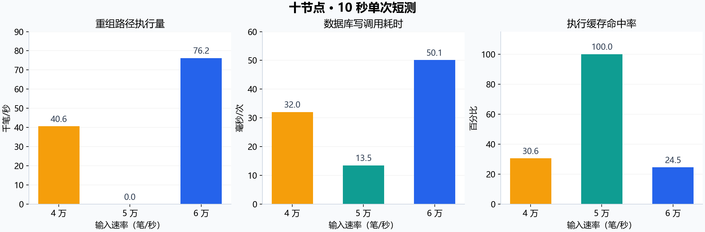

# Chain TPS 瓶颈审阅与优化方案

日期：2026-10-14。结论：**优先减少候选积压、分支切换和重复持久化，稳定共同链的推进；随后调整缓存和工作线程。** 当前代码在良好的同步状态下已测到 50,041 每秒交易数（Transactions Per Second，TPS），这条顺畅路径是下一步优化的参照。

## 1. 审阅范围与数据

审阅工作副本提交为 `cbaaed6`，十节点实际测试的核心代码为 `c4a8724`；两者的账本核心一致，后者之后的更新为实验工具、配置和报告。版本对照的旧版为 `3850727`。D 盘 `D:\Project\Chain` 的提交仍为 `1ac05a2`，本次按实际测试代码形成方案。13 个主要文件的内容校验值与 D 盘比对保存在 `data/source-manifest.json`。

阅读范围覆盖交易接收与验签、账户镜像、交易池、确定性打包、区块验证、分支排名与重放、数据库原子提交、摘要补传、同步窗口、查询工作池、以太坊虚拟机（Ethereum Virtual Machine，EVM）执行，以及压测发送、共同链采样和状态核对。主线代码位置使用 `c4a8724` 的固定链接。

数据使用十台 8 核、16 吉字节（Gibibyte，GiB）服务器的五档 10 秒短测、33 轮 30 秒汇总及本地保留的一轮 30 秒初始 5 万档时间线。资源对照使用清理旧数据库后的三轮组，路径计时使用完整保留的六份时间线，分别标明窗口。本次工作读取代码和已有记录，生成方案及图表。

## 2. 最关键的实测发现

以下每档预热 2 秒、测量 10 秒、一次，所有最终账户与链状态核对均通过。中央处理器（Central Processing Unit，CPU）占用为每节点平均忙碌逻辑核心数。第 99 百分位延迟（99th Percentile，P99）采用所有节点首次查询到同一交易入块位置的观察时刻。

| 输入（笔/秒） | 共同链 TPS | P99（秒） | CPU 核心数 | 重组次数/秒/节点 | 重组路径执行量/共同链净增量 | 执行缓存命中率 | 数据库写调用（毫秒/次） |
|---:|---:|---:|---:|---:|---:|---:|---:|
| 20,000 | 19,592 | 0.373 | 1.02 | 1.36 | 0.22 | 81.6% | 9.17 |
| 30,000 | 29,573 | 1.057 | 1.85 | 5.24 | 0.91 | 44.5% | 18.70 |
| 40,000 | 30,875 | 3.269 | 2.23 | 3.92 | 1.31 | 30.6% | 32.02 |
| 50,000 | 50,041 | 0.202 | 2.53 | 0.00 | 0.00 | 100.0% | 13.46 |
| 60,000 | 63,758 | 6.002 | 4.91 | 3.73 | 1.20 | 24.5% | 50.13 |

5 万档整个测量窗口内重组计数增量为零，执行缓存命中率为 100%，每节点每秒约 19.41 次数据库写调用；缓存未命中的提交执行耗时为零。4 万档中重组路径每节点每秒执行约 40,593 笔交易，共同链每秒净增约 30,875 笔，候选验证预算的平均在途量约 15,807；5 万档该在途量约 188。6 万档在途量约 25,827，并多次接近 40,000 的区块验证预算。

这些数据把问题指向 **候选与分支处理的稳定性、提交路径的写入放大和等待**。对照来自不同输入档位的一次运行，体现对应关系；具体哪个改动带来多少收益，需要同参数的逐项对照。

“重组路径执行量”对应 `fork_reexecute_transactions`，代码累计切换分支时执行的整段新分支交易数，其中包含新加入该分支的交易。该比例描述切换工作量，精确的相同交易重复执行次数需要另记交易身份。缓存命中率由提交执行缓存的命中与未命中增量计算。

初始 5 万档 30 秒样本中，每节点数据库写调用平均耗时约 50.99 毫秒，约 7.85 次/秒；重组路径执行量约 51,546 笔/秒。区块任务累计排队时间约每秒 5.21 秒，交易任务约 1.28 秒；原生候选状态执行约每秒 1.84 毫秒，缓存未命中的提交执行约 2.71 毫秒。不同任务的累计计时相互重叠，按各自计数解释。这个样本的共同链 TPS 为 39,945，属于初始扫描；三轮清理后对照的 46,130 是另一组中位数。

5 万档短测的逻辑批次写入量约为每笔共同链净增交易 308 字节，初始 30 秒 5 万档约为 623 字节。该口径包含块体、索引、账户及回滚记录，来自 `db_batch_bytes`；文件整理和物理磁盘写入另行统计。

## 3. CPU、内存、网络、硬盘分别处于什么状态

新版 5 万输入、30 秒三轮对照的平均情况：

| 资源 | 证据 | 对优化的意义 |
|---|---|---|
| CPU | 节点平均约 3.32/8 个逻辑核心；主机平均空闲 51.9% | 核心仍有余量，关键串行阶段和等待限制推进 |
| 内存 | 节点驻留峰值约 0.98 GiB；主机可用内存均值约 13.6 GiB | 缓存可以有界扩大，先验证是否减少实际重复工作 |
| 网络 | 每节点平均发送约 38.7 兆字节/秒、接收约 40.4 兆字节/秒 | 合计约 0.63 十亿比特每秒（Gigabits Per Second，Gbps），低于服务器标称 5 Gbps |
| 网络包率 | 平均发送约 1,969 包/秒、接收约 28,272 包/秒 | 远低于标称每秒 100 万包（Packets Per Second，PPS）；关注队列和瞬时突发 |
| 硬盘 | 平均忙碌时间占比约 19.9%，写请求平均等待约 31.1 毫秒 | 同步写入延迟值得重点测量；磁盘吞吐和后台整理还需分开观察 |

8 万档节点平均约占用 6.39 个核心，CPU 压力随负载上升。5 万档的优先项是串行推进效率；解决后，验签和哈希计算可能成为更显著的限制。磁盘统计来自虚拟设备，当前 `db_write_ms` 包括整个 RocksDB 写调用，需要进一步拆分日志、内存表和写入限流。

## 4. 代码里现有的优化

| 路径 | 已有实现 | 本次追加关注 |
|---|---|---|
| 存储索引 | 交易位置已压缩到 12 字节，块体只按区块保存 | 分支切换增加了索引、回滚和日志的反复写入 |
| 交易验签 | 16 桶、524,288 项完整内容缓存，合并并发验签 | 缓存命中仍需结合真实重复次数解释 |
| 候选执行 | 8 项、32 兆二进制字节（Mebibyte，MiB）的结果缓存，绑定父块与状态版本 | 分支频繁变化使结果失效；较低排名候选也会先执行状态 |
| 区块传播 | 摘要、来源抑制、缺失交易补传 | 摘要和完整块共享候选线程及交易数量预算 |
| 同步 | 单一同步来源、8 块窗口、每批最多 4 块 | 查询和数据读取仍有路径在网络线程内等待提交锁 |
| EVM | 增量覆盖层、变化账户和存储槽落库 | 当前原生压测的主要等待位于共识与提交；合约场景需要独立测量 |

## 5. 第一优先：每次调度先选好分支，再完成一次切换

入口：[ProcessForks](https://github.com/AdamRitz/Chain/blob/c4a8724/Transaction/Fork.h#L170)、[AdoptFork](https://github.com/AdamRitz/Chain/blob/c4a8724/Transaction/Fork.h#L92)。

当前 `ProcessForks` 按高度、末块交易数和哈希排列分支末端，然后逐个调用 `AdoptFork`。实际分支规则比较的是累计有效交易数、高度和链头哈希。循环允许同一次调度先写入一个更好分支，再遇到另一个更好分支；每次成功都可能落盘、刷新交易池及恢复脱链交易。

建议把当前祖先查找和排名准备提取为一个直接的 `RankFork` 辅助函数，复用已有 `ForkCheck`、不可变块体和状态版本：

1. 在同一父状态快照下找齐可处理的分支末端，计算累计排名。
2. 按实际累计交易数、高度、哈希排列，选出最优的完整分支。
3. 对它执行完整账户与合约规则，验证成功后一次切换；验证失败时删除该无效候选，继续下一候选。
4. 提交前再次核对 `dbStateVersion`、链头和共同祖先，状态变化时重新准备。
5. 本次成功后把新到达的竞争分支交给下次调度，保留父块缺失请求和分叉恢复窗口。

**收益路径：** 减少中间分支的执行、同步写入、交易池重建和脱链交易回填。已有共识排名、账户规则和回滚原子性继续使用。

**估计改动量：** 100～180 行核心代码。**验收：** 记录每次 `ProcessForks` 的成功切换次数、每笔共同链净增交易的分支执行量和写入字节；覆盖累计交易数与高度排序不一致、最高排名分支账户无效、缺失父块、同排名哈希比较及提交写入失败。

## 6. 第二优先：区块摘要与完整块分类排队，合并重复块任务

入口：[ReserveVerify/ProcessMessage](https://github.com/AdamRitz/Chain/blob/c4a8724/Network/Server.h#L18)、[ReceiveCompactBlock](https://github.com/AdamRitz/Chain/blob/c4a8724/Network/Blocks.h#L132)。

39 号摘要消息把 `num` 设置为整个区块交易数，和完整区块、连续块批次共享 40,000 笔预算及候选线程。6,000 笔摘要约 198 千字节，却同样预留 6,000 笔验证额度。七条这种摘要的声明额度已超过预算。摘要拼装完成后，完整块还会再次进入 `ProcessMessage`。同一候选从多邻居到达，也会先进入共享队列，之后才检查是否重复。

建议保留现有工作池和字节边界，直接增加两类计数与一个有界的在途表：

1. 摘要与补传拼装按消息数量、条目数及字节限制；完整块继续按实际交易数限制验签工作量。
2. 摘要先完成长度、头部哈希、交易列表与树根检查，再合并相同摘要的拼装任务。
3. 完整块以完整编码内容的指纹标识在途验证，核对实际字节；同一内容共享一次验证任务。
4. 成功、失败、异常和断线后释放在途记录；无效数据完成后允许同一块头的其他完整内容重新验证。
5. 记录元数据和完整块各自的任务数、排队时间、峰值和重复合并数。

区块头通过交易哈希承诺交易内容，签名字节仍需要完整验证。在途表绑定完整块体和全部合约输入，成功验签缓存沿用完整内容绑定。交易接收反馈继续按原请求顺序返回。

**收益路径：** 降低重复候选的预算占用，让有效候选更快进入本轮比较，缩短落后和补传循环。**估计改动量：** 100～180 行。**验收：** 同一块从多来源到达只验证一次、改签名仍拒绝、同块头坏内容之后的正确内容正常通过、补传分帧及连续四块仍能完成。

## 7. 第三优先：整理连续提交入口，拆清同步写入耗时

入口：[MainLoop](https://github.com/AdamRitz/Chain/blob/c4a8724/Network/Client.h#L331)、[DBWriteBatch](https://github.com/AdamRitz/Chain/blob/c4a8724/DB/DB.h#L174)、[DBCommitBlockLocked](https://github.com/AdamRitz/Chain/blob/c4a8724/DB/DB.h#L449)。

`MainLoop` 同时处理分叉、逻辑轮次等待、本地打包、候选收集、同步写入和清池。提交持有独占 `dbCommitMutex`，RocksDB 的 `sync=true` 写调用在返回前完成日志同步。已有连续分支通过 `AdoptFork` 用一个批次提交；本地候选遇到 `HasForkChild` 又调用整个 `ProcessForks`，会把普通连续提交与竞争分支调度放在一起。

建议先做两项直接调整：

1. 由前述分支择优结果确定本次提交目标，连续的已验证后继直接组成有限批次。最初最多 2～4 块，保持 256 块恢复窗口；每块保留回滚记录、位置索引、费用和回执。
2. 复用现有 `BranchMemory` 与执行缓存，合并一次持久化后发布账户镜像和链头。缓存复用继续检查完整字节、父块、状态版本；失败恢复全部内存状态。

连续块到达即处理，正常单块直接提交。增加 `grouped_commit_batches` 与每批实际块数、交易数、字节数，判断已有合并是否真正覆盖主路径。初始 5 万档仅约每秒 1.06 个块被计入多块组，当前指标统计的是组内块数。

在已有 `DBWriteBatch` 外层采样 RocksDB 的 `write_wal_time`、`write_memtable_time`、`write_delay_time`、`write_pre_and_post_process_time`，定位同步写入、内存表更新和限流。线程局部计时取同一提交线程的调用前后增量。上述字段来自 [RocksDB 8.9.1 PerfContext](https://github.com/facebook/rocksdb/blob/v8.9.1/include/rocksdb/perf_context.h)。

RocksDB 的写前日志（Write-Ahead Log，WAL）支持把可组合的并发写入一起同步。当前账本由一个提交线程与提交锁串行推进，应先在应用层组织连续块的原子批次。同步持久化语义和分叉恢复保持一致。[RocksDB WAL 性能说明](https://github.com/facebook/rocksdb/wiki/WAL-Performance)

**收益路径：** 摊薄每次日志同步成本，减少提交间隙。**估计改动量：** 提交调度约 60～120 行，观测约 40～80 行。**验收：** 崩溃重启、连续块执行失败、写库失败、EVM 回滚、费用守恒和所有节点共同链。

## 8. 第四优先：分叉后只刷新受影响账户的交易池

入口：[RefreshTxPool](https://github.com/AdamRitz/Chain/blob/c4a8724/Transaction/Transaction.h#L290)、[ProcessForks 中的池恢复](https://github.com/AdamRitz/Chain/blob/c4a8724/Transaction/Fork.h#L208)。

真实重组后，当前函数清空全部 `txUserPool`，在交易池锁内遍历每笔交易，重新检查余额和序号，再创建序号树及就绪计数。已有 `BranchMemory.keys` 和 `lastBranchUsers` 已收集回滚与重放涉及的账户，普通连续追赶也已按这些账户清池。

建议为 `RefreshTxPool` 增加受影响账户参数：逐个检查这些账户的池内交易，重建它们的连续前缀，用前后差值更新 `readyPoolTx`。序号下降时从新的确认序号重新计算；余额变化、账户删除和合约发送者都按新状态检查。脱链交易继续通过原接收入口回填。完整刷新保留为显式全量恢复路径。

**收益路径：** 缩短持有交易池锁的时间，降低重组对接收、打包、摘要拼装的连带阻塞。初始 5 万档刷新累计约每秒 15.1 毫秒，6 万短测约 21.8 毫秒；该项作为分支调度之后的增量改进。**估计改动量：** 60～120 行。**验收：** 降低确认序号、余额增加和减少、同序号冲突、新账户删除、混合原生与合约交易、就绪计数与全量刷新结果一致。

## 9. 第五优先：网络线程负责收发，区块读取交给现有工作池

入口：[session](https://github.com/AdamRitz/Chain/blob/c4a8724/Network/Server.h#L268)、[SendBlockBatch](https://github.com/AdamRitz/Chain/blob/c4a8724/Network/Blocks.h#L238)、[ReadQueryResponse](https://github.com/AdamRitz/Chain/blob/c4a8724/Network/Server.h#L149)。

13、19 等查询已有独立工作池。42 号连续块请求在网络 strand 内调用 `SendBlockBatch`，逐块取得提交共享锁再读数据库；20 号链头响应处理也会在网络线程内等共享锁。写盘持有独占锁时，这些同步等待会占用网络工作线程，影响交易接收、时钟探测和后续块消息。

建议把块回复的读取与编码投递到现有查询工作池，增加有限的块回复预算，再回到连接 strand 发送；保持发送队列顺序和字节上限。另在成功落盘后发布一个小的链头快照，包含高度、哈希、累计交易数与状态版本，供统计、链头比较和摘要初筛使用。账户执行、回执、历史链位置和完整状态查询继续使用对应的一致状态。

**收益路径：** 减少网络线程被提交等待占用，降低时钟和传播的调度抖动。**估计改动量：** 100～180 行。**验收：** 写盘期间收发持续进展、回复与实际链头版本对应、分叉后快照原子发布、连接关闭和有界队列行为。

## 10. 第六优先：用现有参数做少量有依据的调优

| 参数方向 | 可选设置 | 选择依据 |
|---|---|---|
| 候选收集窗口 | 轮次 50 毫秒、候选 12 → 20 毫秒 | 给不同节点验证完成的候选更多比较时间；核对重组、轮次迟到和 P99 |
| 最大区块 | 6,000 → 10,000 笔 | 先确认存在满块、后继等待与同步写入限制；保持 2 MiB 字节与合约燃料上限 |
| 近期完整交易缓存 | 131,072 → 262,144 笔，字节预算相应设置 | 6 万短测每节点每秒缺失补传约 22,378 笔；观察补传减少量 |
| 成功验签缓存 | 524,288 → 1,048,576 项 | 新版初始 5 万档有淘汰和命中；分别统计接收、冷块及恢复路径的实际验签 |
| 线程配比 | 先保持输入输出 4、交易验签 8、候选 4、冷块验签 4 | 依据分类后的任务占用再调整候选或验签线程；八核心上合计线程数已高于核心数 |

以上每次选择一个变量，所有节点使用相同配置。`round-ms` 开启时，出块节奏由逻辑轮次决定；`block-ms` 用于关闭轮次时的凑块等待。当前 5 万顺畅样本平均每次写调用对应约 2,578 笔共同链净增量，6,000 笔容量已有余量。吞吐量模式的较大块容量主要帮助满块与追赶场景。

5 万顺畅样本验签缓存命中增量为零，新增交易主要各验一次。缓存扩大通过减少实际重复验签体现收益。当前入池高水位为 18 万笔；初始 5 万档采样的池峰值约 7.19 万笔，`ingress_wait_ms` 还包括取得池锁的时间。该路径优先结合锁等待解释。

数据库配置根据 `STALL_MICROS`、日志同步计时、零层文件数、待整理字节与内存表数量判断。若后台整理积压，起始可评估后台任务 4 个、写缓冲 64 MiB、最多 4 个写缓冲，再根据 CPU、写延迟和停顿调整；这些是拟新增的数据库配置入口。详细计时采用低频抽样，保持测试中的观测开销可见。[RocksDB 调优指南](https://github.com/facebook/rocksdb/wiki/RocksDB-Tuning-Guide)

## 11. 测量方式同步整理

`Test/Experiments.py` 的发送器在一个线程中按固定顺序向十个节点 `sendall`。某节点接收变慢会推迟本批后面的节点，形成不同的到达时刻。10 万输入组实际发送中位数约 78,156 TPS，需要同时观察发送迟到和各连接等待。

后续可用每节点一个发送工作线程、有界队列和统一的计划时间，保持相同交易顺序与广播负载。新旧版本都使用该发送器形成独立对照组，记录发送端处理器和每节点实际到达速率。原生可靠发送的流水模式也单独记录。

队列增长当前使用 `pool + pending`，`pending` 同时统计原生交易、摘要和完整块的加权预算。补充三项并列结果：已发送唯一交易数减共同链交易数的逻辑落后量、原生交易池与原生验证队列、摘要与完整块各自的队列。这样可区分业务积压与重复候选工作量。

现有持续负载标记五档均为 `false`，加权队列增长超过既定门限；最终完整状态核对五档均通过。两项记录分别描述窗口内负载与收尾状态。

50,041 和 63,758 是 10 秒窗口结果；46,130 是 30 秒三轮中位数。6 万短测在测量起点约有 98,304 笔逻辑落后，终点约 74,880 笔，窗口处理了预热积压；中间发生波动，其逻辑落后回归斜率仍为正。每秒吞吐量、P99、收尾核对与队列增长分别保存。

延迟观察受查询和采样等待影响。保留 50 毫秒短测轮询与实际采样间隔，改进查询路径时单列观察开销变化。最终状态核对在收尾完成后执行。当前试验使用 1,024 个账户和原生交易，合约部署、调用及大量账户需要对应的数据与状态核对。

进一步检查了实际取样：名义测量窗口为 10 秒，公式使用窗口内首尾共同链样本的实际时间差。查询与共同前缀搜索的等待使高负载样本更稀疏，6 万档用于吞吐量计算的实际跨度为 6.216 秒。

| 输入（笔/秒） | 实际首尾跨度（秒） | 共同链样本数 | 平均采样间隔（毫秒） |
|---:|---:|---:|---:|
| 20,000 | 9.950 | 135 | 74.3 |
| 30,000 | 9.431 | 56 | 171.5 |
| 40,000 | 9.539 | 14 | 733.8 |
| 50,000 | 9.943 | 180 | 55.5 |
| 60,000 | 6.216 | 11 | 621.6 |

初始 5 万档的 30 秒样本只有 10 个窗口内观察点，实际首尾跨度 25.565 秒，平均间隔 2.841 秒。`Cluster.Common` 在分叉时多次查询历史检查点，`CheckSamples` 还查询交易位置。改进查询快照与观察批次可降低测量干扰。队列均值为这些采样点的简单平均，累计工作计时按实际首尾跨度计算。正式报告继续同时保存计划窗口、实际跨度、样本数和发送负载。

## 12. 落地顺序与验收目标

建议首批完成 **分支择优一次切换＋候选分类与重复合并**，复用现有函数、锁、缓存和工作池，粗估约 200～360 行核心修改，回归覆盖另计。第二批处理连续提交入口、增量清池和网络读块等待。第三批依据新指标调整缓存及数据库参数。

| 顺序 | 工作 | 主要验收指标 |
|---|---|---|
| 1 | 补充少量分类计数和写调用拆分 | 区分元数据、完整块、重组、日志同步与限流 |
| 2 | 排名后一次切换 | 每次调度切换次数、重组路径工作量、每笔写入字节下降 |
| 3 | 分类预算与在途合并 | 候选在途量和等待下降，签名及输入篡改覆盖通过 |
| 4 | 整理连续提交与增量清池 | 每批有效交易增多，数据库调用和池锁等待下降 |
| 5 | 网络等待与参数 | 实际发送达到目标，传播和确认延迟下降 |

本地先通过全部 11 项 CMake 测试（CTest），含账户、回滚、写盘失败、合约、同步、反馈排序和实验测量。正式测试继续用十台服务器，预热 2 秒、测量 10 秒、各档一次、收尾最多 5 秒；输入为用户确定的 2、3、4、5、6 万。一个最终版本跑完五档，报告同时记录共同链 TPS、实际发送、P99、逻辑落后、重组工作量、写入字节及资源。存在波动时按用户确定的次数复测。

第一阶段目标为让 5 万档更经常处于无重组、低等待状态，并提高 6 万档的共同链推进效率和延迟表现。后续在数据支持下增加输入档位。6,000 笔容量和 50 毫秒轮次的满块理想值为每秒 120,000 笔，这个数只反映容量与轮次乘积，实际有效交易数、验签、传播和持久化一起决定 TPS。

代码改动维持现有 PascalCase、头文件组织和直接的数据流。账户模型与交易编码沿用当前实现。原生执行计时较小，账户结构与并行执行的更大改动放在这些等待路径改善后评估。

## 13. 复核文件

- `data/source-manifest.json`：审阅版本、代码 SHA-256（Secure Hash Algorithm 256-bit，安全散列算法 256 位）与 D 盘比对。
- `data/timeline-analysis.json`：五档短测及一轮初始 30 秒样本的阶段计数、队列、写调用与逻辑积压。
- [原始短测及三轮汇总](../2026-10-14-six-ten/REPORT.md)：全部五档核对与 33 轮汇总。
- 本次聚合方式：测量窗口首尾累计计数差除以实际采样时间，再对十节点求均值；缓存命中率使用命中与未命中之和，数据库平均写耗时使用累计写耗时除以写调用数。

预计代码行数为规划粗估。具体收益以相同参数实测确定；当前证据已经给出优先处理的路径和可验证指标。
