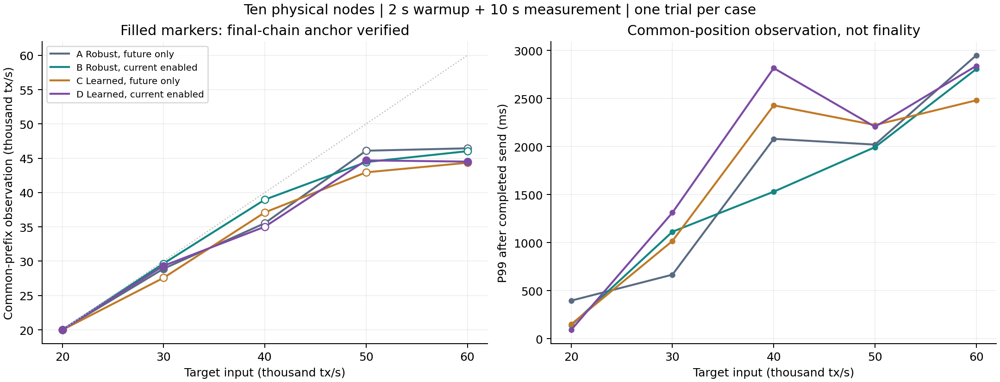
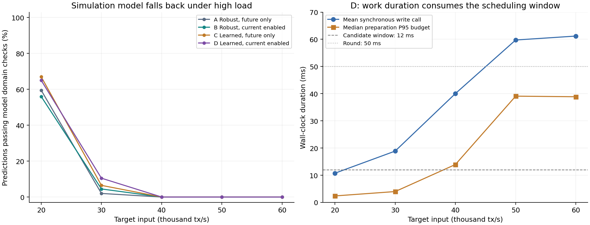

# 学习辅助时钟：十台部署与四组短测

2026-10-21。运行代码为 `070fbb46ff25bce38d9599c5165dce66d63fc561`。十台均已部署并启用模型辅助控制与有界调度；二十组短测全部完成并通过共同链、账户与供应总量核对。当前数据没有证明模型带来稳定的高负载 TPS 收益：4 万及以上输入档，模型的测量窗口预测全部越域回退。

## 部署与验证

- 十台各一个正常 Chain 服务，版本与二进制 SHA-256 一致；每台 9 个邻居，已有开发链高度 3、1,000 笔交易与每台 34 个账户核对通过。原数据库继续使用，旧版 9339054 及服务定义保留用于回退。
- 当前模式：`learned + bounded + join-current-round=1`，固定共享 `simulation-v1.json`，来源按九个监听地址配置，模型文件 SHA-256 为 `c39f45fbd01acb40ecab390ddd99c3987aad67c9ef0aa1b5f92f82c832e4d167`。
- Windows 与 Linux 各十四项回归全部通过；Linux 使用 GCC 13、RelWithDebInfo、`-O2 -g -fno-omit-frame-pointer -DNDEBUG`。节点二进制 SHA-256 为 `a5174f5b797e53b6ff9457465c84f5d09be5aac3f13a1d3eb953aa8ff311830d`。
- 使用 Ansible 分发和校验，测试期间暂停常驻 Chain/FISCO 服务以免争用，结束后新 Chain 与原 FISCO 均已恢复。实验端口 8090，常驻端口 8089。
- 二百个轮次数据库与四十六个 Linux 构建回归数据库已清理，配置、日志、观测与签名数据保留。逐节点后验检查确认本轮实验库为零，没有遗留压测进程。

## 对照方法

四组统一采用同一版本的连续时钟、候选提前准备、父状态版本检查、冻结截止和完整遥测。A 为稳健控制、仅未来轮；B 开启当前轮补入；C 为模型控制、仅未来轮；D 同时开启模型与补入。新增 `--join-current-round 0` 作为对照，避免旧调度路径缺少准备耗时特征造成混淆。

十台均为 4 vCPU，约 3.6 GiB 内存。固定 4 个网络线程、8 个验签线程、每块最多 6,000 笔、轮长 50 ms、候选窗口 12 ms、同步落盘。探测周期采用程序默认 250 ms，模型周期 500 ms、预测有效期 2 s、校正上限 ±1,000 ppm。未修改默认缓存、执行引擎、磁盘语义或 FISCO 参数。

20/30/40/50/60 千 TPS 输入档，各组各一次，预热 2 秒、测量 10 秒、最多收尾 5 秒；同一 720,000 笔原生转账签名集与 1,024 个账户，顺序广播至十节点。每个输入档轮换组别执行顺序，每轮从空实验库开始。启动建立邻居与时间来源在正式流量预热之前单独记录。未注入抖动、攻击、分区或额外时钟偏差。

统计每秒一次链状态、总计每秒两笔延迟样本，并保留 RPC 起止区间。吞吐量观察的是十节点共同前缀的交易计数，时序采用观测区间中点，并提供区间不确定范围。延迟从发送批次完成到首次观察十节点交易位置一致，包含查询和轮询开销；不是不可逆最终确认时间。每轮约二十个正式窗口延迟样本，P99 仅作探索性观察。

## 结果

| 目标输入 TPS | A 稳健/未来轮 | B 稳健/补入 | C 模型/未来轮 | D 模型/补入 | D 发送后 P99 | D 有效预测 |
|---:|---:|---:|---:|---:|---:|---:|
| 20,000 | 20,007† | 19,993† | 19,982* | 19,993† | 90 ms | 65.0% |
| 30,000 | 28,902† | 29,659* | 27,573* | 29,323† | 1312 ms | 10.5% |
| 40,000 | 35,535* | 38,970* | 37,107* | 35,019* | 2816 ms | 0.0% |
| 50,000 | 46,095* | 44,442* | 42,946* | 44,689† | 2205 ms | 0.0% |
| 60,000 | 46,449* | 46,029* | 44,338† | 44,508† | 2839 ms | 0.0% |

† 共同前缀的两个窗口边界均有保存的证据，核对其位于最终共同链；* 为未完成边界证明的诊断观测值，不能用来宣称性能增益。全部二十轮最终账户和共同状态核对通过，与“窗口边界已证明”是不同检查：严格的全部节点链头证明通过 4/20 轮；共同前缀边界可从保存证据核对 8/20 轮。其余缺测保留，不另加重复轮次填补。

6 万档实际发送仅为 50,368–51,366 TPS，发送端或传输链路已形成约束；不能把该档称为实测承载 60,000 TPS。各轮均在固定收尾窗口内完成实际已发送数据的核对，不能据此把十秒短测外推为长期可持续吞吐量。

## 模型实际起效程度

2 万档 D 组预测通过率 65.0%，共同前缀约 19,993 TPS；发送后 P99 约 90 ms，A/B 分别约 395/138 ms。但在 3 万档，D 的 P99 约 1,312 ms，反而高于 A 的 666 ms。单次、少量样本没有形成稳定的延迟改善证据。

3 万档四组的有效预测率仅 2.0%–10.5%；4 万及以上全部为 0%。实际准备、提交耗时及队列长度越出模拟训练域，保护逻辑按设计回退。高负载的 C/D 因而主要运行传统回退控制，不能把组间波动归因于学习模型，也不能手工放宽模型域来冒充已验证泛化。

## 仍在限制出块的工作

D 组在 4 万档平均每节点每秒约 34,366 笔重组重执行，约 4.57 次重组，本地候选约 4.34 次/秒。5/6 万档平均进程 CPU 约占满 4 vCPU 的 97%–98%；同步写调用平均约 59.7/61.2 ms，准备 P95 预算的观测中位数约 39.1/38.9 ms，均明显挤压 50 ms 轮长和 12 ms 候选窗口。写调用壁钟耗时包含阻塞与调度影响，不能单独据此认定存储介质已饱和。

5/6 万档每节点本地候选仅约 1.70/1.72 次/秒，当前轮补入次数为零。候选准备和提交跨轮、同步/重组打断及 CPU 竞争仍是更直接的限制；校正时钟本身不能腾出这些执行时间。全部保存的候选记录没有重复轮号，也没有越过冻结截止而被接受的本地候选。

下一步应先以独立标定的实机时间参考和本地准备耗时标签重新训练、校准，再检验混合故障泛化；同时按已观察到的提交、重执行和准备路径定位 CPU/阻塞来源。本次没有开展额外优化、扩大测试次数、重新训练模型或重测 FISCO。

## 记录与重现

完整统计与逐组差值见 [analysis.json](data/analysis.json)，逐轮结果见 [results.json](data/results.json)，部署后验见 [validation.json](data/validation.json)。构建、二进制和模型清单、Windows/Linux CTest、常驻服务验证均保存在 `data/`；Ansible、四组运行器和观测/分析方法在 `methods/`。

原始观测归档 SHA-256 为 `1fb102b946e416fb4b335ed992da79fdb85f82f56f2ac3177fb698fca09f54e0`，体积 9,490,993 字节。源数据集 SHA-256 为 `142f5e5d6024c1be4f6e646ec2fb240c4e7789ad546b1543f37752132821f613`，仍保存在控制机 `/opt/chain-control/results/clock-070fbb4-20261021/transactions.bin`。大体积归档不混入 Git，用户交付目录另有副本。
