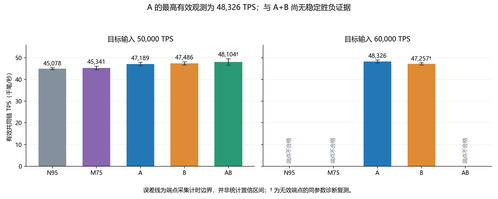

# 候选时机与无效准备风险模型：十节点实验结果

本次最高有效观测为 **A：48,325.61 TPS**。目标发送 60,000 TPS，实际发送 51,161.6 TPS；共同链端点采集区间给出的吞吐范围为 **47,654–49,017 TPS**。该范围是计时不确定性的边界，不是统计置信区间。

A 是目前优先保留的候选实现：决策时刷新负载特征、预测准备 P95，并选择两轮内可完成的轮次。A+B 在 50,000 档复测得到 48,103.81 TPS，与 A 的最高值只差 0.46%，两者计时区间重叠。本次不能证明 A 稳定优于 A+B，更不能宣称得到了系统长期容量上限。

## 实现和验证

| 版本 | 时钟/准备策略 | 实验开关 |
|---|---|---|
| N95 | 鲁棒时钟 + 历史准备 P95 | timing=0, risk=0 |
| M75 | 原有学习准备 P75 | timing=0, risk=0 |
| A | 学习准备 P95 + 决策时特征刷新 + 可行轮次 | timing=1, risk=0 |
| B | N95 + 四分桶在线 EWMA 无效准备概率 | timing=0, risk=1 |
| AB | A 与 B 组合 | timing=1, risk=1 |

A 使用历史整轮实验训练并冻结的 `preparation-v2.json`，本次数据没有回流训练。刷新的是就绪量、待处理任务及近期准备/提交 P95，其余历史特征受 TTL 约束；并未实现全部候选字节数、账户冲突和父链生存时间特征。B 是一个小型在线统计模型，不是神经网络：四个负载上下文分别学习未进入本地候选池的概率。至少 8 个真实样本、失败概率≥0.65、工作预测≥5ms、当前剩余窗口不足且已有验证候选时才让步，连续最多两次。跳过的工作没有虚构训练标签。

两个开关默认关闭。块有效性、分支排名、完整验签、账户执行、同步落盘、冻结单调截止与父状态版本检查保持原有约束。收益评价针对候选调度，未做攻击检测、注入网络故障或新增最终确认协议。

Windows 与 Linux 各十四项 CTest 全部通过。运行代码提交 `0e3c1397fcd53fe6104ba4d240406bb4028696d5`；管理连接复用与失败轮次复用数据的驱动更新见 `0796ae1`、`2f73c2a`。十台可执行文件与两个模型 SHA256 一致，详见 `data/linux-validation.json`。

## 统一测试条件

十台物理服务器、每台一个节点；同一份 720,000 笔签名原生转账、1,024 个账户、128 笔批次、顺序广播。50ms 轮次、12ms 候选窗口、6,000 笔最大块、4 个 I/O 线程、8 个验签线程、同步落盘。查询线程统一为 2 个，因此不能把此前单查询线程的历史数字当成本轮配对结果。发送端运行在 node01，与该机节点共享资源。

五版本×五速率各一次：预热 2 秒、测量 10 秒、停止发送后最多等待 5 秒。版本顺序按速率轮换。最初一次管理连接中断发生在发压前，清理后重新开始。正式 25 轮中有 8 轮端点不合格，仅这 8 轮按相同参数、原签名数据及新数据库各诊断复测一次。总计 33 个负载轮次全部通过十节点独立余额、nonce、费用及持久化状态核对；330 份数据库删除记录均成功。十台常驻 Chain/FISCO 服务最终均恢复 active/enabled，无遗留实验进程或数据库。常驻配置没有切换为本次候选策略。

最终 20/25 个版本—速率组合具有有效 TPS。33 次测量中，20 次通过端点证明；9 次采集跨度超过预定 0.5 秒，4 次缺少完整端点/共同前缀，均不参与排名。已获取且完成校验的共同前缀没有发现后验哈希不一致。剩余缺测保留，不能填为零或用局部执行计数补齐。

## 全部 TPS 结果

| 目标输入 TPS | N95 | M75 | A | B | AB |
|---:|---:|---:|---:|---:|---:|
| 20,000 | 19,995 | 20,008 | 20,006 | 19,994 | 19,994 |
| 30,000 | 29,856 | 29,854 | 29,818 | 28,076 | 28,443 |
| 40,000 | — | 37,987 † | 39,759 | 36,850 | — |
| 50,000 | 45,078 | 45,341 | 47,189 | 47,486 | 48,104 † |
| 60,000 | — | — | 48,326 | 47,257 † | — |

† 仅用于修复无效端点的同参数复测；原始失败记录仍保留。— 表示没有满足测量要求的结果。60,000 档实际发送约 50.3k–52.4k，存在发送侧约束，不能称为已承受真实 60,000 TPS 输入。

## 为什么 A 的最高观测更高

最有可比性的证据来自实际发送均为 49,996.8 TPS 的 50,000 档。以下计数是十个节点在第 2、12 秒统计快照之间的增量总和；重放量是各副本重复执行的交易，不是新确认交易。

| 版本 | 共同链 TPS | 准备预算中位数 ms | 迟到/准备次数 | 重放交易 | 重组次数 | CPU 核/节点中位数 |
|---|---:|---:|---:|---:|---:|---:|
| N95 | 45,078 | 39.03 | 90/488 | 1,459,840 | 133 | 3.92 |
| M75 | 45,341 | 26.55 | 83/355 | 1,728,080 | 138 | 3.91 |
| A | 47,189 | 37.27 | 31/505 | 642,000 | 54 | 3.89 |
| B | 47,486 | 38.06 | 101/509 | 1,230,192 | 107 | 3.92 |
| AB | 48,104 † | 36.53 | 32/478 | 758,560 | 58 | 3.90 |

A 对原有 M75 的本轮同负载 TPS 增幅为 **4.07%**，对 N95 为 **4.68%**。准备预算从 26.55ms 增至 37.27ms，迟到率从 83/355≈23.4% 降至 31/505≈6.1%；重放交易从 1,728,080 降至 642,000，减少约 62.8%；重组从 138 次降至 54 次。全轮（含预热/排空）准备耗时被预算覆盖的比例从约 75.0% 升至 95.5%。CPU 仍约 3.9/4 核，说明更高有效吞吐与减少无效工作同时出现。

这组现象支持“预测更合适的准备提前量和可完成轮次→减少迟到与分支重放→更多资源推进共同链”的解释，但不能把相关性当作完整因果分解。A 同时改变了 P95 模型、特征刷新和轮次选择，本轮没有进一步拆分三个因素。50,000 档各版本加入当前轮次的计数均为零；时间误差预测头在该档采样全部越域回退，工作耗时预测头保持有效。因此不能把收益描述为提高了物理时钟精度。

B 在 50,000 档让步 48 次，TPS 比 N95 高约 5.34%，重放量降低约 15.7%，但迟到候选并没有减少。AB 的有效复测让步 46 次，TPS 为 48,104，重放 758,560 笔，仍多于 A 的 642,000。两策略不是简单叠加必然更好。

A 在 60,000 目标档观测到 48,326 TPS：十节点合计迟到 21/464、重放 540,000、重组 52，CPU 中位数 3.92 核。预算仍约 36.79ms。模型没有增加硬件能力；它主要改善了这些资源的使用方式。

## 实时性与代价

| 50,000 档版本 | 计划到共同可见 P50 ms | P95 ms | 实际发送后 P99 ms |
|---|---:|---:|---:|
| N95 | 1044 | 1660 | 2158 |
| M75 | 1557 | 2195 | 2196 |
| A | 838 | 1759 | 1788 |
| B | 1296 | 2152 | 2170 |
| AB † | 822 | 1366 | 1443 |

每格测量期只抽取 20 笔交易，报告首次在十节点观察到同一交易位置的延迟。它包括发送排队、网络查询和轮询开销，也不代表不可逆最终确认；P95/P99 的样本量较小。

A 相对 M75 在 50,000 档同时改善了观测中位延迟及尾延迟；相对 N95，A 的 P50 更低，但计划到共同可见 P95 从 1,660ms 增至 1,759ms，不能说所有延迟指标都提高。A 的最高 TPS 轮次中，计划到共同可见 P50/P95 为 2,262/3,594ms，实际发送后 P99 为 2,337ms；比 A 的 50,000 档更慢。追求最大短窗 TPS 不等于最好的实时性。

## 结论的边界和下一步

现在可以给出最高有效观测版本 A，以及优先保留 A/AB 继续验证的依据；还不能宣称稳定最优或普遍提高 TPS。A 与 AB 的最高观测差距只有 0.46%。更直接的波动证据是：30,000 档 B 的让步次数为零、实际决策基本退回 N95，TPS 却比 N95 低约 6%；同样，AB 在该档未触发风险让步，也与 A 有明显差距。这些短测的运行波动可与约 4% 的收益同量级。

下一步应先让测量端点原子地捕获发布后的共同链历史，减少查询排队造成的端点缺失；再对 A 的三个因素分别消融，做独立重复并同时比较稳定吞吐和尾延迟。A 的模型调用次数远多于真正准备次数（最高 TPS 轮次 17,856 次决策预测、464 次准备），调度返回路径中存在重复决策开销，也值得后续检查。本轮未额外修改这条路径或通过放宽验证、异步落盘提高成绩。

## 复核材料

`data/summary.json` 包含所有 33 次尝试和固定选择规则；`data/quality.json` 保存拒绝原因与清理计数；两端测试、模型训练和服务恢复摘要同目录。完整原始轨迹、RPC、发送批次、端点证明、状态和停止记录在交付目录的 `evidence-original.tar.gz`、`evidence-retry.tar.gz` 中。分析入口为 `Test/Clock/Benchmark/Analyze.py` 和 `Report.py`。
