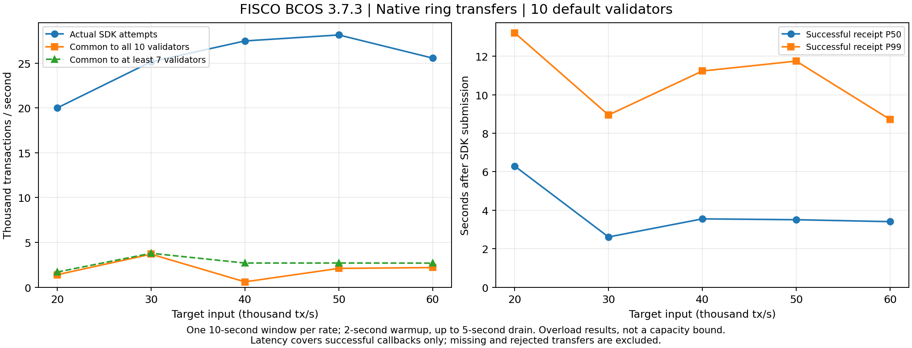

# FISCO BCOS 3.7.3 原生转账复测结果

报告日期：2026-10-23。正式批次：`native-aligned-20261023`。实测驱动版本：`b8ec3b0e882f8ee5ed25e79ebb25943aa9744d21`。

五档实验已完成，本轮未运行 Chain 性能测试。业务已换为 FISCO 内置 C++ 预编译转账 `DagTransferPrecompiled.userTransfer`，地址 `0x100c`，没有部署 Solidity 转账合约。十台均采用原有 FISCO 3.7.3 二进制和原样复制的节点配置。

**这组结果描述默认节点配置、1024 账户环形转账下的过载短测，不能解释为 FISCO 的最大或长期可持续 TPS。** 成功回执 P99 为 8.715–13.216 秒；十节点共同进度为 599–3685 TPS。所有五档的计数窗口和账本前缀证明通过，但 2 万、4 万档在停止时仍有节点落后。账本一致性与完全追平是两个不同检查。

## 已对齐的实验条件

十台原服务器，每台一个验证节点，4 vCPU、约 3.6 GiB 内存，内网通信。1024 个逻辑账户各初始化 1,000,000,000，转账金额 1，账户 i 向 (i+1) mod 1024 转账，与 Chain 的业务路由一致。初始化的 1024 笔交易位于测量之前。

每档一次，全新实验库；预热 2 秒、测量 10 秒、最多 5 秒回调收尾。签名在计时前完成；单个 Java 驱动位于 node01，连接全部十个 SDK 入口；全局在途上限 50,000、4 个发送线程。SDK 3.7.0、JDK 17，客户端异常按错误码完整计数，不逐笔打印拒绝堆栈。未改动节点的日志设置或性能参数。

保留原 PBFT 十节点、`tx_count_limit=1000`、`min_seal_time=500ms`、交易池容量 15000、RPC 线程 4、`is_serial_execute=true`、`enable_dag=true`。签名交易解码为 `to=0x100c`、attribute=5（ABI 与 DAG 标志），原生调用保持 SDK DAG 标志。节点配置文件逐字节校验一致，具体哈希见文末。

## 吞吐量与输入负载

| 目标输入 TPS | 实际 SDK 提交/秒 | 十节点共同 TPS | 至少七节点共同 TPS | TxPoolIsFull 占全部提交 |
|---:|---:|---:|---:|---:|
| 20,000 | 20,000 | 1,395 | 1,694 | 81.4% |
| 30,000 | 25,145 | 3,685 | 3,785 | 79.0% |
| 40,000 | 27,471 | 599 | 2,696 | 83.3% |
| 50,000 | 28,137 | 2,099 | 2,699 | 83.5% |
| 60,000 | 25,555 | 2,191 | 2,689 | 82.4% |

实际 SDK 提交是发起调用次数，既不等于节点接纳量，也不等于执行成功数。拒绝比例使用整个 12 秒发送段的提交次数作为分母；TPS 使用 2–12 秒的测量窗口，两者统计窗口不同。

主 TPS 为十节点最小累计已落块交易计数在两个端点的增量，除以端点 RPC 取得区间中点的时间差。20 个端点均与独立枚举的规范账本区块哈希和累计数相符。实际取得跨度约 10.002–10.042 秒。`summary.csv` 保存取得区间上下界；这些边界表示计时不确定性，不是重复实验的统计置信区间。

“至少七节点共同 TPS”用十个计数排序后的第四小值计算，辅助显示较慢节点的影响。它不是另外采集的 PBFT 提交证书指标，也不能替换主表中的全部十节点口径。

3 万及以上档实际发压未达到目标。不能称这些档位已实测承载 3–6 万 TPS。约 79%–83% 的提交返回交易池满，说明该短测处于明显过载区。SDK 超时并不等于交易最终失败，停机审计对已入块但未收到成功回调的交易逐一复查原生返回码。

## 确认延迟

| 目标输入 TPS | 成功回执 P50（秒） | 成功回执 P99（秒） | 有效回执延迟样本 | 十节点位置一致的成功观察/计划 |
|---:|---:|---:|---:|---:|
| 20,000 | 6.295 | 13.216 | 14,400 | 0/20 |
| 30,000 | 2.609 | 8.947 | 26,692 | 1/20 |
| 40,000 | 3.550 | 11.231 | 19,096 | 0/20 |
| 50,000 | 3.506 | 11.747 | 26,157 | 2/20 |
| 60,000 | 3.406 | 8.715 | 18,783 | 1/20 |

回执延迟从测量期内实际调用 SDK 前的单调时间戳，到收到 `receipt.status=0` 且原生返回码为 0 的回调计算，包含本地 SDK 排队、网络、节点处理和回执返回。它仅描述成功且在收尾预算内拿到回执的交易；拒绝、超时、未回调交易不在分位数内，不能当作所有请求的 P99 保证，也不是纯共识算法耗时。

十节点共同观察每档计划 20 个样本，只有 0、1、0、2、1 个完成。其余包含未发出、被拒绝或观察期内未完成同步的样本。**这些样本不足以给出可靠的十节点确认 P50/P99，更不足以声称比 Chain 快或慢多少倍。** 原始单点/两点观测值仍保留在 JSON 中，不把一个样本的值包装成有统计意义的 P99。

Chain 的已有延迟从发送批次完成到全部节点观察到相同入块位置；FISCO 这里的大样本回执延迟从逐笔 SDK 调用开始。起点、返回条件和最终性语义都不完全相同。本轮不据此输出确认时间的直接倍率。

## 正确性、同步落后与清理

| 目标输入 TPS | 停机后最长账本成功转账 | 全十节点共有成功转账 | 停机后高度范围 | 所有链头追平 |
|---:|---:|---:|---:|:---:|
| 20,000 | 43,010 | 21,010 | 24–46 | 否 |
| 30,000 | 58,006 | 58,006 | 61–61 | 是 |
| 40,000 | 47,004 | 13,004 | 16–50 | 否 |
| 50,000 | 64,373 | 64,373 | 71–71 | 是 |
| 60,000 | 48,004 | 48,004 | 51–51 | 是 |

所有档均通过：1024 账户余额重建、供应总量守恒、规范账本内原生返回码为 0、各节点自身高度的区块哈希/状态根/累计交易数匹配、测量两个端点的 20 项证明。2 万与 4 万档较慢节点都是 node01（同时承载发送器），分别落后 22,000、34,000 笔。3 万、5 万、6 万档停止后链头相同。

主表 TPS 不包含收尾或审计阶段。各节点在 t=17.000–17.062 秒收到控制端停止请求，最迟在 t=17.768 秒完成停止；停机后的交易总数可能包含关停过程中完成的在执行区块，不能称其为严格 t=17 秒的确认总数。

审计时所有测试单位先停止，再逐一单独重开一个验证节点；没有 PBFT 法定人数，不提交新交易，且每次前后账本计数不变。最长账本执行完整余额重建，其他节点的持久化链头及状态根按各自高度匹配该账本。审计完成、证据保存、进程和路径检查通过后，删除每轮独立测试数据库。

最终十台 `chain-node` 与 `fisco-bcos` 均为 active/enabled；没有原生复测残留数据库或测试进程，常驻数据目录保留。结束检查发现临时包装脚本在 EXIT 时因工作目录改变未加载 Ansible inventory，遗漏了 Chain 服务恢复；已直接恢复并重新核验。仓库的新 `Run.sh` 固定 inventory 工作目录并在恢复完成后写退出码，保存的原始批次日志保留此次问题。

## 之前批次如何处理

最初 `native-aligned-20261022` 的总在途额度误设为 5000，实际输入约 6000 TPS，已证明的共同吞吐约 5,871–6,305 TPS。它只作为低实际输入、受回压约束的诊断数据保留，不能混入 2–6 万目标负载正式表。其吞吐高于本轮过载结果，本身就说明 **本轮最高 3685 TPS 不是 FISCO 的能力上限**。

随后 `native-aligned-20261022b` 恢复 50000 在途，但只连接单个入口，在首档出现 node01 落后、交易池满和大量 SDK 异常堆栈；零成功延迟样本触发了汇总字段缺失，批次中断。该批次没有包装成成功结果。新批次修复空样本、每轮观察缓存、客户端多入口及逐笔日志问题，所有失败与诊断记录均保留。

最初 Solidity 与 Chain 原生转账的约 2.02 倍结论不再作为原生对原生或共识优越性的证据。本轮已经对齐业务账户数、路由、金额、准备阶段、时间窗口和硬件，但仍存在 FISCO 逻辑用户名与 Chain 公钥/连续序号账户、ECDSA 与 Ed25519、TLS 与编码、SDK 入口选择与 Chain 逐笔广播、默认封块设置、持久化及最终性等差异。node01 同时承载发送器也会影响其追平速度。因此适合作为指定配置的系统压力结果，尚不支持严格的共识算法倍率或最终确认速度结论。

## 证据与复现

- FISCO 二进制：`3.7.3`，上游提交 `5811f123b0a82928de8ec662e84763d67c16fb1e`。
- 十台二进制 SHA-256：`7c29bd2afe615a57af02a440fc4d665c3beec3cf7301ec4007cc07caf5b683f4`。
- `config.ini` SHA-256：`7867a2b0e3d674260954dd354b8eea47a3b780570d5e7c6b54ddb90cf0548676`。
- `config.genesis` SHA-256：`3e76abec0b7bc8a98aca9415063bf8c746742772afbdd8f9d50a6a16e42f0729`。
- 原始证据：`native-retest-20261023-evidence.tar.gz`，75,534,557 字节，SHA-256 `1566e7cdcc5810089bca2e97d143341106772aed49138c7a1320ac386b7775c2`；本地下载后已核对。包括正式五档、冒烟测试、两批诊断、RPC/端点/回执/状态与节点证据。大体积签名输入保留控制机，哈希和位置写入各节点证据包；归档排除私钥与实验数据库。
- 汇总：`summary.csv`、`summary.json`；实验结束后验：`postflight.json`；源方法：仓库 `Test/Fisco/Aligned/Analyze.py`，对解压后的 `native-aligned-20261023` 目录运行即可重算，不连接服务器。
- 账本观察得到的数据均来自本轮实测，未用目标输入或 SDK 提交量填充缺测结果。每档仅一次短测，没有长期稳定性或统计显著性结论。

原生路径的官方版本源码：[DagTransferPrecompiled.cpp（v3.7.3）](https://github.com/FISCO-BCOS/FISCO-BCOS/blob/v3.7.3/bcos-executor/src/precompiled/extension/DagTransferPrecompiled.cpp)。
