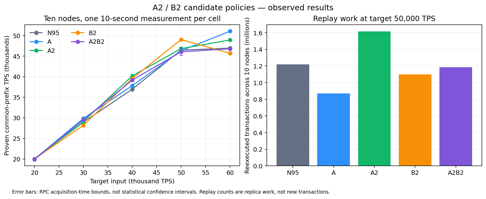

# A2/B2 十节点候选策略实验

最高有效观测为 **A：51,065.42 TPS**（目标 60,000，实际发送 50,854.4 TPS）。

本报告比较 N95（历史 P95）、A（上一版决策预测）、A2（预测缓存与有界残差校准）、B2（父分支/候选保留学习）及 A2B2。最高观测不等于稳定最优；每格一次短测不能建立统计显著性。

## 本轮判断

**最大观测继续由 A 取得；新方案中，B2 在相同 50,000 输入档最有价值，但尚未稳定胜出。** 本轮 A 是旧策略在同一个新二进制及共同测量配置下的对照，不是直接使用上轮历史数字。

- 50,000 档实际发送均为 49,996.8 TPS：B2 为 49,034.09 TPS，相对 N95 的 46,458.33 提高 5.54%；共同可见 P95 从 1,872.63ms 降至 1,690.15ms，下降 9.74%。它执行了 14 次让步，重放从 1,221,456 降至 1,098,384 笔（下降 10.08%）。迟到并未下降：105→106，不能把这里的收益解释为更准确的时钟或更少迟到。以上是一次同负载观测及机制关联，不是完整因果证明。
- A2 的缓存确实有效：50,000 档预测从 A 的 17,494 次降至 465 次，减少 97.34%，另有 14,961 次缓存命中。但十节点合计预算路径墙钟仅从 113.12ms 降至 18.20ms，相当于平均每节点每秒约 0.95ms，远小于节点约 3.9/4 核的整体忙碌程度。它不是主要 CPU 瓶颈。A2 的重放反而比 A 多（1,615,952 对 870,976），所以不能从调用次数下降推导明显 TPS 收益。
- 60,000 目标档，A 观测 51,065.42 TPS；B2 只有 45,707.13 TPS，且测量期只让步 2 次。A2B2 在该档没有价值模型让步，却与 A2 有明显差异，这再次说明短测的分支演化及运行波动不能忽略。组合策略没有取得最高成绩。
- A 在 60,000 档的迟到率为 27/463≈5.8%，N95 为 104/453≈23.0%；重放分别为 962,416 和 1,313,728 笔。这支持更合理准备预算减少无效工作的解释。两组实际发送不同（50,854.4 与 49,728.0 TPS），不能将全部吞吐差异归因于模型。A 的共同可见 P95 达 3,595.19ms，也说明最高短窗 TPS 不等于最好实时性。

下一步更值得补充“相对已经存在候选的增量贡献/成本”标签。当前 B2 学的是局部候选保留概率；一个区块即使最终保留，也可能已经被其他节点准备好，不能证明再次本地准备有额外价值。现有数据可以支撑后续独立训练，但本轮没有在线调阈值追逐最高分，也没有增加统计重复次数。

## 实现与训练边界

- A2 继续使用冻结 preparation-v2.json，在已有 32 维特征上刷新队列和工作历史；新增按状态/轮次/工作版本/负载档位缓存，最长 10ms，以及分拥塞上下文的有界残差 P95 校准。未加入精确候选账户扫描或重新训练真实时间误差头。
- B2 是两个小型在线逻辑回归头：父分支在延后观察中保留，以及父分支保留条件下候选保留。每次进程从零权重开始；两个头各有 12 个已观测样本后才可能让步。旧数据没有这些标签，因此没有冒称完成离线预训练。
- 标签来自准备完成后首次主循环观测，年龄限于 250–500ms；超时、祖先不可见或退出删失。仅实际完成的准备产生标签，不推断被跳过工作的反事实结果。评价概率在决策时保存。
- B2 根据已选目标轮次判断，必须有同父候选可走原提交流程，连续最多让步两次。各组统一开启生命周期跟踪；N95/A/A2 运行影子价值模型，只有 B2/A2B2 允许采取行动。
- 共识排序、签名与账户检查、同步落盘和每轮一次准备约束保持原有规则。默认不开启新策略。

## 固定协议

十台物理机、每台一个节点；同一份 720,000 笔签名原生转账、1,024 账户、批次 128、顺序广播。50ms 轮次、12ms 候选窗口、最大 6,000 笔/块，4 个 I/O、8 个验签、2 个查询线程，sync=1。发送端仍与 node01 共享机器。每格预热 2 秒、测量 10 秒、排空最多 5 秒，版本顺序轮换。

各节点原子发布本地已持久化链头和最多 256 个祖先；观察端在十份快照中求共同前缀。RPC 区间跨度超过 0.5 秒、前缀缺失或停机后锚点核对失败的结果不参与排名。单节点原子快照不是全局原子快照。

所有组统一以 20Hz 抽样交易，测量期计划 200 笔；延迟为首次在十节点观察到同一交易位置的时间，包含查询和轮询，不能解释为不可逆最终确认。只对已观察完成的样本计算分位数，必须结合未完成样本数阅读。

有效单元格 **25/25**；修正测量驱动后的批次共进行 26 次负载尝试，状态核对通过 26/26 次。修正前作废的 9 次负载另列于下方。

## 共同链 TPS

| 目标输入 | N95 | A | A2 | B2 | A2B2 |
|---:|---:|---:|---:|---:|---:|
| 20000 | 20,005 | 19,991 | 19,991 | 20,003 | 19,896 |
| 30000 | 28,962 | 29,845 | 29,090 | 28,193 | 29,551 |
| 40000 | 36,951 | 37,818 | 40,201 † | 39,573 | 39,177 |
| 50000 | 46,458 | 46,315 | 46,825 | 49,034 | 46,056 |
| 60000 | 46,949 | 51,065 | 48,931 | 45,707 | 46,783 |

— 表示没有合格结果，不是零 TPS。只有原测量无效时才采用同参数、同数据集、新数据库的诊断复测；全部尝试保存在 summary.json。

## 50,000 档机制与实时性

| 版本 | 实际发送 TPS | 共同链 TPS | 迟到/准备 | 重放交易 | CPU 核/节点 | P95 共同可见 ms | 未完成/样本 |
|---|---:|---:|---:|---:|---:|---:|---:|
| N95 | 49,996.8 | 46,458.33 | 105/442 | 1,221,456 | 3.91 | 1,873 | 0/200 |
| A | 49,996.8 | 46,315.48 | 19/456 | 870,976 | 3.89 | 2,112 | 0/200 |
| A2 | 49,996.8 | 46,825.43 | 13/324 | 1,615,952 | 3.91 | 1,691 | 0/200 |
| B2 | 49,996.8 | 49,034.09 | 106/531 | 1,098,384 | 3.92 | 1,690 | 0/200 |
| A2B2 | 49,996.8 | 46,055.66 | 23/348 | 1,186,560 | 3.91 | 1,841 | 0/200 |

## 决策开销与价值模型行动

下表为十节点测量端点之间的合计。墙钟累计包含等待/抢占，不等于 CPU 独占时间；B2 标签数与动作数也不是节省 CPU 的直接证明。

| 50,000 档版本 | 准备预测次数 | 缓存命中 | 预算路径墙钟 ms | 模型推理墙钟 ms | B2 让步 | 父分支/候选标签 |
|---|---:|---:|---:|---:|---:|---:|
| N95 | 0 | 0 | 26.53 | 0.00 | 0 | 422/397 |
| A | 17,494 | 0 | 113.12 | 7.36 | 0 | 424/412 |
| A2 | 465 | 14,961 | 18.20 | 1.14 | 0 | 283/272 |
| B2 | 0 | 0 | 9.18 | 0.00 | 14 | 498/452 |
| A2B2 | 521 | 16,550 | 84.24 | 17.61 | 1 | 330/315 |

## 60,000 目标档的实际输入与实时性

| 版本 | 实际发送 TPS | 共同链 TPS | 共同可见 P95 ms | 实际延迟样本 |
|---|---:|---:|---:|---:|
| N95 | 49,728.0 | 46,948.62 | 3,414.13 | 166 |
| A | 50,854.4 | 51,065.42 | 3,595.19 | 170 |
| A2 | 51,609.6 | 48,931.32 | 4,082.61 | 173 |
| B2 | 50,611.2 | 45,707.13 | 3,933.06 | 169 |
| A2B2 | 51,404.8 | 46,783.20 | 3,592.48 | 172 |

60,000 只是目标速率，发送器实际约为 49.7k–51.6k。短窗口内共同链也可能消化预热阶段积压，因此 A 的观测 TPS 略高于窗口内发送率不代表额外交易或长期容量。各格已发送的延迟样本均被观察到；高目标档因发送器达不到目标而没有产生全部计划样本。

## 测试、计量修复与恢复

运行代码提交 `d28a2fb2146a9afcff4f8f0758cd7c248e1023b6`；修正测量驱动提交 `c2c0c38536768f2d8a596c4c4f215e89470555a6`。Windows 与 Linux 核心十四项 CTest 全部通过；响应协议修复后 Windows 全套再次通过，Linux 补跑 ClockTools、ClockNetwork、ExperimentNetwork 对应脚本通过。初次本地回归两项因复用旧目录拒绝启动，随后使用全新隔离目录验证。

首次云端批次有 9 个已完成负载轮次因旧客户端 16KiB 响应上限拒收大祖先快照，没有有效 TPS；第十格在发压前中断。原始证据保留。修复为统计响应最多 64KiB、其他查询维持 16KiB，并补足大响应及超限拒收回归后重跑固定矩阵。

修正批次 25 轮中只有 A2/40,000 的采集跨度超过预设上限，所有已捕获锚点均在十份持久化状态中匹配；该格同参数、原始签名数据、新数据库诊断复测一次，表中标 †。未替换任何原本有效的结果。

包括作废测量在内共 **35 个负载轮次全部通过十节点持久化余额、nonce、费用核对**；连同一次发压前中断，共 360 份独立测试数据库均已删除。十台常驻 Chain/FISCO 服务均恢复 active/enabled，无遗留实验进程或数据库，常驻服务未切换为新实验策略。

## 结论解释范围

只有在实际发送速率接近、端点合格且状态核对通过时才能进行同档比较。模型降低迟到或重放，但没有提高共同链 TPS，应如实认为尚未验证吞吐收益；模型不触发行动的版本差异也不能归因于其决策。

五组没有进一步拆分 A2 缓存与校准各自的贡献，也没有覆盖网络抖动、异常报时或恶意节点注入。B2 的局部短期保留标签不是全网最终收益，当前短测没有证明长期稳定容量、跨场景泛化或统计显著改进。

## 复核材料

`data/summary.json` 包含每格固定选择结果及全部修正批次尝试；`data/protocol.json`、`data/evidence.json` 保存版本、数据集和原始证据 SHA256。完整原始记录另保存在本次交付目录的 `raw-invalid.tar.gz`、`raw-main.tar.gz`、`raw-retry.tar.gz`，没有提交签名工作负载二进制、私钥或实验数据库到 Git。

方法脚本的运行位置和离线复核入口见 [methods/README.md](methods/README.md)。
