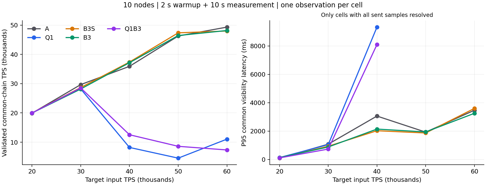

# Q1/B3 十节点部署与测试

最高有效观测为 **A：49,343.75 TPS**，目标 60,000、实际发送 51,929.6 TPS。

## 本轮结论

**保留 A 作为当前性能对照；本轮没有验证 Q1/B3 提高最高 TPS。Q1 的现实现有明显高负载退化，不建议启用为常驻配置。**

- 目标 60,000 时，A 为 49,343.75 TPS；B3 为 48,184.21 TPS，变化 -2.35%。B3 的共同可见 P95 为 3,257.61ms，较 A 变化 -6.19%，重放变化 -49.98%；这表示本轮重放和时延有改善迹象，但吞吐没有胜出。
- 目标 50,000、实际输入同为 49,996.8 时，B3 相对 A 的 TPS 变化仅 +0.37%，相对 B3S 为 -1.94%；不足以宣称行动策略提高吞吐。60,000 档 B3 相对 B3S 的 TPS 变化 +0.36%，但实际发送率也变化 +2.47%。
- Q1 在 40k/50k/60k 三档分别仅约 8.2k/4.5k/11.0k TPS，同时压低实际发送率。它的元数据等待确实下降，但新共享验签门控和落后节点成为主要疑点，不能用局部排队改善代替共同链吞吐。
- B3 的全部有效建议均来自 `full_alternative` 满块规则，`low_marginal_value` 学习建议为零。B3 active 在 50k/60k 的第 12 秒，十个进程均未取得 16 个训练标签；因此本轮没有证明学习模型本身产生收益。

## 固定比较

| 组 | 说明 |
|---|---|
| A | 同一二进制的原 A 策略对照，Q1/B3 关闭 |
| Q1 | A + 独立元数据通道、冷验签预算 3、分段池选择 |
| B3S | A + B3 影子模式，只记录建议 |
| B3 | A + B3 有界行动 |
| Q1B3 | A + Q1 + B3 有界行动 |

五组均使用 learned、决策时 P95 准备、冻结 preparation-v2、生命周期和 B2 影子模型；B2 不行动。B3 每个进程从零开始在线更新，满块替代规则与学习建议分开计数，未根据本轮结果调整阈值。

十台服务器，每台一个节点；50ms 轮次、12ms 候选窗口、6,000 笔/块、sync=1、4 个 I/O、8 个交易验证、2 个查询线程。共用 720,000 笔签名原生转账、1,024 个账户、128 笔批次、顺序广播。每格预热 2 秒、测量 10 秒、收尾最多 5 秒，各一次，按速率轮换版本顺序。发送器与 node01 共享机器。

## 共同链 TPS

| 目标输入 | A | Q1 | B3S | B3 | Q1B3 |
|---:|---:|---:|---:|---:|---:|
| 20000 | 19,900 | 19,990 | 19,990 | 19,991 | 19,991 |
| 30000 | 29,692 | 28,194 | 28,681 | 28,194 | 28,529 |
| 40000 | 35,931 | 8,204 | 37,397 | 37,177 | 12,545 |
| 50000 | 46,295 | 4,544 | 47,382 | 46,465 | 8,588 |
| 60000 | 49,344 | 11,039 | 48,012 | 48,184 | 7,341 |

## 共同可见 P95 时延（毫秒）

| 目标输入 | A | Q1 | B3S | B3 | Q1B3 |
|---:|---:|---:|---:|---:|---:|
| 20000 | 98 | 136 | 115 | 141 | 114 |
| 30000 | 1,082 | 1,052 | 936 | 883 | 736 |
| 40000 | 3,063 | 9,331 | 2,030 | 2,145 | 8,101 |
| 50000 | 1,930 | 1,989 † | 1,871 | 1,943 | 12,911 † |
| 60000 | 3,472 | 2,776 † | 3,601 | 3,258 | 6,856 † |

时延按 20Hz 抽样，从发送到首次在十节点观察到同一交易位置，包含查询与轮询等待。只对已完成样本计算分位数；它不是不可逆最终确认时间。† 表示存在未完成样本，显示值仅描述完成子集，不能当作总体 P95 或据此宣称时延改善。

## 实际输入与样本完成度

| 目标 | 组 | 实际发送 TPS | 有效共同链 TPS | P95 ms | 未完成/实际样本 |
|---:|---|---:|---:|---:|---:|
| 20000 | A | 19,993.6 | 19,900.34 | 98.0 | 0/200 |
| 20000 | Q1 | 19,993.6 | 19,990.09 | 136.4 | 0/200 |
| 20000 | B3S | 19,993.6 | 19,990.15 | 115.3 | 0/200 |
| 20000 | B3 | 19,993.6 | 19,990.65 | 141.5 | 0/200 |
| 20000 | Q1B3 | 19,993.6 | 19,990.82 | 113.8 | 0/200 |
| 30000 | A | 30,003.2 | 29,692.33 | 1,082.4 | 0/200 |
| 30000 | Q1 | 30,003.2 | 28,194.16 | 1,051.7 | 0/200 |
| 30000 | B3S | 30,003.2 | 28,681.03 | 936.3 | 0/200 |
| 30000 | B3 | 30,003.2 | 28,194.22 | 882.6 | 0/200 |
| 30000 | Q1B3 | 30,003.2 | 28,528.98 | 735.9 | 0/200 |
| 40000 | A | 40,000.0 | 35,931.45 | 3,062.9 | 0/200 |
| 40000 | Q1 | 24,972.8 | 8,203.95 | 9,330.8 | 0/125 |
| 40000 | B3S | 40,000.0 | 37,396.70 | 2,030.1 | 0/200 |
| 40000 | B3 | 40,000.0 | 37,177.22 | 2,144.9 | 0/200 |
| 40000 | Q1B3 | 28,505.6 | 12,544.77 | 8,101.2 | 0/143 |
| 50000 | A | 49,996.8 | 46,295.42 | 1,930.3 | 0/200 |
| 50000 | Q1 | 22,169.6 | 4,544.05 | 1,988.5 | 87/89 |
| 50000 | B3S | 49,996.8 | 47,382.45 | 1,870.6 | 0/200 |
| 50000 | B3 | 49,996.8 | 46,465.21 | 1,943.2 | 0/200 |
| 50000 | Q1B3 | 25,177.6 | 8,587.88 | 12,911.0 | 17/101 |
| 60000 | A | 51,929.6 | 49,343.75 | 3,472.4 | 0/174 |
| 60000 | Q1 | 21,747.2 | 11,038.74 | 2,775.8 | 53/73 |
| 60000 | B3S | 50,828.8 | 48,011.88 | 3,601.4 | 0/170 |
| 60000 | B3 | 52,083.2 | 48,184.21 | 3,257.6 | 0/174 |
| 60000 | Q1B3 | 20,480.0 | 7,341.45 | 6,856.3 | 63/65 |

## 高负载机制

以下是测量端点之间十节点累计增量。CPU 为每节点占用核数的中位数；锁/等待均为累计墙钟，不能相加后当成 CPU 时间。

| 目标 | 组 | CPU 核/节点 | 迟到/准备 | 重放交易 | B3 满块规则建议 | B3 学习建议 | B3 实际让步 | B3 标签 |
|---:|---|---:|---:|---:|---:|---:|---:|---:|
| 50000 | A | 3.90 | 31/455 | 982,272 | 0 | 0 | 0 | 0 |
| 50000 | Q1 | 2.31 | 1/666 | 1,611,753 | 0 | 0 | 0 | 0 |
| 50000 | B3S | 3.91 | 11/383 | 1,398,528 | 70 | 0 | 0 | 62 |
| 50000 | B3 | 3.91 | 34/454 | 859,872 | 108 | 0 | 108 | 11 |
| 50000 | Q1B3 | 2.51 | 1/561 | 2,009,065 | 11 | 0 | 11 | 15 |
| 60000 | A | 3.92 | 22/414 | 968,304 | 0 | 0 | 0 | 0 |
| 60000 | Q1 | 2.49 | 0/708 | 1,916,430 | 0 | 0 | 0 | 0 |
| 60000 | B3S | 3.92 | 33/540 | 690,000 | 108 | 0 | 0 | 93 |
| 60000 | B3 | 3.92 | 38/563 | 484,368 | 99 | 0 | 99 | 4 |
| 60000 | Q1B3 | 2.09 | 1/861 | 1,137,872 | 5 | 0 | 5 | 14 |

## 质量与解释

有效单元格 25/25；共 25 次负载尝试，25 次通过十节点持久化余额、nonce、供应量与费用核对。

只有十节点祖先快照交集存在、两个端点采集跨度均不超过 0.5 秒、停止后十份持久化链上锚点复核通过的 TPS 才参与比较。采集区间上下界是计量边界，不是统计置信区间。无效原测量只允许同参数、新数据库的诊断复测；所有尝试保留，不替换有效低成绩。

A 对 Q1 检验调度与池锁组合；B3S 对 B3 检验相同模型开销下的行动效果；Q1B3 尚未完整拆分交互与推理开销。单次短测只能判断本轮观测，不能证明统计显著提升或长期最高容量。若收益只伴随满块规则动作，应归于规则，而不能称作学习模型提高了 TPS。

## 退化定位

Q1 的独立元数据通道达到了局部目标：50k 档每条元数据累计排队均值从 A 的约 17.07ms 降到 0.91ms。但共享验签许可在 10 秒测量窗口内平均每节点累计等待约 34.53 秒，属于多个线程重叠等待；其中 node09 为 108.34 秒。节点验签完成数均值约 240,648，A 为 492,152。不能把这些墙钟等待直接解释为消耗的 CPU 秒数。

Q1/50k 的 node09 测量期只推进 41,216 笔本地链交易，其他节点约 242k–248k；端点时 node09 为 107,776 笔，其他节点均为 318,848 笔。这解释了为什么共同链只有约 4,544 TPS，远低于多数节点的本地推进速度。node09 的交易验签队列达到 32,768，区块队列为 39,392；顺序广播的发送端也受慢节点背压。Q1/40k 的 node06、node09 同样出现明显落后，故不能只将问题归为某一台机器偶然变慢。

结合代码，`VerificationBudget::Enter/Leave` 在每次冷验签上竞争同一互斥锁，并在授予/释放时唤醒等待线程；普通交易与区块优先请求共享三个许可。这是新增同步和队列耦合开销的直接排查点。当前证据支持“共享门控与落后节点放大了拥塞”，但没有独立拆分元数据通道、池分段和验签预算的因果贡献，也没有采集上下文切换或 CPU 火焰图，不能声称已经证明唯一根因。

分段路径的池锁持有时间在 Q1/50k 平均每节点约 0.061 秒；元数据更快、池锁等待下降、迟到更少，却伴随输入受限和共同链退化。这些局部指标不能单独作为优化成功标准。下一轮应先拆开 Q1 三个开关，单测元数据通道与池分段，并改为批次或任务级验签许可，避免逐签名全局锁与反复全体唤醒；本轮没有追加这类消融测试。

B3/60k 的重放从 A 的 968,304 降到 484,368 笔，但 CPU 中位数仍约 3.92/4 核，验签量没有减少，TPS 仍低于 A。它在测量期执行的 99 次让步全部为规则动作。满块规则跳过准备后，恰好也减少了可供在线学习的真实标签；50k/60k active 每节点到第 12 秒只有 0–3 个、0–2 个标签。后续可利用独立训练轮或保留有界探索来解决冷启动，但需与规则单独对照，不能把本轮规则作用记作机器学习效果。

## 时延删失

Q1/50k 只产生 89 个实际抽样交易，其中 87 个在观测截止前未完成，仅两笔完成交易的 P95 约 1,989ms；这个数字不能用于总体实时性比较。Q1/60k 为 53/73 未完成，Q1B3/60k 为 63/65 未完成。曲线中不展示有未完成样本的 P95，完整表格保留完成子集数值并标 †。实际样本数不足计划 200 还受发送速率不足影响，两种缺失原因分别保留。

## 部署、验证与恢复

节点实现基于 `97dc3379431263167fd3068881a09a1252f367cc`；实际发布提交为 `6ca799a49ce1a3a7ab264ccdda2baaa0d0cd71dd`，后者只增加固定实验入口与分析字段。Linux 十四项 CTest 全通过（58.80 秒），开启 Q1 的额外 EVM 十一组检查通过；此前本地 Windows 回归见 `../2026-10-23-q1-b3-local/REPORT.md`。十台部署同一二进制，SHA-256 为 `50e5f3fa0e913383f4e61ab6d89a292d72e4bd31b5569144a01be0dacc760851`。

25 个原始单元格均有效，无诊断重跑、无替换有效低成绩。250 份实验节点数据库全部清理，控制节点额外 26 份回归数据库也已清理，保留签名数据、创世配置、源码、二进制和日志。十台无遗留本轮实验进程，Chain/FISCO 均恢复 active/enabled；常驻原有 1,000 笔交易、每节点 34 个账户、九个邻居复核通过。

新版本保留在每台 `/opt/chain/releases/6ca799a49ce1a3a7ab264ccdda2baaa0d0cd71dd`，已用于全部实验。常驻服务恢复原先 `070fbb4` 发布与配置，没有将退化的 Q1 设置成默认运行策略。

## 复核材料

`data/summary.json` 保留全部 25 个原始结果及排序依据；`data/mechanisms.json` 保留节点端点增量、模型标签及规则/学习动作拆分；`data/protocol.json`、`data/linux-validation.json` 和 `data/evidence.json` 记录固定参数、版本与归档校验。原始证据压缩包及完整节点轨迹保留在本机交付目录的 `raw-main.tar.gz`，未向 Git 提交签名二进制、私钥、运行日志或数据库。方法和复算入口见 [methods/README.md](methods/README.md)。
