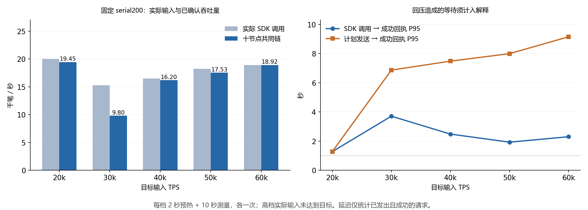

# FISCO BCOS 3.7.3 原生转账容量复测

日期：2026-10-26。十台原服务器，每台一个 PBFT 验证节点、4 vCPU。业务为内置 `0x100c` 的 `userTransfer`，不是 Solidity 合约。完成 1 次冒烟、12 个配置/压力对照和 5 档正式短测。本轮没有运行 Chain 压测。

**当前测得的短时吞吐量在 2 万 TPS 附近：调参最高 20,534 TPS，固定配置的正式五档最高 19,453 TPS。不能将任一个数值称为已经证明的长期可持续上限。** 更高目标压力主要增加发送端排队，并可能触发提案验证超时和视图切换。之前默认配置的 599–3,685 TPS 是过载短测结果，确实没有代表这组机器的容量。

同样值得保留的是低延迟配置：串行执行、50 ms 最小封块时间、每块最多 6,000 笔，在目标 20k 的一次对照中得到 **19,786 TPS、回执 P95 639 ms、P99 785 ms**。它具有较好的吞吐量与延迟组合，但仍是一次 10 秒短测，不能承诺长期亚秒确认。

## 正式五档结果

正式批次 `cap-formal-20261026` 在运行前固定使用 `serial200`，没有按档位事后选择最好配置：串行执行、最小封块 200 ms、区块上限 20,000、交易池 50,000、leader 周期 5、验签线程 4、RPC 线程 4、notify 线程 2、warning 日志。每节点一个 SDK 发送器、各自连接本机节点；每个发送器在途阈值 3,000，全局约 30,000。TLS、签名校验、十节点 PBFT 和持久化路径保留。

| 目标输入 TPS | 实际 SDK 调用/秒 | 十节点共同链 TPS | 成功回执 P95 | 成功回执 P99 | 计划发送起点 P95 |
|---:|---:|---:|---:|---:|---:|
| 20,000 | 19,999.9 | **19,452.6** | 1.275 s | 1.472 s | 1.275 s |
| 30,000 | 15,275.1 | 9,797.2 | 3.704 s | 8.969 s | 6.864 s |
| 40,000 | 16,469.1 | 16,200.1 | 2.476 s | 2.732 s | 7.479 s |
| 50,000 | 18,218.4 | 17,526.6 | 1.922 s | 2.148 s | 7.992 s |
| 60,000 | 18,917.4 | 18,919.1 | 2.296 s | 3.213 s | 9.150 s |

实际 SDK 调用不是接纳确认，更不是执行成功 TPS。高档位受到发送器在途阈值回压，实际调用速率远低于目标；这些数据没有证明 FISCO 承载了 30k–60k 的有效输入。共同链 TPS 偶尔略高于当期调用速率，是因为测量窗口消化了预热阶段的交易。

| 目标 TPS | 12 秒计划请求数 | 实际调用数 | 截止时尚未调用 | 失败回调 | 未决回调 | 测量期回执延迟样本 |
|---:|---:|---:|---:|---:|---:|---:|
| 20,000 | 240,000 | 239,999 | 1 | 0 | 0 | 199,999 |
| 30,000 | 360,000 | 191,575 | 168,425 | 0 | 0 | 152,751 |
| 40,000 | 480,000 | 225,291 | 254,709 | 0 | 0 | 164,691 |
| 50,000 | 600,000 | 229,243 | 370,757 | 0 | 0 | 182,184 |
| 60,000 | 720,000 | 249,957 | 470,043 | 0 | 0 | 189,174 |

未调用的请求不属于节点拒绝，也不能算成功。回压减少了无效提交和交易池满错误；必须同时披露未调用数，不能用零拒绝率掩盖目标负载未达到。

## 配置对照与选择依据

下表完整保留 12 个配置/压力对照。每个用例新数据库，预热 2 秒、测量 10 秒、最多 5 秒收尾，各配置点一次。`parallel` 表示 `is_serial_execute=false` 的 DMC 执行路径；交易始终保留 ABI/DAG 标志，不能仅凭标志就认定任意执行路径获得了并行收益。

| 批次 | 配置 | 目标 TPS | 共同 TPS | 回执 P95 | 每发送器在途阈值 |
|---|---|---:|---:|---:|---:|
| tune | parallel100：100 ms / 10,000 笔 | 20,000 | 17,462 | 2.058 s | 3,000 |
| tune | parallel200：200 ms / 20,000 笔 | 20,000 | 15,497 | 2.252 s | 3,000 |
| tune | serial100：100 ms / 10,000 笔 | 20,000 | 19,341 | 0.778 s | 3,000 |
| tune | parallel50：50 ms / 6,000 笔 | 20,000 | 18,801 | 2.118 s | 3,000 |
| tune2 | serial50：50 ms / 6,000 笔 | 20,000 | 19,786 | **0.639 s** | 3,000 |
| tune2 | serial200：200 ms / 20,000 笔 | 20,000 | 19,815 | 1.612 s | 3,000 |
| tune2 | serial100 + 交易树传播 | 20,000 | 7,046 | 5.238 s | 3,000 |
| tune2 | serial100 + 验签线程 2 | 20,000 | 17,319 | 2.129 s | 3,000 |
| tune3 | serial50 + 不返回输入参数 | 20,000 | 14,233 | 3.958 s | 3,000 |
| tune3 | serial50 + 不返回输入参数 | 30,000 | 15,327 | 5.110 s | 3,000 |
| tune3 | serial200 | 30,000 | **20,534** | 2.010 s | 3,000 |
| tune4 | serial50 + 较低在途阈值 | 30,000 | 19,657 | **0.648 s** | 1,000 |

正式批次之前，serial200 在 30k 对照中取得最高吞吐量，因此选为正式配置。正式 30k 却降到 9,797 TPS，说明该配置在高压力下存在明显波动，调参最高值不能替代固定配置的正式结果。

tune4 是看到正式批次的超时证据后增加的一次针对性配置诊断，不混入正式五档排名。其 10 秒测量中没有记录到提案验证超时或视图超时；回执 P99 701 ms，吞吐量仍接近 2 万。实际调用速率只有 19,270/秒，12 秒计划 360,000 笔中有 123,559 笔未调用，计划起点 P95 为 **4.308 秒**。这支持降低排队的方向，但不能证明亚秒承载 30k。

从本轮单次短测看，serial50 更适合后续吞吐量与延迟兼顾的验证，serial200 只保留为容量候选。串行路径在本次轻量转账、1024 账户共享环和 4 核节点条件下优于已测 DMC 路径；没有证据据此推论所有合约、硬件和账户分布都应关闭并行执行。交易树传播、减验签线程、不返回输入参数均没有获得可复现收益，也不能只靠一个短测认定其必然有害。

## 当前瓶颈的证据

正式 20k 用例平均每台节点进程消耗 **3.178 核**，SDK 消耗 **0.391 核**，整机平均空闲 **1.6%**；CPU steal 为 0，iowait 约 0.005%。十台都在承担发送端工作，这一配置下已接近 4 vCPU 预算。线程采样显示网络/IO 服务与节点工作线程占用显著；当前采样没有函数级栈，不能进一步把主要 CPU 成本精确归因到验签、编解码或交易执行。

正式 30k 用例平均空闲反而上升至 **31.2%**。测量窗口内，十节点日志合计记录 7 条提案验证超时、1 条提案补传失败、5 条视图超时，只有 12 个共同确认区块。日志条数是各副本事件总数，不是 5 次独立的全网视图切换。node01 的关键记录包括 14:31:10.867 的提案验证 timeout、14:31:10.988 的已提交提案补传 timeout，以及 14:31:15.693 的视图超时，均位于实际测量窗口。

这表明高压力时既有资源限制，也有共识等待和补传停顿。不能将低 TPS 全部解释为 CPU 不够。正式 40k 的测量期也出现 5 条提案验证超时、1 条补传失败；50k 没有这些超时，但仍存在较高排队。没有重复样本和函数级诊断，暂不把某个参数单独认定为全部波动的根因。

v3.7.3 的交易同步配置类将网络请求超时初始化为 **500 ms**，PBFT 日志同步使用 **1,000 ms** 的请求超时。它们与视图超时不是同一个参数；本轮没有找到将前者直接暴露为普通 INI 调整项的初始化路径，因此没有随意添加无效配置，也没有修改官方二进制。源码依据：[TransactionSyncConfig.h](https://github.com/FISCO-BCOS/FISCO-BCOS/blob/v3.7.3/bcos-txpool/bcos-txpool/sync/TransactionSyncConfig.h)、[TransactionSync.cpp](https://github.com/FISCO-BCOS/FISCO-BCOS/blob/v3.7.3/bcos-txpool/bcos-txpool/sync/TransactionSync.cpp)、[PBFTConfig.h](https://github.com/FISCO-BCOS/FISCO-BCOS/blob/v3.7.3/bcos-pbft/bcos-pbft/config/PBFTConfig.h)、[节点配置读取](https://github.com/FISCO-BCOS/FISCO-BCOS/blob/v3.7.3/bcos-tool/bcos-tool/NodeConfig.cpp)。

正式 20k 用例每台平均网络收发合计约 0.552 Gbit/s。该值为 RX+TX，不是单向链路利用率；没有链路容量和排队证据，不能宣称网卡已满。内存没有耗尽证据。以上观测支持“降低过度排队、控制块大小、避免 SDK 与节点抢占过多 CPU”的下一步方向，尚不足以证明已经穷尽所有配置可能性。

## 实验口径与复现边界

十个发送器共用 1024 个逻辑账户，各初始余额 1,000,000,000，金额 1，全局下标 i 的交易为账户 i mod 1024 向下一账户转账。初始化按账户号分片，总计仍为 1024 笔。原生交易地址 `0x100c`，attribute=5，签名在计时前准备；成功同时要求回执状态 0 与原生返回码 0。[原生实现](https://github.com/FISCO-BCOS/FISCO-BCOS/blob/v3.7.3/bcos-executor/src/precompiled/extension/DagTransferPrecompiled.cpp)

主 TPS 使用十节点最小累计已落块计数的端点增量，除以控制端两次采集区间中点的时间差；初始化不进入吞吐量。每个端点的区块哈希与累计数均在停机后规范账本中核对。18 个用例全部通过端点证明，正式采集跨度约 14–72 ms，均小于 0.5 秒准入阈值。`tps_bounds` 是采集区间造成的计时边界，不是统计置信区间。

回执延迟覆盖测量窗口内实际调用 SDK、并在观察预算内拿到成功回调的交易，按各发送器单调时钟计时，合并 1 ms 向上取整直方图。计划起点延迟额外包含发送端回压等待，但同样不包括未调用的请求。本轮没有逐笔测量“全部十节点观察到相同入块位置”的延迟；**回执 P95 不应直接等同于 Chain 先前的十节点共同观察 P95，也不能当成所有目标请求的服务保证。**

当前是优化后 FISCO 的容量实验：发送器由历史单点改为十路，区块、交易池、日志等配置也改变。历史默认 FISCO 结果可以解释为什么原先低估容量，但不能拿两次最高值的比率作为单一参数优化收益。与 Chain 比较时，应明确区分默认配置对照和各自调优容量，并重新统一发送器资源预算、账户集、持续时间、回压政策及确认语义。

本轮保持官方 3.7.3 二进制，十台 SHA256 均为 `7c29bd2afe615a57af02a440fc4d665c3beec3cf7301ec4007cc07caf5b683f4`；上游提交 `5811f123b0a82928de8ec662e84763d67c16fb1e`。正式驱动源码基于仓库提交 `4e6c571069c05149d6e11f666aae0dea076a83c4`，并保存源码快照/校验值。SDK 为 3.7.0，JDK 17；每发送器 JVM `ActiveProcessorCount=1`、最大堆 512 MiB、SDK 线程 2、发送线程 4。节点存储参数保持原样，没有关闭 TLS、签名验证或持久化来取得高分。

## 正确性、清理与证据

18 个用例累计 **3,774,422 笔测试转账**，所有实际调用最终均取得业务成功回调并进入审计账本。每轮停止全部测试节点后逐个无 quorum 重启：枚举规范账本、匹配预签名交易哈希、重建全部 1024 账户余额与总量，并核对每个持久化链头的哈希、状态根和计数。18 轮全部十节点追平，余额差异 0，失败回调 0，未决回调 0。审计时产生的无 quorum 超时已排除在测量期事件统计之外。

180 份独立测试数据库均在确认停机和路径后删除。十台 `chain-node`、`fisco-bcos` 常驻服务恢复 active/enabled，原配置文件哈希不变，未遗留实验节点、发送器或采样器进程。代码、配置、签名数据和实验记录保留。停机审计交易总量不用于替代测量窗口 TPS。

仓库保存 [分析数据](data/analysis.json)、[正式协议及源码校验](data/formal-protocol.json)、[硬件及时间同步信息](data/hardware.json)、[最终服务与清理检查](data/postflight.json)、[原始归档 SHA256](data/archives.json) 和 [来源说明](data/provenance.json)。完整原始证据六个压缩包合计 414,921,652 字节，已下载并逐个校验 SHA256；包含配置、资源采样、日志、客户端结果、交易哈希和审计账本，不提交数据库或私钥。

原始证据本地目录：`C:\Users\61485\Documents\Codex\2026-10-20\182-151-27-42-118-122\outputs\fisco-capacity-20261026`。控制机目录：`/opt/fisco-control/results/cap-*-20261026`。可用 `Test/Fisco/Capacity/Analyze.py --raw <解压目录> --output <分析.json>` 重算本报告。

## 尚未证明的“真正上限”

**已经完成本次五档短测和配置探索；尚未完成长期可持续容量认证。** 2 秒预热不能保证完全稳态，10 秒内可能消化积压、碰到或避开视图切换。正式 20k 的节点平均待处理数从约 10,591 增至 13,614，发送器全局在途数也增加；仅凭该窗口不能保证长期接收 20k 后队列不增长。当前结果更适合表述为“这十台机器、1024 账户原生转账、十路 SDK 共机条件下，已观察到约 2 万 TPS 的短时容量”。

下一阶段建议固定 serial50，分别检查接近饱和点时的实际调用率、共同链 TPS、队列趋势、业务失败和 P95/P99，并至少采用每档 60 秒、3 次重复；如要确定精细边界，再围绕容量附近增加输入档位。区块上限与预签名 blockLimit 的有效范围也应在延长测试前复核。评判可持续容量应要求实际有效输入达到目标、队列无持续增长、错误与未决数满足标准、各重复表现一致；不能只挑单次最大值。

当前仓库 [AGENTS.md](../../AGENTS.md) 明确要求：“增加档位、重复次数或测量时间需有用户明确要求。” 本次已提出 60 秒×3 次、30 秒×3 次或保持短测的选择，尚未收到答复，因此没有擅自延长或重复正式五档。原服务已恢复，等待时没有继续占用服务器压测。
