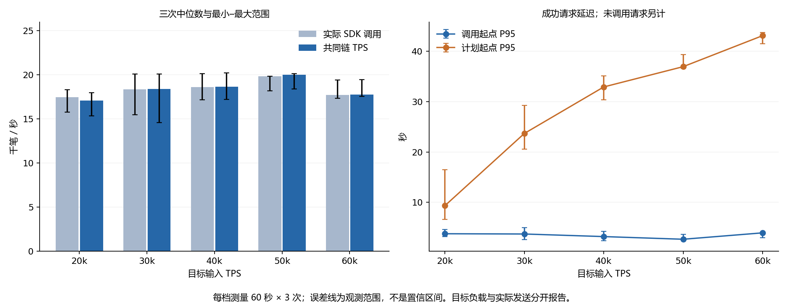
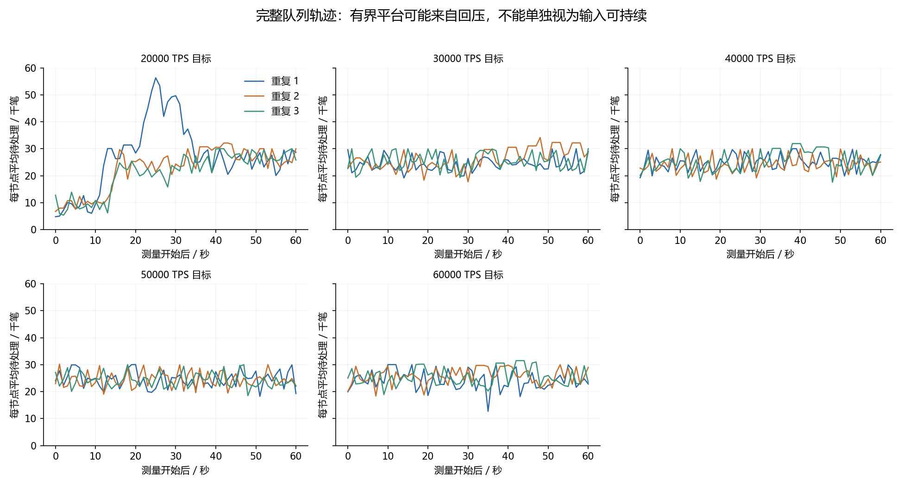

# FISCO BCOS 3.7.3 原生转账：五档 60 秒 × 3 次复测

日期：2026-10-27。批次 `cap-formal-20261027`。已按用户选择完成 20k、30k、40k、50k、60k 五档，每档测量 60 秒、重复 3 次，共 15 个正式用例。用户随后明确只完成这 15 轮，因此没有增加 14k、16k、18k 或其他容量档位。

**本轮最高的三次中位吞吐量为 20,002 TPS（目标 50,000 档），单次最高为 20,214 TPS。** 这些是十台原机器、1024 账户原生转账、固定调优配置下的实测处理能力。高压力时发送器受到回压，不能把目标输入 30k–60k 当成系统实际承载量。

**没有一档在三个重复中满足持续接纳目标速率的条件。** 最低目标 20k 也存在未发出请求和队列增长。因此结果支持“饱和处理能力约 2 万 TPS 的量级”，不支持“可以稳定、无拒绝地接收每秒 2 万笔”，也不能证明已经穷尽所有配置的全局最大 TPS。

## 三次统计

| 目标 TPS | 实际 SDK 调用/秒，中位数 | 共同链 TPS，中位数 | 共同链 TPS，最小–最大 | 回执 P95，中位数 | 回执 P99，中位数 | 计划起点 P95，中位数 |
|---:|---:|---:|---:|---:|---:|---:|
| 20,000 | 17,466 | **17,073** | 15,356–17,986 | 3.771 s | 5.824 s | 9.346 s |
| 30,000 | 18,361 | **18,373** | 14,569–20,073 | 3.720 s | 5.380 s | 23.682 s |
| 40,000 | 18,595 | **18,646** | 17,199–20,214 | 3.207 s | 4.742 s | 32.921 s |
| 50,000 | 19,815 | **20,002** | 18,400–20,147 | 2.677 s | 3.551 s | 36.949 s |
| 60,000 | 17,725 | **17,753** | 17,547–19,451 | 3.948 s | 5.087 s | 43.104 s |

范围为三个实际观测值的最小–最大，不是置信区间。每轮先独立计算分位数，再报告三个分位数的中位数。测量窗口可以消化预热积压或较慢节点的落后量，因此部分窗口共同链 TPS 略高于当期实际调用速率，不能据此虚增长期接纳能力。

## 全部 15 轮

| 目标 | 重复 | 共同 TPS | 实际调用/秒 | 回执 P95 / P99（秒） | 未调用数 | SDK 错误回调 | 未决回调 |
|---:|---:|---:|---:|---:|---:|---:|---:|
| 20,000 | 1 | 15,356 | 15,780 | 4.587 / 5.824 | 253,219 | 47,681 | 0 |
| 20,000 | 2 | 17,073 | 17,466 | 3.771 / 5.627 | 152,049 | 7,490 | 0 |
| 20,000 | 3 | 17,986 | 18,320 | 3.181 / 5.888 | 100,820 | 0 | 0 |
| 30,000 | 1 | 20,073 | 20,074 | 2.582 / 3.346 | 609,210 | 0 | 0 |
| 30,000 | 2 | 14,569 | 15,486 | 4.965 / 6.533 | 880,312 | 12,098 | 0 |
| 30,000 | 3 | 18,373 | 18,361 | 3.720 / 5.380 | 709,214 | 17 | 0 |
| 40,000 | 1 | 18,646 | 18,595 | 3.207 / 4.742 | 1,312,762 | 0 | 0 |
| 40,000 | 2 | 20,214 | 20,148 | 2.403 / 3.498 | 1,218,804 | 0 | 0 |
| 40,000 | 3 | 17,199 | 17,161 | 4.241 / 5.567 | 1,400,314 | 8,128 | 0 |
| 50,000 | 1 | 18,400 | 18,162 | 3.682 / 4.970 | 1,962,919 | 1 | 0 |
| 50,000 | 2 | 20,147 | 19,839 | 2.677 / 3.551 | 1,860,675 | 0 | 0 |
| 50,000 | 3 | 20,002 | 19,815 | 2.610 / 3.491 | 1,867,590 | 0 | 0 |
| 60,000 | 1 | 19,451 | 19,407 | 2.951 / 4.209 | 2,504,103 | 0 | 0 |
| 60,000 | 2 | 17,753 | 17,725 | 3.948 / 5.669 | 2,605,429 | 0 | 0 |
| 60,000 | 3 | 17,547 | 17,331 | 4.053 / 5.087 | 2,631,682 | 5,305 | 0 |

未调用数、错误回调和未决数统计整个 62 秒发送段；TPS 与回执延迟统计中间 60 秒测量窗。SDK 超时不是最终链上失败：停机审计对所有已入块但缺少业务成功回调的交易逐一查询返回码。错误回调不会被补入成功延迟样本，未调用请求也不会被算成吞吐量。

本轮实际调用的 17,130,898 笔转账最终全部进入审计账本，包括 80,720 笔曾收到 SDK 错误回调的交易；这部分逐笔复查均为回执状态 0、原生返回码 0。它们不是最终丢单或失败交易。“交易池满”错误回调也不能直接解释为整个集群最终拒绝。早期进度中使用的“拒绝”应理解为 SDK 层错误反馈，最终业务结果以本次审计为准。

回执延迟从实际调用 SDK 开始，到状态 0 且原生返回码 0 的回调；计划起点延迟包含发送器回压排队，但仍仅覆盖最终观察到成功回调的已调用请求。队列受到在途阈值约束后形成平台，不代表目标输入可持续。

## 资源和停顿证据

| 目标 | 重复 | 节点 CPU 核数/台 | 发送器 CPU 核数/台 | 整机空闲 | 提案验证超时日志 | 视图超时日志 |
|---:|---:|---:|---:|---:|---:|---:|
| 20,000 | 1 | 2.582 | 0.265 | 21.1% | 1 | 23 |
| 20,000 | 2 | 2.815 | 0.304 | 13.8% | 5 | 9 |
| 20,000 | 3 | 2.943 | 0.316 | 10.2% | 3 | 6 |
| 30,000 | 1 | 3.108 | 0.305 | 5.8% | 12 | 0 |
| 30,000 | 2 | 2.429 | 0.243 | 25.7% | 17 | 27 |
| 30,000 | 3 | 2.877 | 0.286 | 12.2% | 8 | 1 |
| 40,000 | 1 | 2.921 | 0.277 | 11.2% | 19 | 4 |
| 40,000 | 2 | 3.108 | 0.311 | 5.5% | 4 | 0 |
| 40,000 | 3 | 2.681 | 0.265 | 18.5% | 14 | 14 |
| 50,000 | 1 | 2.820 | 0.276 | 14.1% | 21 | 11 |
| 50,000 | 2 | 3.083 | 0.301 | 6.5% | 19 | 0 |
| 50,000 | 3 | 3.074 | 0.301 | 6.8% | 12 | 0 |
| 60,000 | 1 | 2.974 | 0.294 | 9.6% | 20 | 5 |
| 60,000 | 2 | 2.807 | 0.265 | 14.8% | 13 | 11 |
| 60,000 | 3 | 2.716 | 0.269 | 17.0% | 18 | 18 |

CPU 为测量窗口内累计 CPU 时间的增量，1.0 表示占用一个核。日志计数只包含测量窗口，排除初始化和停机后无 quorum 审计；是十个副本的事件总数，不是独立全网故障次数。日志、CPU 与队列关联属于诊断证据，不能仅凭相关性认定某个函数或配置是全部波动的根因。

表现最好的一次 40k/重复2 达到 20,214 TPS，节点平均 3.108 核、发送器 0.311 核，整机空闲约 5.5%，接近四核预算。较差的 30k/重复2 只有 14,569 TPS，整机空闲却上升至约 25.7%；测量期内记录 27 条视图超时和 17 条提案验证超时。其后半段三个 10 秒窗口分别约 10,266、6,948、7,754 TPS，说明共识停顿和队列变化是长测波动的重要线索，不能把性能下降全部归因于 CPU 算力。

20k/重复1 更明显：中间两个 10 秒窗口只推进约 1,042 和 1,391 TPS，后续追赶窗口达到 31,203 TPS。31,203 是落后进度恢复期间的短窗增量，不是本次可持续容量。相反，部分高吞吐轮次也有提案验证超时而没有视图超时，因此不能把每一条验证 timeout 都当成一次全网停顿。

## 固定配置与计量口径

官方 FISCO BCOS 3.7.3，十台原服务器各一个 PBFT 验证节点、4 vCPU、约 3.6 GiB 内存。SDK 3.7.0、JDK 17，每台一个预签名发送器连接本机节点；节点与发送器共享 CPU。1024 个账户共享全局环，金额 1、初始余额各 1,000,000,000；总初始化仍为 1024 笔。地址 `0x100c`、attribute=5，业务为内置 C++ 预编译 `userTransfer`，没有部署 Solidity 转账合约。

固定使用上一轮的 `serial50` 候选：串行执行、最小封块 50 ms、区块上限 6000、交易池 50000、leader 周期 5、验签线程 4、RPC 线程 4、notify 线程 2、warning 日志。每个发送器在途阈值 3000，全局约 30000；发送线程 4、SDK 线程 2、JVM 最大堆 512 MiB、ActiveProcessorCount=1。TLS、签名校验、存储参数及节点二进制保持原样。

每轮新数据库，预热 2 秒、测量 60 秒、最多 5 秒收尾。第 1 遍按 20/30/40/50/60k，第 2 遍按 60/50/40/30/20k，第 3 遍按 30/50/20/60/40k。配置在 15 轮之间没有改变，未因低结果重跑或剔除某轮。

长测预签名有效期设置为初始化高度 +4000，在隔离 config.genesis 设置 chain.block_limit=5000。节点的有效期和签名检查仍开启，签名前后检查实际编码值，全部用例最终高度也低于签名上限。首次准备冒烟误将参数仅写入 config.ini，出现 BlockLimitCheckFail，并遇到一次 SCP 传输错误；修正后的第二次冒烟通过。两次准备记录均保留，不进入正式排名。

主 TPS 为十节点最小累计已入块计数在测量端点的增量，除以端点采集区间中点的时间差；各端点在规范账本中核对哈希与累计数。采集跨度不超过 0.5 秒才进入排名，tps_bounds 只表示采集时刻不确定性。本轮最大采集跨度约 137 ms，全部发送器记录的启动时间差为 0 ms（毫秒分辨率）。分析数据另外保留至少七节点的进度指标，不能替代主指标，也不是单独采集的 PBFT 提交证书；由于各自起点不同，其区间增量未必高于十节点最小值增量。

单窗筛选使用：实际调用至少达到目标 99.9%、共同 TPS 至少达到目标 99%、未调用比例至多 0.1%、零错误/未决回调，以及完整窗口和后半 30 秒队列回归斜率均不超过目标速率的 0.1%/秒。还要求不少于 58 个合格队列观测、状态与签名有效期核对通过。同一档三个重复都满足才称在本次有限窗口内通过；这些工程容差不是无限时长稳定性的数学证明。

本轮未运行 Chain 压测。与 Chain 既有 10 秒结果比较时，持续时长、发送器资源预算、持久化和确认语义仍需一致；本轮成功回执 P95 不是全部十节点共同可见的逐笔确认 P95。不能直接据此宣称某条链快若干倍，或认定 FISCO 在所有条件下都无法做到亚秒确认。

## 正确性、清理与复现

15 轮共计划 37,200,000 笔请求，实际调用 17,130,898 笔；审计账本内成功测试转账共 17,130,898 笔。全部正式用例通过 1024 账户余额重建、总量守恒、原生业务返回值核对和十节点规范前缀证明，停止时全部链头追平。

正式实验的 150 份数据库及两次准备冒烟的 20 份数据库均按停止身份和路径检查后清理。最终服务状态与原始配置哈希见 postflight.json；完整逐笔签名保留在各发送器，交易哈希清单、完整规范账本和 RPC 日志保留在控制机。为避免重复占满控制机磁盘，已完成的大 JSONL 证据无损压缩，并解压校验 SHA256 后才移除文本副本。

本地保存分析证据包、所有节点的配置/日志/资源档案、客户端结果、审计结果和区块索引；它不是完整逐笔原始资料的第二份复制。未下载的大记录在 retained-records.json 中列出远端路径、大小和 SHA256，可按需重新核验。分析包本身也逐字节核对 SHA256。

实测驱动提交 553eb092f4633d96617a73175931f49a687dbcdb；节点二进制 SHA256 为 7c29bd2afe615a57af02a440fc4d665c3beec3cf7301ec4007cc07caf5b683f4。各批次还保存实际源码快照和独立校验值。

[统计数据](data/analysis.json) · [实验计划](data/plan.json) · [构建和准备验证](data/validation.json) · [最终检查](data/postflight.json) · [归档来源](data/archives.json)。原始批次位于控制机 /opt/fisco-control/results/cap-formal-20261027；本地分析包位于 C:\Users\61485\Documents\Codex\2026-10-20\182-151-27-42-118-122\outputs\fisco-long-20261027。

复算入口：methods/AnalyzeLong.py --raw <分析包解压目录> --output data/analysis.json；图表由 methods/Plot.py 生成。
