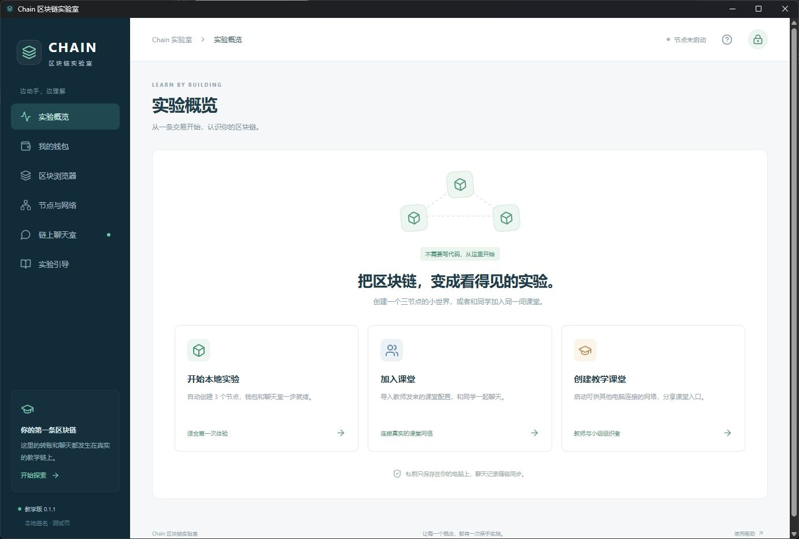
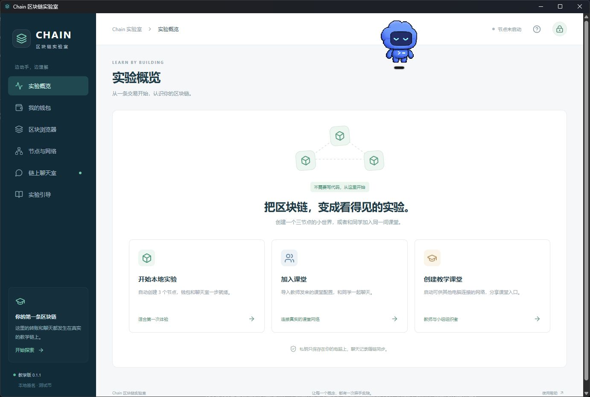
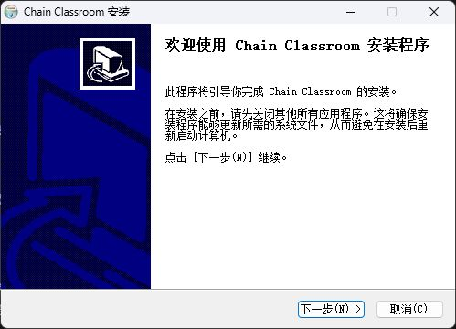

# Chain Classroom 0.1.1 一键安装验证

日期：2026-10-29。基于 `0baad3a` 的教学应用继续修改。最终安装包已通过 **8 项安装集成检查、5/5 项前端回归**；C++ 节点、网关、共识、账户和 FISCO 实验代码未修改。

## 学生使用方式

双击 `Classroom/release/ChainClassroom-0.1.1-windows-x64-setup.exe`，等待进度完成，程序自动打开。默认自动选择语言和用户安装目录，创建桌面、开始菜单快捷方式，不需要逐页点击向导，也不需要 Node.js、Python 或编译器。第一次进入实验仍需自行设置钱包密码。

安装包为当前用户级安装，包含 WebView2 离线安装程序和节点所需 DLL。尚未进行发布者代码签名，Windows 可能显示发布者或信誉提示；程序不绕过系统提示。缺少 WebView2 时的微软依赖安装仍可能受到系统策略限制。

| 项目 | 最终产物 |
|---|---|
| 安装包 | `ChainClassroom-0.1.1-windows-x64-setup.exe` |
| 大小 | 229,265,541 字节，约 218.64 MiB |
| SHA256 | `374e0041794891d11e817e88dc879dbadd282a62286e69acddf2e0708cae3f6b` |
| 默认程序目录 | `%LOCALAPPDATA%/Chain Classroom` |
| 独立数据目录 | `%LOCALAPPDATA%/edu.chain.classroom` |
| 测试系统 | Windows 11，build 26100，x64 |
| 已安装 WebView2 | 156.0.4314.50 |

## 实现改动

- 基于带 MIT 许可的 Tauri CLI 2.12.4 NSIS 模板，普通双击默认使用带进度的自动安装，成功后启动应用。关闭额外语言选择框。
- `/WIZARD` 保留完整向导；`/NOLAUNCH` 不自动启动；`/P`、`/S` 保留部署参数行为。
- 安装及卸载检查确切目录中的桌面程序、网关及节点，正在运行时返回 2 并要求正常关闭，不使用上游被动安装流程的强制终止。
- 打包前清理生成资源中的历史哈希文件，运行清单包含全部 17 个运行文件；自动生成 `release/` 安装包及 `.sha256` 文件。
- 统一版本为 0.1.1，界面底部从 package.json 读取版本，避免硬编码显示旧版本。

模板来源和维护说明见 [installer/README.md](../../Classroom/src-tauri/installer/README.md)，Tauri 提供的自定义模板机制见[官方安装文档](https://v2.tauri.app/distribute/windows-installer/#installer-template)。

## 最终包实测

| 检查 | 结果 | 证据 |
|---|---|---|
| 没有已安装程序时，无参数启动安装包 | 通过，16.906 秒返回 0，自动打开 GUI 和网关 | `13-final-clean-install.json` |
| 从原 0.1.0 包升级到最终 0.1.1 | 通过，16.953 秒，数据探针保留，`/NOLAUNCH` 生效 | `07-install-old-version.json`、`08-upgrade-final.json` |
| 同一版本再次无参数安装 | 通过，32.953 秒，自动重开，数据探针保留 | `09-repeat-final-auto-launch.json` |
| GUI/网关运行时安装 | 通过，返回 2，原 PID、创建时间和程序 Hash 均不变 | `10-final-busy-install.json` |
| GUI/网关运行时卸载 | 通过，返回 2，原进程及文件不变 | `11-final-busy-uninstall.json` |
| 正常关闭后卸载 | 通过，程序、注册信息和开始菜单入口移除，数据探针保留 | `12-final-uninstall.json`、`18-cleanup-uninstall.json` |
| 快捷方式和注册入口重开 | 两个快捷方式均指向有效程序；关闭后经 `edu.chain.classroom` 注册入口重新启动成功 | `final-shortcuts.json`、`15-stopped-before-launch.json`、`16-registered-launch-observation.json` |
| `/WIZARD` 高级向导 | 显示中文完整向导；取消返回 1，安装状态不变 | `17-wizard-cancel.json`、`wizard-ax.txt` |

安装、升级、重复安装均核对了主程序及 17 个运行文件。Tauri 会在打包时把主程序的 bundle marker 从 `UNK` 改为 `NSS`，完成后还原构建目录文件；因此安装后主程序应按该字节替换计算校验值，不直接与还原后的构建文件比较。依据见 [Tauri 2.12.4 bundle.rs](https://github.com/tauri-apps/tauri/blob/tauri-cli-v2.12.4/crates/tauri-bundler/src/bundle.rs)。最终安装主程序 Hash 为 `aa9f14ebd3366452b2dc0f7f083f57ba716a16e96580a25ee83243ca7edb694b`，全部安装结果一致。

前端回归 **5/5 通过**，TypeScript/Vite 构建和 Rust/NSIS 打包成功。方法与断言位于 [CheckInstaller.py](methods/CheckInstaller.py)、[VerifyResults.py](methods/VerifyResults.py)，汇总见 [validation.json](data/validation.json)。本轮进程 PATH 仅含 Windows System32；不依赖本机开发工具运行安装后的程序。

## 真实桌面截图

最终安装完成后自动打开，底部显示教学版 0.1.1：

从 Windows 注册入口重新打开。图中悬浮机器人来自用户桌面工具，不属于 Chain 界面：

仅在显式传入 `/WIZARD` 时显示传统向导：

## 边界和测试记录说明

- 测试账户已安装 WebView2，本轮未移除该系统依赖，不能声称“无 WebView2 的全新 Windows”路径已实测。离线依赖已按 Tauri 配置打入包内。
- 当前执行宿主具有 Windows 打包应用的 LocalAppData 重定向，证据同时记录逻辑安装路径及实际文件句柄解析出的路径。普通资源管理器启动安装包和其他 Windows 版本仍需要额外环境覆盖；不将本轮结果泛化为所有系统验证。
- 数据保留使用非敏感测试文件检查，并核对程序目录与数据目录分离。本轮未创建、读取或解锁钱包；完整转账、聊天室、三节点和窗口恢复验证沿用 [GUI 测试报告](../2026-10-29-classroom-gui/REPORT.md)。
- `01` 至 `07` 是最终包之前的准备/候选包记录。首次候选包检查发现前端版本仍写死为 0.1.0，已修复并重打包；表格使用 `08` 及之后的最终包证据。
- `04-busy-uninstall.json` 中返回 0 来自测试驱动错误引用 NSIS 的 `_?=` 参数，等待的是启动器而非真正卸载进程，未用作通过依据。改为规定的末尾不加引号参数后，`05` 和最终 `11` 均正确返回 2。注册入口启动工具曾先报告无法匹配窗口，后续重新获取窗口和进程已证实成功，未重复启动。
- 测试应用已正常关闭并卸载。原地调用卸载器会留下卸载器自身，旧 0.1.0 包携带的部分历史前端文件也留在测试目录；后续删除残留和数据探针的操作被自动审批以 `blocked by policy` 拒绝，未给出更具体原因，未改用其他方式删除。完整残留清单见 [cleanup.json](data/cleanup.json)，不影响分发安装包；用户既有数据目录保留。
- 本轮没有云端部署或 TPS 实验。
