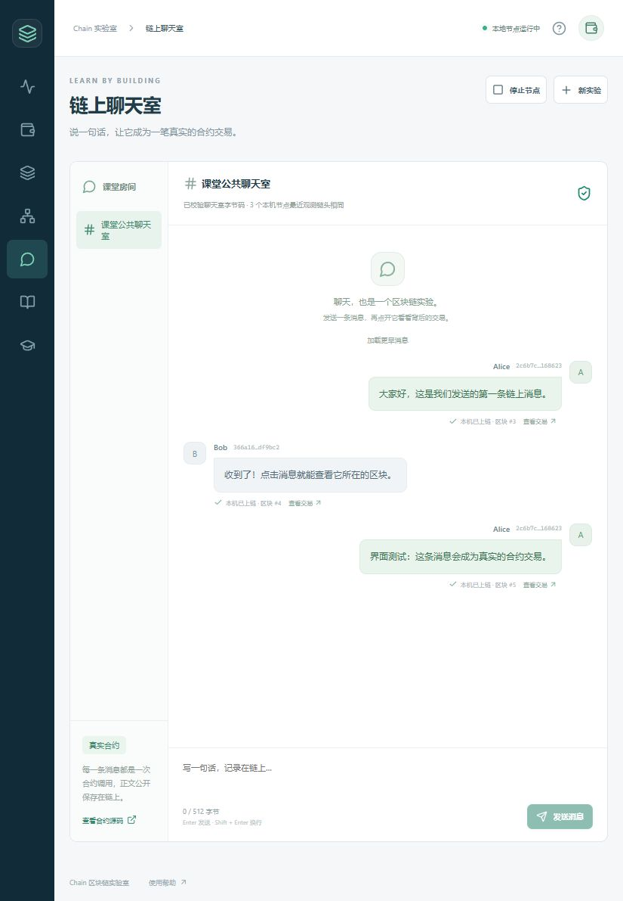

# Windows 区块链教学界面、聊天室与 IPv6

2026-10-29。本地实现 Chain Classroom 0.1.0，包含 React 中文界面、Tauri Windows 桌面壳、独立 C++ 网关、普通 Solidity 聊天合约及 IPv4/IPv6 网络支持。未部署云端，未运行新的 TPS 性能实验。原有共识排名、账户执行、签名规则和 schema 7 保留，无学习模型；FISCO 测试方法及历史模型资料不属于本次修改范围。

## 可以直接使用的功能

- 一键创建独立的三节点本地实验，生成加密的 Alice、Bob、教师演示钱包及测试币，正常发送部署交易初始化聊天室。
- 教师创建课堂、导出公开 JSON 邀请；独立学生钱包启动本地节点加入课堂，教师正常转账发放测试币。
- 可视化转账、余额与序号、规范链区块及分页交易、部署/调用回执、节点连接和近期教学观测速率。
- UTF-8 文字聊天室，房间、消息唯一标识去重、昵称、教师关闭房间和链上成员权限控制。点击消息可追踪到交易和区块；窄窗口使用消息详情弹窗。
- 钱包锁定、解锁、密码加密备份及空钱包目录恢复。共用原生/合约账户序号，重试发送相同签名原文。
- 规范链消息索引、分叉回退、重放、重建，以及部署完成后桌面中断时的元数据恢复。
- Windows 中文路径、隐藏的受监督节点进程、正常关闭、桌面父进程退出时停止网关及所属节点。

Windows 安装包：`Classroom/release/ChainClassroom-0.1.0-windows-x64-setup.exe`，229,294,775 字节（约 218.7 MiB），包含离线 WebView2 安装程序。校验值见 `data/artifacts.json`。二进制和安装包不加入 Git；源代码、锁文件、编译好的合约、方法与验证摘要加入 Git。使用与重建步骤见 [Classroom/README.md](../../Classroom/README.md)。

## 实现与边界

界面与本地 C++ 网关分离，原 C++ 节点仍为独立进程。React 19.3.1、Tauri 2.12.5、Rust 1.90.0；npm/Cargo 使用锁文件。Node 22.15.0 构建，节点/网关采用 MinGW UCRT64 GCC 15.2.0、C++20、Release。教学构建开关默认关闭，常规节点构建不要求安装 SQLite/npm/Rust。

`ClassroomChat.sol` 使用 solc 0.8.28、Shanghai、优化器 200 次。合约源代码、ABI、部署代码和运行代码随应用提供。一个课堂部署一次，学生加入同一个合约；不修改创世 EVM 状态，不新增预编译。每次新建实验有独立创世指纹。恢复时从已保存发件箱与当前规范链回执核对部署结果，避免重新部署。

消息正文在交易输入与成功事件中，SQLite 是可重建索引。按区块高度、交易位置和事件位置排序，不把 EVM 逻辑时间当现实日期。昵称由发送者提供，不是实名认证；地址绑定签名身份。消息公开上链，应用不提供真正删除历史或端到端加密私聊。

交易状态区分提交、当前本机上链、最近观测节点一致与退出主链。后续若干块不被叫作不可逆最终确认。界面 TPS 为短窗口教学观测值，不代表此前十节点性能结果，也没有测量界面对高负载 TPS 的影响。

网关只绑定随机回环端口，验证 Host、Origin 和随机访问令牌；前端不接触明文私钥。钱包采用 Argon2id 与 libsodium secretbox，密码不写文件。节点由真实进程句柄/Job Object 管理，退出使用本地 stop-file；没有远程任意命令或任意进程终止接口。

IPv6 覆盖地址解析、监听、连接、发现报文、完整地址/端口去重、发送端与实验清单。保留旧 IPv4 握手及类型 9 六字节记录，新握手 4 / 发现 48 支持两种地址族。教学只读查询使用 46/47，包含节点、运行代码、规范链区块/回执分页及有界 EVM 静态调用，沿用查询工作池；不实现完整 Ethereum JSON-RPC。

混合网络测试的“旧节点”是本次二进制的旧握手模式，用于验证旧报文格式，不是再次部署历史二进制联测。课堂桌面应用显式启用新版协议，课堂参与者应使用同一套发行包。

## 验证

| 验证 | 结果 | 记录 |
|---|---|---|
| 原十一项回归，含账户/签名/分叉/合约/网络/落盘约束 | 全部通过 | `data/ctest.xml` |
| 新增 ClassroomIndex、ClassroomNetwork、ClassroomJoin、IPv6Network | 全部通过；合计十五项，约 92.62 秒 | `data/ctest.xml` |
| 前端规范链重放位置覆盖、排序、键盘/按钮权限和 UTF-8 字节限制 | 3/3 通过 | `data/frontend-tests.json` |
| 独立学生应用通过 IPv6 加入、领币和发言 | 通过 | `data/classroom-join.json` |
| 房间关闭、未授权成员调用回退、授权后正常发言 | 通过 | `data/classroom-join.json` |
| 索引切换分支、删除旧事件、标记退出主链及较短链回退 | 通过 | `data/classroom-index.json` |
| 中文路径下完整三节点操作、重启、索引恢复 | 通过 | `data/unicode-path.json` |
| 最新网关补测：部署元数据丢失后，锁定钱包状态下从回执恢复 | 通过，不再部署 | `data/classroom-network.json` |
| Windows 父进程退出，网关与三个所属节点停止 | 通过 | `data/parent-lifecycle.json` |
| 原生桌面程序从独立资源目录启动，移除开发工具 PATH | 成功创建窗口、启动三个节点，三个链头相同 | `data/native-runtime.json` |
| 离线 NSIS 安装包生成、运行库哈希及安装目标路径核对 | 通过 | `data/artifacts.json` |

完整十五项回归之后，网关又增加了部署恢复和父进程监督；这两项修改以最新网关重新运行完整教学网络流程及专门生命周期测试。核心节点在这期间未改动。IPv6 清单与 SSH 目的地址的解析另有最终补测，记录在 `ipv6-network.json`。

浏览器界面实际输入并发送了教学消息，观察到等待入块变为本机上链，见截图：

原生桌面测试发现并修复了两类 Windows 路径问题：中文路径需要 UTF-8 进程清单与 Unicode 参数/文件路径；Tauri 的 verbatim 资源路径需要转换为 MinGW 可用的普通格式。修复后桌面窗口已创建，独立运行环境中的三个真实节点高度均为 5、链头相同。随后测试进程已停止。

**验证限制：最终原生窗口的目视检查因 Windows 锁屏而暂停，截图来自已验证的浏览器界面，不是原生窗口截图。没有实际运行安装向导，也未验证校园网/公网的 IPv6 可达性。** 安装包未配置代码签名。IPv6 回环、双栈、旧握手混合及两个独立应用的真实交易流程已测试；系统防火墙不由应用自动修改。

本次正确性测试使用独立目录。新教学测试在结束时清理自己的数据库；原十一项等遗留的 78 份临时 RocksDB 另在核对进程已停止、路径及数据库标记后清理，保留日志、输入和配置。详见 `data/database-cleanup.json`。没有清理之前任务的历史数据库或旧的受阻清理目录。

`methods/CollectValidation.py` 只收集已有记录、计算哈希、核对资源与复制安装包，不启动节点或发压。`data/validation.json` 记录构建工具及 LF 规范化源码哈希；构建时基于工作区，`base_commit` 是修改前的提交，不能把它当作本次实现的提交号。
