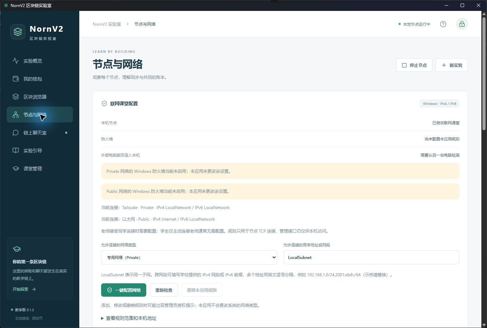
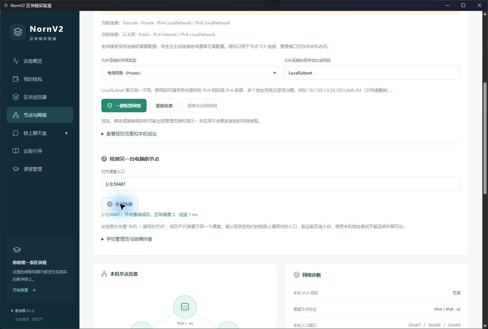

# NornV2 0.1.3 联网课堂配置实施与验证

日期：2026-10-29。基于 0.1.2 增加图形化网络配置、独立管理员脚本及 Windows 权限工具。节点共识、账户、合约和性能参数不变，未向十台服务器部署。

## 已交付

“节点与网络”增加“联网课堂配置”。首次创建或加入联网课堂后直接进入该页面；单机演示不给出放行按钮。界面展示节点运行情况、Windows 当前网卡类型、规则范围、IPv4/IPv6 地址、策略限制，以及对指定节点的查询结果。

默认 Private + LocalSubnet，用户可选择 Domain/Public 和明确的 IP/CIDR 范围。Public 在界面中需要确认范围。配置仅针对当前安装的 boost.exe、TCP 入站；动态端口无需重新开规则。HTTP 管理网关保持回环和临时令牌认证。

界面通过原有受认证本地 API 启动异步工具。非管理员 helper 只读检查；需要变更时通过 ShellExecuteExW/runas 请求用户授权，提权实例仅执行编译内嵌的固定规则函数，不接收任意脚本、程序路径或输出文件。原用户重新读取配置结果。规则名由规范化节点路径的 SHA-256 派生，检查组名和程序路径后才更新/撤销，其他安装及其他软件规则不变。

提供同目录 Configure-Network.ps1。默认安装无防火墙变更；无规则时卸载无需提权，有规则时先清理再删除程序。清理失败/拒绝授权时停止卸载，保留 helper 可供重试。同路径默认被动版本升级保留规则。

## 验证结果

环境：本机 Windows 11 x64，普通用户进程，已有 WebView2。使用独立测试目录和测试钱包。

| 范围 | 结果 | 证据 |
|---|---|---|
| 前端回归 | 7/7 通过，包含状态语义、网卡类型和组策略提示；生产构建通过 | `Classroom/test/network.test.mjs`、原有 model 测试 |
| Rust 权限工具 | 5/5 通过：危险/无界参数拒绝、双栈范围、路径引用、相同规则判定、Windows 网段规范化 | `cargo test --offline --bin norn-network` |
| 防火墙策略函数 | 8 项通过；创建、更新、撤销、安装隔离、权限失败和冲突均通过模拟 cmdlet 验证 | [rules-policy.json](data/rules-policy.json) |
| 原有课堂回归 | ClassroomIndex、ClassroomNetwork、ClassroomJoin 3/3 通过 | [CTest 记录](data/classroom-ctest.txt) |
| 真实网关/Windows 工具集成 | 7 项通过：异步读取、诊断中提交真实聊天交易、无规则撤销无提权、IPv4/IPv6 节点查询、不可达/非法地址、认证拒绝 | [gateway-tools.json](data/gateway-tools.json) |
| 安装包 | 0.1.2 → 0.1.3 真实升级成功，自动启动，19 个 runtime 文件摘要匹配，测试数据保留 | [upgrade.json](data/upgrade.json) |
| 独立管理员脚本 | 安装目录中脚本的只读 status 成功，目标匹配同目录节点 | [standalone-script.json](data/standalone-script.json) |
| 原生窗口 | 版本显示 0.1.3；网络页面与实际系统状态一致；点击检测返回 IPv6 节点高度及查询耗时 | 下方真实截图及 `data/window-*.txt` |
| 卸载 | 正常关闭后卸载成功，无规则时无需授权，保留测试数据标记；恢复测试前记忆安装路径 | [uninstall.json](data/uninstall.json) |

首次新增集成测试错误地期待空闲链高度持续增长。现有节点不必产生空块，已将判据改为“诊断期间提交一条真实聊天交易并观察入块”，使用新目录复测通过。未修改出块行为。

## 实测界面

状态页正确区分“尚未配置本应用规则”和“外部电脑入站尚待验证”。本机测试环境的 Private/Public 防火墙原本未启用，界面如实显示，测试没有修改其开关。



原生窗口点击 IPv6 检测按钮，查询 `[::1]:56487` 成功。此处的 1 ms 是本机节点查询往返耗时，既不是跨机器延迟，也不是交易确认时间。页面保留方向与回环测试边界说明。



## 验证边界与人工验收

未自动操作 Windows UAC，也未在本机新增、更新或删除真实防火墙规则；变更逻辑通过固定函数的模拟测试验证。真实 Windows 上的权限允许/拒绝、安装已有规则时的保留/卸载清理、启用防火墙后的双机入站，以及校园网/公网 IPv6 可达性，仍需人工验收，不能标为已经通过。

建议在教学测试机上操作：创建课堂 → 选择实际网卡类型和同学范围 → 点击一键配置并人工授权 → 让第二台电脑查询入口 → 再次同范围配置应无需授权 → 撤销后核对对应规则消失。拒绝授权应保留原状态。学校禁止本地规则时应联系管理员，应用不会绕过策略。

自动化网关/课堂回归的测试节点已停止，数据库按各自脚本清理，见 [gateway-cleanup.json](data/gateway-cleanup.json) 及 CTest 工作目录的清理记录。原生窗口/安装测试也已正常关闭和卸载，但其三个测试节点数据库的递归删除被自动审批拦截，工具未提供更具体原因。没有重试或改用其他方式删除；保留在 `build/classroom-network-install-20261029-01/ui/data/networks/`，不进入 Git。

## 安装包

`Classroom/release/NornV2-0.1.3-windows-x64-setup.exe`，SHA-256：

```
43711dc4e6f91f8e59884f9cda41254363fac95c594e2b14d5ba584823bb2fc7
```

安装包仍未做发布者代码签名，位于本地 release 目录；源码和报告随本次 Git 提交同步。规则参数依据 [New-NetFirewallRule 官方文档](https://learn.microsoft.com/en-us/powershell/module/netsecurity/new-netfirewallrule?view=windowsserver2025-ps)，提权入口依据 [ShellExecuteExW 官方文档](https://learn.microsoft.com/en-us/windows/win32/api/shellapi/nf-shellapi-shellexecuteexw)。
