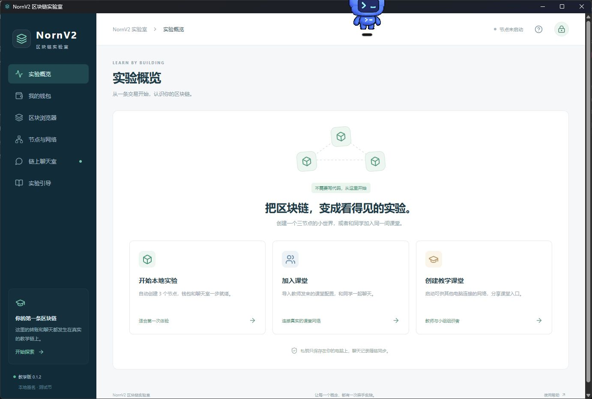

# NornV2 区块链实验室 0.1.2

2026-10-29。在 `ec27747` 基础上完成名称调整：侧栏、面包屑、页脚、页面标题、原生窗口、启动错误提示、安装器和快捷方式显示 NornV2；移除“边动手，边理解”及其空白样式。下载文件名使用 nornv2 前缀。

安装包：`Classroom/release/NornV2-0.1.2-windows-x64-setup.exe`，229,266,324 字节。SHA256：`194ee302518268c02eba278527464d85129833dee40ba25dee1e233ad8c468ad`。仍为一键安装，未增加开发环境要求。

应用标识 `edu.chain.classroom`、主程序文件名、安装注册键和原数据目录保留，以识别旧版本和原钱包。只有指向本次安装程序的旧桌面/开始菜单快捷方式才更名。测试使用全新 `build/classroom-nornv2-20261029-01` 目录，先安装旧 0.1.1，再升级新包。

| 验证 | 结果及证据 |
|---|---|
| 前端回归 | 5/5，通过；`data/frontend-tests.txt` |
| TypeScript/Vite、Rust 和 NSIS 构建 | 通过；`data/package.txt` |
| 0.1.1 → 0.1.2 自动升级 | 通过，18.016 秒，安装路径相同、注册显示名称更新、17 个运行文件校验一致；`data/old.json`、`data/upgrade.json` |
| 桌面和开始菜单快捷方式 | 旧名称消失，新名称存在并指向相同主程序；`data/shortcuts.json` |
| 真实桌面界面 | 显示 NornV2 和 0.1.2，没有原标语；`data/window-ax.txt` 与下图 |
| 数据与退出 | 非敏感测试数据探针在升级及卸载后保留；程序正常关闭后卸载，恢复测试前记录的默认安装位置；`data/uninstall.json`、`data/cleanup.json` |

图中悬浮机器人属于用户的桌面工具，不是本应用功能。本轮未创建或解锁钱包，没有运行新的节点性能实验；未对上轮保留的安装残留再做递归清理。

## 当前 IPv6 能力

当前本地节点实现支持 IPv6 监听、种子解析、连接、节点发现和查询，并保持 IPv4 兼容。入口格式为 `[IPv6地址]:端口`。教师课堂在系统支持时监听 `::`，本地实验监听 `::1`；应用不自动更改防火墙。

已有的 [IPv6 网络测试记录](../2026-10-29-classroom/data/ipv6-network.json) 覆盖纯 IPv6 发送者、双栈与旧 IPv4 节点间的真实交易传播、CLI IPv6 查询和发现报文。此前 [GUI 测试](../2026-10-29-classroom-gui/REPORT.md) 还完成了独立学生应用仅通过 `[::1]` 加入、领币和聊天。

这些是本机回环和混合协议验证；校园网/公网跨机器 IPv6 可达性尚未实测，需要实际地址可路由且端口被允许。本轮只核对现有代码与保存的证据，未修改网络代码、重跑上述网络测试或重新部署十台云服务器。
