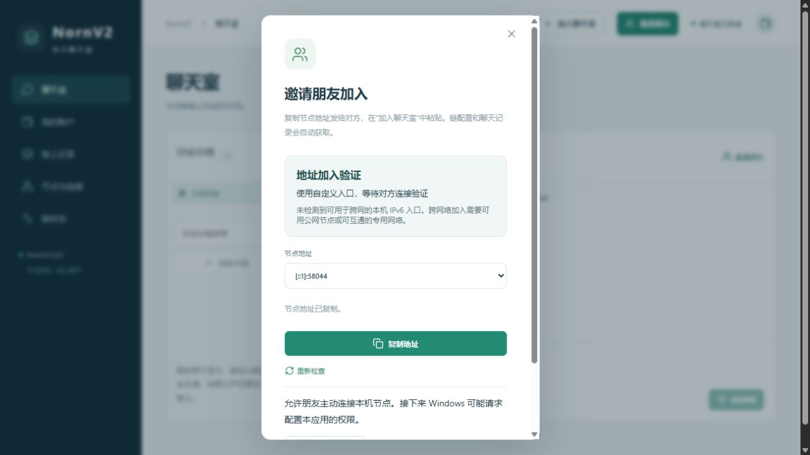
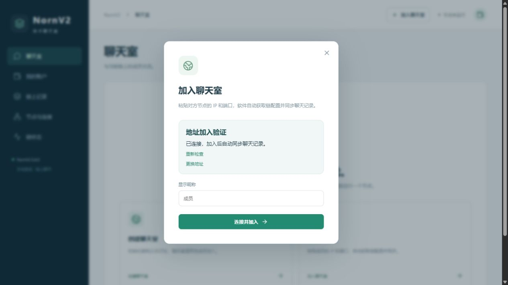
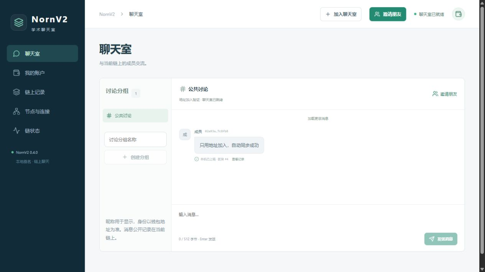

# NornV2 0.4.0：通过节点地址加入聊天室

日期：2026-11-04。实现位于本机 `D:/Project/Chain`，不部署云端，不覆盖正在使用的客户端或账户数据。

## 使用变化

创建者点击“邀请朋友—复制地址”，默认只分享一个 `IPv4:端口` 或 `[IPv6]:端口`。有多个地址候选时可切换，默认沿用已有公网 IPv6 优先的排序。接收者在“加入聊天室”粘贴地址，客户端后台连接节点、自动读取链配置并核验；点击“连接并加入”后启动本机节点，自动同步区块及聊天记录。用户不需要传递创世文件、复制账户分配或手工部署合约。

现有地址使用的端口会保存在本机链配置中。连接端口仍需包含在分享内容中，IPv6 地址仍需方括号。域名入口继续兼容。旧 `NORN1:`、JSON 和 `.norninvite` 邀请保留，收在兼容入口内；默认不再展示或复制长码。

本次默认发布一个标准安装包，减少普通包与离线包并列造成的混淆。项目保留离线打包能力。

## 前后端与节点实现

1. 节点现有只读查询协议增加 `network` 方法，复用同一个 TCP 节点端口。没有新增对外管理网页、钱包操作或远程命令接口。
2. 网关创建/恢复链时，在本地生成 `network-info.json`，只包含合约版本、链名称、公开创世分配、创世指纹、合约地址及代码摘要。初始分配只保留公钥和余额，不包含钱包私钥、口令、网关令牌或账户备份。合约就绪后才发布；普通资料保存不重复替换未变化的公开文件。
3. 网关启动节点时传入本地 `--network-info` 路径。路径由本机进程指定，远端请求不能指定或修改文件路径。未配置此功能的普通节点返回不可用。
4. 节点读取公开配置限制为 256 KiB，返回字段使用白名单；返回前核对当前节点创世指纹、已同步合约及实际代码摘要。沿用现有查询工作池和报文长度限制。
5. 接收端先通过用户输入的地址读取公开配置，再核对创世配置计算结果、节点链头中的创世指纹及本机支持的合约版本/运行代码。下载超时、格式错误、配置不一致都不会替换现有链。
6. 下载得到的其他入口不会被自动跟随；用户输入的地址成为本次同步种子。预检在后台执行，创世计算在网关串行处理路径执行，避免网络线程改写进程级创世状态。
7. 通过核验后复用现有创世初始化、种子连接、区块验证和规范链索引。相同聊天室地址只更新入口，不重启节点或重建账本。共识、余额与费用规则、schema 7、无学习模型基线及 FISCO 工具保持原有行为。

地址加入依赖对方节点提供公开配置，因此双方应更新至 0.4.0 或更新版本。旧节点可继续使用完整邀请码加入。通过地址获取配置只能核对该节点提供内容的一致性，用户仍需从预期成员获取正确地址。

## 验证

验证摘要及安装包 SHA-256 见 [validation.json](validation.json)。

| 项目 | 结果 |
| --- | --- |
| C++、TypeScript/Vite、Rust/Tauri 与 NSIS 构建 | 通过 |
| 全部本地 CTest | 17/17 通过，98.71 秒 |
| 公开配置稳定发布收尾后 | InviteNetwork 6 组真实节点检查再次通过 |
| 前端测试 | 13/13 通过 |
| IPv4 / IPv6 地址加入 | 分别仅传入 IPv4 或 IPv6 地址，下载链配置，连接对应地址族并自动同步；普通转账补费后互发合约消息 |
| 公共配置 | 核对六个白名单字段，创世指纹与运行链一致；普通节点不开放任意配置读取 |
| 失败隔离 | 错误链、失效预检及下载创世配置不匹配均被拒绝，原节点 PID 和链标识保留 |
| 大小边界 | 超过 256 KiB 的公开配置被拒绝；修复本地配置后服务恢复 |
| 同链更新与去中心化连接 | 更新地址不改变 PID；原创建者停止后其他成员继续互联并聊天 |
| 旧邀请兼容 | 旧完整码预检、不可用入口回退、文件转交收件箱通过 |
| 实际浏览器 | 默认分享短地址；粘贴 IPv6 地址后自动识别聊天室；点击加入后就绪；发送消息在两端同步至区块 4 |
| 测试数据 | 新建隔离目录，地址加入与 UI 测试的节点均停止，数据库按对应测试清理；不触碰用户正在运行的账本 |

截图来自两个独立的隔离网关及真实 C++ 节点，不是静态页面或模拟链。UI 使用的回环地址仅用于本机正确性验证。复制按钮出现成功提示，页面分享地址与前后端选择逻辑一致；本次通过页面地址值完成接收端输入，未声称从自动化虚拟剪贴板读回系统剪贴板内容。

当前电脑仍缺少可用于公网的 IPv6 地址与路由。本次没有把本机回环成功解释为两台物理电脑跨网连接成功。`192.168.*` 或 `10.*` 等地址仍依赖实际局域网/校园网路由与访问许可；更短的分享内容不改变网络可达性。没有修改 Windows 防火墙、路由器或执行覆盖真实安装的安装/卸载测试。

## 安装与使用

关闭当前程序后安装 [NornV2 0.4.0](https://github.com/AdamRitz/Chain/releases/tag/v0.4.0)，双方都更新。默认安装文件为 `NornV2-0.4.0-windows-x64-setup.exe`，保留原账户、链和聊天记录。首次启动既有链会生成该链的公开连接配置，无需重新创建链。

## 界面证据

