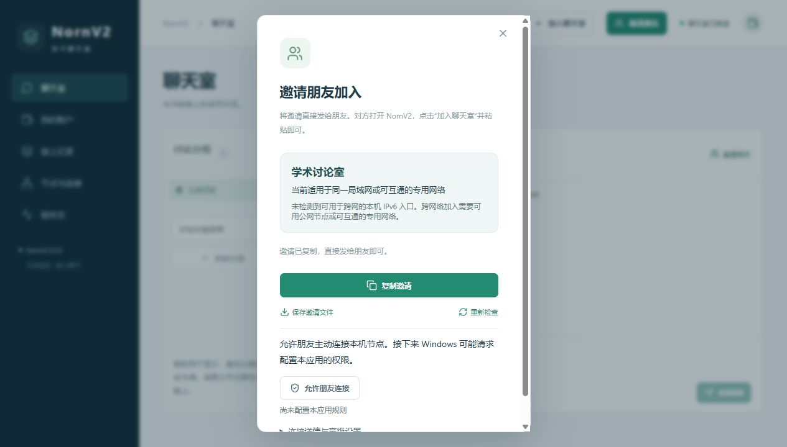
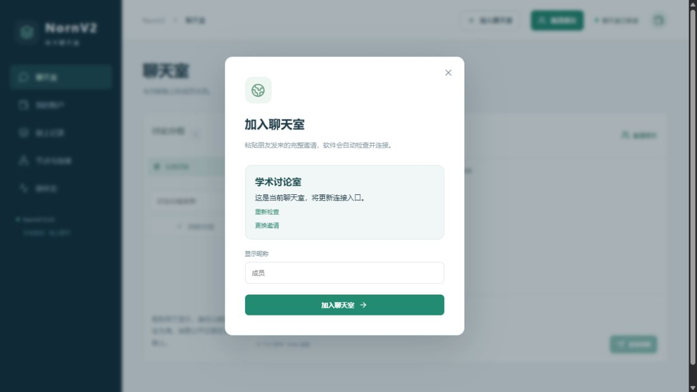
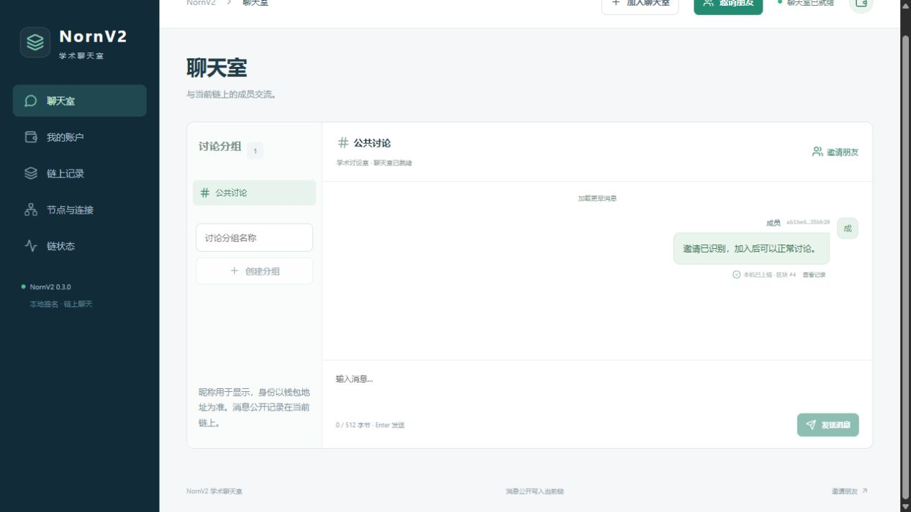

# 2026-11-04 NornV2 0.3.0 邀请与 IPv6 修正

## 使用流程

顶栏始终提供“加入聊天室”，当前聊天室提供“邀请朋友”。分享者打开邀请弹窗后自动识别本机入口，点击“复制邀请”即可发送带使用说明的整段文字。接收者粘贴整段文字，自动检查连接，确认聊天室名称后点击加入；识别成功后收起长邀请码，支持重新检查和更换邀请。

旧 JSON 文本及文件继续支持。新文本使用 `NORN1:` 自包含 URL-safe Base64 信封，独立 `format_version` 与原合约 `version` 分开，SHA256 校验值用于检测复制损坏；不将校验值解释成发送者认证。新 `.norninvite` 文件携带同一版本化信封。邀请不包含私钥，导入文件只打开预览，不自动创建账户、切换链或发送交易。

## 地址与后台处理

- 地址采集改为 C++ 网关直接调用 Windows `GetAdaptersAddresses`、`GetUnicastIpAddressEntry`，独立于防火墙 PowerShell 查询，无需管理员授权。保留地址状态、有效期、路由与接口信息；防火墙读取失败不影响地址采集。Linux 网关使用保守的本机接口采集，不将未验证路由声明为跨网可达。
- 按解析后的地址字节分类，排除回环、链路本地 IPv6 全部 `fe80::/10`、APIPA、组播和不可用地址；ULA/专用网络与局域网地址不标为公网。默认排除常见仅主机虚拟网卡；忽略 `SkipAsSource`、未就绪接口和不处于 Preferred 状态的地址。
- 选择跨网 IPv6 前检查本机 IPv6 节点实际监听；保留 IPv4 回退。入口最多 8 个，有很多临时 IPv6 时仍为另一地址族保留位置。每次打开邀请重新采集，打开期间刷新，复制过时邀请前重新准备；高级详情支持已有公网映射、域名或专用网络入口。
- 分享端只报告“候选”，不将本机检查当作外部可达证明。当前电脑未检测到全局 IPv6 和 IPv6 默认路由，页面正确显示局域网/专用网络范围，没有将 `fe80::` 写为公网入口。
- 接收者预检查为后台任务，最多 8 个受限并发入口，错开尝试并设置超时。复用 19/20 号查询核对创世指纹，再核对合约字节码。响应长度有额外上限，失败不停止当前节点或改写当前链。
- 连接状态区分节点未运行、正在连接、正在同步、聊天室就绪；本机进程启动不再直接显示连接成功。消息发送条件同步使用真实就绪状态。
- 同链邀请合并入口并原子更新本地 `seeds.json`，节点通过可选 `--seeds-file` 读取。没有添加允许远端改写种子配置的管理接口。不重启节点或重建账本；排除已识别的本机自身入口。切换其他链启动失败时尝试恢复原配置及运行状态。
- 节点发现改为有界并行种子尝试，DNS 有截止时间，IPv6/IPv4 地址错开尝试，按完整端点限制和去重在途连接。共识、交易执行和数据库 schema 7 保持不变。

## Windows 文件与安装

安装器只注册 `.norninvite`，不占用 `.json`。首次启动参数和单实例转交均经过大小限制读取，并通过本机收件箱交给网关。新增原生事件通知，避免后台 WebView 仅依赖轮询；刷新中到达的通知保留一次补刷。

修正 NSIS 默认关联宏在同版本覆盖安装时备份自身的问题。卸载仅处理指向本安装的关联，恢复之前的打开方式；用户在安装后改选其他处理程序时保留其选择。仅包含本应用元数据的空关联键会清理。标准和离线安装包复用同一已构建应用，只更换 WebView2 安装载荷。

## 验证结果

| 验证 | 结果 |
| --- | --- |
| 本地完整 CTest：原有节点、账户、分叉、EVM、IPv6、聊天与新增邀请测试 | 17/17 通过，96.49 秒 |
| 增加大量临时 IPv6 仍保留 IPv4 的边界后，InviteCorrectness / InviteNetwork 复测 | 2/2 通过，14.13 秒 |
| 前端状态、邀请有效期和收款信息等测试 | 11/11 通过 |
| Rust 检查及正式桌面构建 | 通过 |
| 地址过滤、原生网卡、信封往返、旧 JSON、损坏和大小上限 | 通过 |
| 四个真实本地网关：无效入口回退、错误链阻止、同链入口更新、创建者停止后的聊天 | 通过 |
| 真实 0.1.5 三节点旧链恢复为一个节点，保留原密钥、端口、合约及消息 | 通过，另一次独立兼容性检查 |
| 真实浏览器：复制反馈、整段粘贴、自动预检查、加入、消息发送并上链 | 通过，见界面图片 |
| 连续两份本机收件箱邀请的浏览器预览替换 | 通过，见 `browser-file-open.txt` |
| Windows 正式标准包安装、同版本覆盖、普通卸载 | 通过 |
| 旧文件处理程序恢复、用户后来改选处理程序的保留 | 通过 |
| 标准/离线包 20 个运行文件清单一致，与测试节点/网关摘要一致 | 通过 |
| 原用户账户/链目录文件摘要和安装位置记忆 | 前后保持一致 |

新增测试入口为 `Test/InviteTest.cpp`、`Test/InviteNetworkTest.py`、`Classroom/test/invite.test.mjs`。安装关联复现入口为 [InstallerQA.py](InstallerQA.py)，具体安装时间与包摘要见 [installer.json](installer.json)。完整与复测摘要见 [validation.json](validation.json)。测试使用全新隔离目录，运行结束正常停止进程并清理测试节点数据库，没有连接或部署云端服务器。

真实安装包标准版 13,759,250 字节（约 13.12 MiB），离线版 226,975,941 字节（约 216.46 MiB）。已有 WebView2 时，本机标准包全新安装观测 1.266 秒，同版本覆盖 1.491 秒，离线包跳过已有运行库时 1.640 秒，均是单次观测。

## 实际界面

## 验证范围

当前电脑缺少可用公网 IPv6，未完成两台物理电脑跨互联网 IPv6 入站验证；回环同步和地址分类测试不能代替该结果。本次未修改真实防火墙、路由器或部署公网中继，也未重测 TPS。

Windows 实际安装注册、首次携带中文文件名启动进入加入预览已观察到；单实例后续消息的文件创建与消费、浏览器连续预览替换已验证。原生后台窗口的可访问性树在连续文件转交时未稳定刷新，工具激活窗口返回 `foreground window did not report a process id`，因此不将该观察声明为完整的 Explorer 前台连续双击验收；保留 [原生窗口记录](native-file-open.txt)。没有自动操作账户密码或权限提示。

运行中的实时入口可能变化，静态邀请不会自动修改已发送的内容。没有可达入口时仍需对方上线、重新发送邀请或提供同链可达节点；客户端不会承诺自动穿透任意网络。
