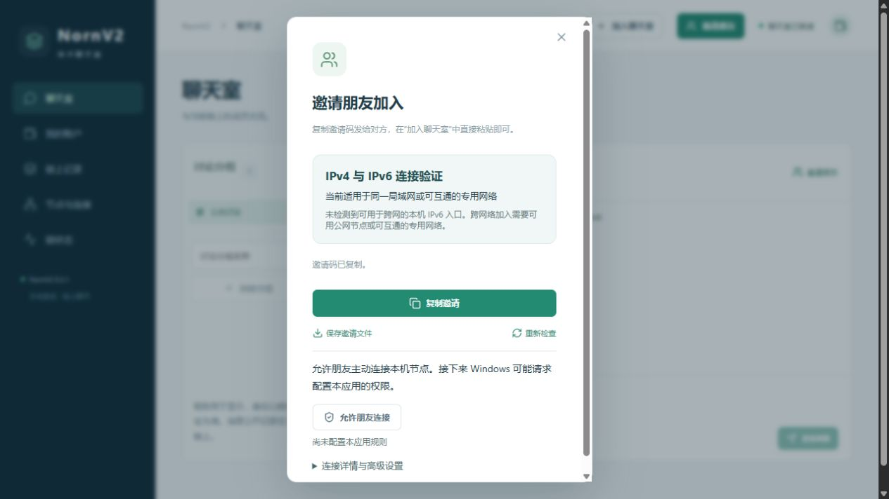
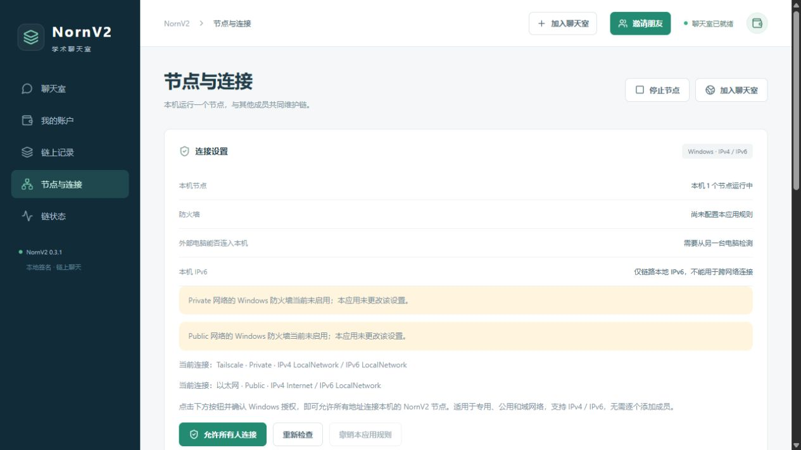
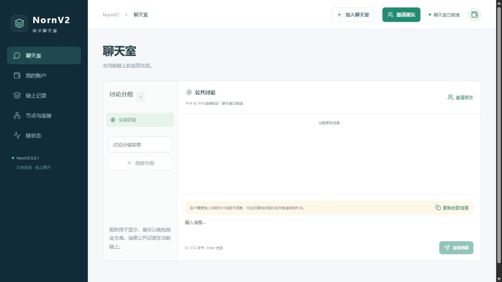

# NornV2 0.3.1：纯邀请码与本机 IPv6 排查

日期：2026-11-04。范围：本机 Windows 配置、邀请前后端、本机混合网络正确性和 Windows 打包。未部署云端。

## 已确认的原因与边界

当前物理网卡启用 IPv6、路由器发现及 DHCPv6，但只有 `fe80::/10` 链路本地地址，没有全局 IPv6 地址，也没有 `::/0` 默认路由。原生网卡与真实路由表检测结果为：全局地址 0、可用物理网卡链路本地地址 1、IPv6 默认路由 false。当前只能把适用的局域网 IPv4 入口自动写入邀请，不能生成不存在的公网 IPv6 入口。

已运行的用户节点同时监听 IPv4 与 IPv6。分别通过 IPv4 回环、IPv6 回环及物理网卡的链路本地 IPv6 做只读链头查询，三者均成功，创世指纹及链头相同。既有安装的节点入站规则有效。本次没有改动 Windows 防火墙开关、路由器或用户账户、链数据，也没有停止正在使用的客户端。

因此，本机缺少跨网络 IPv6 条件已确定；若另一台电脑在同一可互通局域网，仍可使用邀请内的 IPv4 入口。另一台电脑的当前邀请码、地址和失败提示尚未提供，不能据此断言其地址、端口或上游入站策略正常，也没有完成两台物理电脑跨互联网连接的验证。

链路本地地址的范围及接口作用域见 [Microsoft Winsock 文档](https://learn.microsoft.com/en-us/windows/win32/winsock/link-local-and-site-local-addresses-2)。IPv6 路由器发现机制见 [RFC 4861](https://www.rfc-editor.org/rfc/rfc4861.html)。上游路由器是否未开启 IPv6、未获得前缀或受到机构网络限制，当前证据不足以进一步区分。软件不能仅靠写入一个静态地址解决上游路由问题。

## 程序调整

- 复制按钮只写入 `NORN1:…` ASCII 邀请码；后端兼容字段 `share_text` 也返回相同码串，没有中文前缀、说明、空格或换行。邀请码仍自包含链指纹、合约及入口，不依赖查询短码的服务器。
- 粘贴解析容忍聊天软件插入的 ASCII 空白，保留旧版带说明文本及 JSON 邀请兼容性和完整性校验。
- Windows 使用 `GetIpForwardTable2` 读取真实默认路由，网卡网关作为读取失败时的降级来源；不要求提升权限。
- “节点与连接”和邀请高级详情展示 IPv6 状态，区分链路本地、没有全局地址、没有默认路由以及地址与路由存在但外部尚未验证。
- 预检保存各入口的地址族与错误类别。无路由、端口拒绝、超时、域名失败、错误链和错误合约分别展示原因；包含公网 IPv6 入口但本机无相应条件时给出具体提示。
- RPC 截止时间触发后保留超时语义，避免将主动取消误报为其他网络故障。未改变共识、账户、合约或数据库格式。

## 验证结果

验证数据见 [validation.json](validation.json)。

| 检查 | 结果与实际范围 |
| --- | --- |
| C++ 构建、TypeScript/Vite 构建 | 通过 |
| 前端测试 | 12/12 通过 |
| 首轮 CTest | 16/17 通过；新增 InviteNetwork 断言错误地要求关闭端口必须在两秒内报告拒绝 |
| InviteNetwork 修正后独立重跑 | 5 组检查通过；允许操作系统先达到明确的两秒截止时间并报告超时。未为此修改连接逻辑或延长超时 |
| 真实混合网络 | IPv4 成员和 IPv6 成员分别通过对应入口加入双栈节点，核对实际 peer 地址族，普通转账补费后发送并接收合约聊天消息 |
| 入口故障与链匹配 | 第一个关闭端口超时/拒绝后，IPv6 可用入口继续成功；错误链、无效预览不会替换原链 |
| 同链更新 | 合并新入口且节点 PID 不变；原创建节点停止后，其他成员继续连接并聊天 |
| IPv6Network | IPv6-only、双栈和 legacy IPv4 节点完成签名交易同步；两代发现报文和 IPv6 sender CLI 正常 |
| 浏览器界面 | 0.3.1 可见，纯邀请码内容为 ASCII 无空白，粘贴预检通过，加入后显示聊天室已就绪；IPv6 配置提示与真实网卡一致 |
| 当前用户节点 | 三种本机入口只读查询相同链头，不修改用户账本 |
| 打包 | 标准包及完整离线包构建成功；20 项运行文件清单哈希核对通过，节点/网关与本次构建一致，网页与 dist 一致；两种包复用同一次应用构建 |

首轮失败和修正后的成功记录均保留在本机 build 目录，没有把首轮写成 17/17 成功。浏览器点击复制后显示“邀请码已复制”；自动化工具的虚拟剪贴板与系统网页剪贴板隔离，不能用其空值证明或否定系统剪贴板内容。本次通过页面只读码串、复制调用的源码与后端返回一致性、粘贴及真实加入验证流程，不声称已从该虚拟剪贴板读回系统内容。

测试使用全新目录，测试节点已全部停止。邀请与界面测试自行完成数据库清理。其余回归留下的 15 个数据库位于本次隔离目录 `build/ipv6-diagnosis-20261104-01`；核对进程停止、实际目录和非链接属性后，清理仍被自动安全检查拒绝，工具未提供具体理由。逐个列明已核对目录的更小范围清理也被拒绝，因此保留这些测试数据库，不采用替代删除方式绕过拦截。

没有执行覆盖当前用户安装的安装/卸载回归：当前真实安装正在运行；本次没有修改安装逻辑。公网 IPv6、第二台物理电脑及安装后的当前用户会话仍需在相应条件下验证。

## 使用与下一步定位

关闭当前 NornV2 后安装 [0.3.1](https://github.com/AdamRitz/Chain/releases/tag/v0.3.1)，保留原账户和链数据。发送者点击“邀请朋友—复制邀请”，接收者点击“加入聊天室”直接粘贴。双方使用当前邀请，保持至少一个可达成员节点运行。

若跨网络使用 IPv6，应让路由器及上游网络先提供全局 IPv6 地址和可用路由，再重新生成邀请；接收者的预检负责验证该具体地址、端口和链。遇到校园网隔离或上游入站过滤时，单独添加本机防火墙规则不能解决。IPv4-only 与 IPv6-only 网络之间需要双栈或可达的转换/中继；本应用没有实现网络协议转换。

继续定位另一台电脑需要其当前完整邀请码和错误提示，用于核对入口是否过期、是否仅为内网地址、实际 TCP/链指纹是否可达。本次未获得该信息。

## 实际界面

截图来自隔离测试客户端。构建目录的节点程序与用户安装的节点程序路径不同，测试界面中的规则状态不能代替上文对用户既有安装的规则检查。

## 安装包

| 文件 | 字节 | SHA-256 |
| --- | ---: | --- |
| NornV2-0.3.1-windows-x64-setup.exe | 13949649 | `ff302b58d5d7ab706c3902380f53671227b83d3fcf43690fdbee0bd44956299d` |
| NornV2-0.3.1-windows-x64-offline-setup.exe | 227166369 | `2ec7543e7f86733c359fad048685c564a930651cfb65708223525594489e3eb9` |

安装包和校验文件位于 GitHub Release；代码提交不包含运行数据库、构建输出或凭据。
